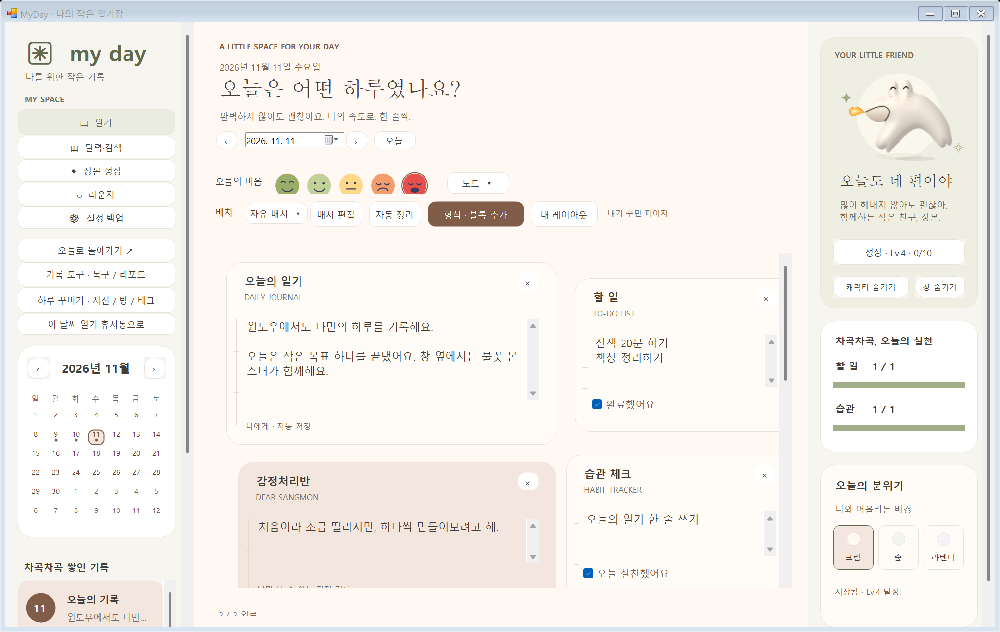

# 마이데이 (MyDay)

## 앱 다운로드 · 0.15.0 시험판

**[다운로드 페이지 열기](https://github.com/parkhookjung-debug/myday-diary/releases/tag/v0.15.0-preview)** — 내 운영체제에 맞는 파일 하나를 받으세요. GitHub 로그인과 개발 도구가 필요 없습니다.

| 운영체제 | 다운로드 | 실행 방법 |
| --- | --- | --- |
| Windows 10/11 · .NET Framework 4.8+ | [Windows 실행 파일 (.exe)](https://github.com/parkhookjung-debug/myday-diary/releases/download/v0.15.0-preview/MyDay-Windows.exe) | 기존 앱 종료 후 EXE 실행 |
| Mac · Apple Silicon(M1 이상) · macOS 13+ | [Mac 앱 (.zip)](https://github.com/parkhookjung-debug/myday-diary/releases/download/v0.15.0-preview/MyDay-macOS-arm64.zip) | 압축을 풀고 `MyDay.app` 실행 |
| Android 8 이상 · Galaxy 등 | [Android 설치 파일 (.apk)](https://github.com/parkhookjung-debug/myday-diary/releases/download/v0.15.0-preview/MyDay-Android.apk) | 휴대폰에서 APK 다운로드 후 설치 |

[자세한 설치·업데이트 안내](docs/DOWNLOADS.md). Mac은 **Apple Silicon 전용**이며 Apple 공증 미적용 시험판입니다. Android는 **디버그 서명 APK**입니다. 기존 사용자는 **공통 백업 → 앱 완전 종료 → 새 앱 실행 → 기록 확인** 순서로 업데이트하세요. Android 서명이 달라 설치가 안 되더라도 백업 확인 전 기존 앱을 삭제하지 마세요.

배포 소스는 [v0.15.0-preview 태그](https://github.com/parkhookjung-debug/myday-diary/tree/v0.15.0-preview)에서 확인합니다. Windows 파일에는 상몬의 탄성 드래그·속도 비례 던지기가 포함됩니다. [플랫폼별 파일 출처·SHA256](https://github.com/parkhookjung-debug/myday-diary/releases/download/v0.15.0-preview/SOURCE.json)

[](https://github.com/parkhookjung-debug/myday-diary/actions/workflows/android.yml)
[](https://github.com/parkhookjung-debug/myday-diary/actions/workflows/windows.yml)
[](LICENSE)

Windows·Mac·Android에서 쓰는 일기 앱입니다. 사진과 일기 블록을 자유롭게 배치하고, 기록할수록 함께 자라는 캐릭터 **상몬**을 키웁니다.



- **일기**: 글·할 일·습관·감정·사진 블록, 자유 배치, 일기 형식 100종(추천 20종), 내 레이아웃 저장
- **기록 탐색**: 월간 달력, 본문·사진 설명 검색, 감정 달력, 태그·즐겨찾기, 월별 사진 앨범
- **상몬 성장**: 기본 상몬 한 마리, 출석·일기·할 일·습관으로 Lv.100까지 성장
- **안전한 저장**: 자동 저장, 직전 저장본 복구, 휴지통·변경 이력, 하루 한 번 자동 백업, 기기 간 Wi-Fi 전송
- **플랫폼별 기능**: Windows 바탕화면 캐릭터 · Android 홈 위젯·라이브 배경화면·햅틱 · 세 앱 공통 라운지 채팅(로컬 서버)

기록은 각 기기에만 저장합니다. 플랫폼 사이의 자동 동기화는 없고, 공통 JSON 백업(버전 1~9)으로 옮깁니다.

> **공개 다운로드 0.15.0 시험판**: 기본 상몬·일기·레벨업에 집중합니다. 변신·코디·뽑기·재화·합성 화면은 제거했으며 로컬 채팅과 카카오 연동 원본은 유지합니다. [기능 범위](https://github.com/parkhookjung-debug/myday-diary/blob/v0.15.0-preview/docs/FOCUSED-APP.md). 아래 개발 문서는 main의 이전 소스를 포함하므로 실제 배포 코드는 다운로드 태그를 기준으로 확인하세요.

## 직접 빌드하기

```sh
git clone https://github.com/parkhookjung-debug/myday-diary.git
cd myday-diary
git switch codex/windows-app
```

| 플랫폼 | 기술 | 빌드 | 테스트 |
| --- | --- | --- | --- |
| Windows | C# / Windows Forms | `./windows/build.ps1` → `windows/bin/MyDay.exe` | `MyDay.exe --self-test` |
| Android | Kotlin / Jetpack Compose (JDK 17+, SDK 35) | `./gradlew :app:assembleDebug` | `./gradlew :app:testDebugUnitTest` |
| macOS | Swift / SwiftUI | `zsh macos/build.command` | CI의 macOS 작업 |

`shared/`의 공통 원본(일기 형식·색상·성장·채팅 규칙)을 고친 뒤에는 `python tools/sync-desktop.py`로 각 앱의 생성 코드(`*.g.cs`, `*.g.kt`, `*.g.swift`)를 다시 만듭니다. 생성 파일은 직접 고치지 마세요. [공통 개발 순서](docs/DESKTOP-SHARED.md)

## 폴더 구조

```text
app/        Android 앱 (Kotlin / Compose)
windows/    Windows 앱 (C# / WinForms) — UI · Core · Character · Chat · Tests
macos/      Mac 앱 (SwiftUI) — Sources/MyDay, Sources/MyDay/Verification
shared/     세 앱 공통 원본 (형식 100종 · 색상 · 규칙)
server/     로컬 채팅 서버 (Python) · Cloudflare 무료 서버 원본
supabase/   친구 공유 미리보기용 DB·함수
tools/      생성·동기화·호환성 검사 도구
docs/       기능 안내 · 수정 가이드 · 팀 문서
previews/   실제 앱 화면 캡처
```

[자세한 폴더 안내](docs/REPOSITORY-STRUCTURE.md)

## 어떤 파일을 수정하면 되나요?

**아래에서 기능을 고르고, 작업할 플랫폼의 파일 이름을 클릭하세요.** 화면·저장·캐릭터를 나눠 두었으므로 기능에 맞는 파일부터 수정합니다.

| 바꾸려는 기능 | Windows에서 열 파일 | Android에서 열 파일 |
| --- | --- | --- |
| 사진 꾸미기·상몬 방·감정 달력·태그·질문·잠금 | [여섯 기능의 원본·화면·검증 파일](docs/STUDIO.md#어떤-파일을-수정하나요) | [세 앱 공통 목록](shared/studio.json) |
| 기기 연결·월별 사진·자동 백업 (Mac 포함) | [세 플랫폼 수정 파일 표](docs/DEVICE-ALBUM-BACKUP.md#수정할-파일) · [공통 전송 화면](shared/device-link.html) | [PhoneDeviceLink.kt](app/src/main/java/com/myday/diary/ui/diary/PhoneDeviceLink.kt) · [PhonePhotoAlbum.kt](app/src/main/java/com/myday/diary/ui/diary/PhonePhotoAlbum.kt) · [PhoneAutomaticBackup.kt](app/src/main/java/com/myday/diary/ui/diary/PhoneAutomaticBackup.kt) |
| 서버 채팅·메시지·접속자·초대코드 | [ChatClient.cs](windows/Chat/ChatClient.cs) · [ChatWindow.cs](windows/UI/ChatWindow.cs) · [chat_server.py](server/chat_server.py) | [LoungeClient.kt](app/src/main/java/com/myday/diary/chat/LoungeClient.kt) · [PhoneLounge.kt](app/src/main/java/com/myday/diary/ui/diary/PhoneLounge.kt) |
| 무료 서버·Mac 채팅 화면·공통 통신 | [무료 서버 원본](server/cloudflare/src/index.ts) · [배포 차단](server/cloudflare/tools/free-deploy.mjs) · [Mac 화면](macos/Sources/MyDay/ChatView.swift) · [Mac 통신](macos/Sources/MyDay/ChatClient.swift) | [공통 프로토콜](docs/CHAT.md) |
| 색·글꼴·버튼·카드 디자인 | [Design.cs](windows/UI/Design.cs) | [MyDayTheme.kt](app/src/main/java/com/myday/diary/ui/design/MyDayTheme.kt) · [colors.xml](app/src/main/res/values/colors.xml) |
| 전체 화면·메뉴·탭 위치 | [DiaryWindow.Shell.cs](windows/UI/DiaryWindow.Shell.cs) | [PhoneNotebookScreen.kt](app/src/main/java/com/myday/diary/ui/diary/PhoneNotebookScreen.kt) |
| 일기 카드·입력창·체크박스 | [BlockCard.cs](windows/UI/BlockCard.cs) | [PhoneBlockEditor.kt](app/src/main/java/com/myday/diary/ui/diary/PhoneBlockEditor.kt) |
| 블록 이동·크기 조절·자유 배치 | [DiaryBoard.cs](windows/UI/DiaryBoard.cs) | [PhoneFreeBoard.kt](app/src/main/java/com/myday/diary/ui/diary/PhoneFreeBoard.kt) |
| 사진 회전·압축·용량 제한 | [DiaryPhoto.cs](windows/Core/DiaryPhoto.cs) | [NotebookPhoto.kt](app/src/main/java/com/myday/diary/data/NotebookPhoto.kt) |
| 달력·일기 검색 화면 | [JournalBrowser.cs](windows/UI/JournalBrowser.cs) | [PhoneCalendar.kt](app/src/main/java/com/myday/diary/ui/diary/PhoneCalendar.kt) |
| 일기 형식 100종의 제목·질문 | [Windows·Mac 공통 원본](shared/catalog/templates.json) · [생성 도구](tools/sync-desktop.py) | 생성 후 [Android 자산 생성](tools/export-android-assets.ps1) |
| 내 레이아웃 목록·이름·미리보기 | [MyLayoutsWindow.cs](windows/UI/MyLayoutsWindow.cs) | [PhoneDialogs.kt](app/src/main/java/com/myday/diary/ui/diary/PhoneDialogs.kt) |
| 저장·백업 형식·이전 기록 | [DiaryData.cs](windows/Core/DiaryData.cs) | [DiaryStore.kt](app/src/main/java/com/myday/diary/data/DiaryStore.kt) · [NotebookJson.kt](app/src/main/java/com/myday/diary/data/NotebookJson.kt) |
| 뽑기·클로버·꽃잎·수집 도감 | [SangmonCollection.cs](windows/Core/SangmonCollection.cs) · [CollectionWindow.cs](windows/UI/CollectionWindow.cs) | [CollectionRules.kt](app/src/main/java/com/myday/diary/diary/CollectionRules.kt) · [PhoneCollection.kt](app/src/main/java/com/myday/diary/ui/diary/PhoneCollection.kt) |
| 경험치·레벨·성장 규칙 | [SangmonGrowth.cs](windows/Core/SangmonGrowth.cs) | [NotebookRules.kt](app/src/main/java/com/myday/diary/diary/NotebookRules.kt) |
| 상몬·소품 선택 화면 | [GrowthWindow.cs](windows/UI/GrowthWindow.cs) · [EquipmentWindow.cs](windows/UI/EquipmentWindow.cs) | [PhoneCompanion.kt](app/src/main/java/com/myday/diary/ui/diary/PhoneCompanion.kt) |
| 상몬 외형·소품 그림·이름 | [상몬·아이템 원본 안내](windows/Character/README.md) · [SangmonItems.cs](windows/Core/SangmonItems.cs) | 원본 수정 후 [Android 자산 생성](tools/export-android-assets.ps1) |
| 홈/바탕화면 캐릭터 이동·터치 | [DesktopPet.cs](windows/Character/DesktopPet.cs) · [PetBehavior.cs](windows/Character/PetBehavior.cs) | [CharacterWallpaperService.kt](app/src/main/java/com/myday/diary/CharacterWallpaperService.kt) |
| 휴대폰 진동·햅틱 반응 | — | [DiaryHaptics.kt](app/src/main/java/com/myday/diary/platform/DiaryHaptics.kt) |
| 자동 검사 | [windows/Tests/](windows/Tests) | [app/src/test/](app/src/test/java/com/myday/diary) |

각 폴더의 README도 수정 위치를 안내합니다: [Windows 화면](windows/UI/README.md) · [Windows 저장](windows/Core/README.md) · [상몬 그림](windows/Character/README.md) · [Android 화면](app/src/main/java/com/myday/diary/ui/diary/README.md) · [Android 데이터](app/src/main/java/com/myday/diary/data/README.md) · [Android 동작](app/src/main/java/com/myday/diary/diary/README.md) · [Mac](macos/README.md) · [개발 도구](tools/README.md)

Android의 생성된 PNG·catalog.json·SangmonIdentity.kt는 직접 고치지 않고 원본에서 다시 생성합니다. 저장 ID를 바꾸는 작업은 기존 기록 호환성도 함께 확인합니다. 더 자세한 예는 [기능별 수정 가이드](docs/EDITING-GUIDE.md)에 있습니다.

## 문서

| 목적 | 문서 |
| --- | --- |
| 앱 사용법 | [사용자 설명서](docs/USER-MANUAL.md) · [Word](docs/manual/MyDay-0.12.0-User-Manual.docx) |
| 기능별 안내 | [문서 목록](docs/README.md) |
| 세 플랫폼 화면·차이 | [세 플랫폼 안내](docs/THREE-PLATFORMS.md) · [실제 화면](previews/three-platforms/README.md) |
| 저장·백업 호환성 | [성장](docs/SANGMON-GROWTH.md) · [소품](docs/SANGMON-ITEMS.md) · [기록 도구](docs/JOURNAL-TOOLS.md) |
| 발표 자료 | [발표 준비 자료](docs/PRESENTATION-BRIEF.md) · [Word](docs/presentation/MyDay-Presentation-Brief-0.14.0.docx) · [오픈소스 목록 CSV](docs/presentation/open-source-inventory.csv) |

## 함께 개발하기

1. [기능별 수정 가이드](docs/EDITING-GUIDE.md)에서 바꿀 파일을 고릅니다.
2. [공동 작업 안내](CONTRIBUTING.md)를 따라 `codex/windows-app`에서 자기 브랜치를 만들어 수정합니다.
3. 해당 플랫폼을 빌드·테스트한 뒤 PR을 올립니다.

팀 역할은 [TEAM.md](docs/TEAM.md)에 있습니다.

## 라이선스

[MIT](LICENSE). 사용한 오픈소스와 라이선스는 [docs/licenses](docs/licenses/README.md)에 정리했습니다.
