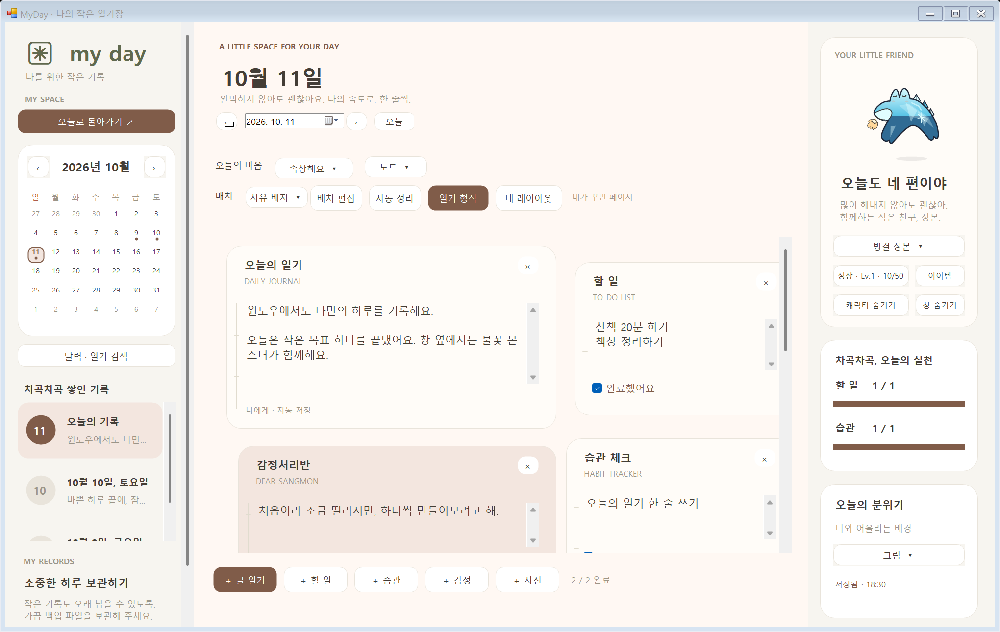

# 마이데이 (MyDay)

[](https://github.com/parkhookjung-debug/myday-diary/actions/workflows/android.yml)
[](https://github.com/parkhookjung-debug/myday-diary/actions/workflows/windows.yml)
[](LICENSE)

Windows·Mac·Android용 커스터마이즈 일기 앱입니다. 세 버전에서 사진과 일기 블록을 자유롭게 배치하고 상몬 64종을 키우며 장비 300종을 8개 슬롯에 조합합니다. Android는 손가락 조작과 짧은 햅틱, Windows는 바탕화면 캐릭터를 제공합니다. MIT 라이선스로 공개하며 5명이 화면·저장·캐릭터·통합·검증을 나눠 개발합니다.

**0.9.0 기록 도구:** [휴지통·이력 → 월간 리포트 → 알림 → Wi-Fi·QR 이동 → 상몬 반응 → 업데이트](docs/JOURNAL-TOOLS.md) · [실제 화면](previews/journal-tools/README.md) · [변경 내역](CHANGELOG.md). 각 앱의 **기록 도구**에서 시작하세요. 실행 위치와 기능별 수정 파일을 안내 첫 화면에 정리했습니다. Wi-Fi 전송은 별도 로컬 Python 도구를 사용하고 업데이트 설치는 백업 후 OS에서 진행합니다.

**세 플랫폼 같은 화면·기능:** [메뉴·화면·공통 백업·OS 차이·바로 수정할 파일](docs/THREE-PLATFORMS.md). 메뉴는 일기 / 달력·검색 / 상몬·공방 / 라운지 / 설정·백업으로 통일했습니다. Mac에도 64종·300소품·Lv.100·등급 뽑기·합성·내 레이아웃을 적용합니다. 컴퓨터는 사이드바, 휴대폰은 하단 탭과 햅틱을 사용합니다.

[세 앱의 실제 화면](previews/three-platforms/README.md) · [완료된 검사·실행 파일 받기](docs/THREE-PLATFORMS.md#2026-10-23-검증-기록)

**상몬의 작은 옷장:** [파스텔 일상 소품 300종·8슬롯·수정 파일](docs/SANGMON-ITEMS.md) · [출석·일기 미션 점수표](docs/SANGMON-GROWTH.md) · [실제 적용 이미지](previews/applied/cozy-v1/README.md). 기존 경험치를 유지하며 기본 미션 최대 40 XP와 연속 7일 출석 보너스 10 XP를 쌓습니다.

**세분화한 성장·선물 상자:** 초반 10 XP부터 성장 구간별로 레벨 업하고 클로버로 소품을 뽑습니다. [레벨·보상 표](docs/SANGMON-GROWTH.md) · [확률·10회 보장·중복 교환·수정 파일](docs/SANGMON-COLLECTION.md). **기본 소품 8종은 무료, 나머지 292종은 획득 후 착용**합니다. 미보유 잠금·보유 필터와 이전 착용 소품 보존을 제공합니다.

**만렙 기간 조정:** 세 플랫폼 모두 Lv.100 / 3,590 XP가 만렙입니다. 매일 루틴 **99일**, 주 5일 기록 **200일**, 여유로운 사용 **295일**의 실제 활동 검사로 확인합니다. 연속 7일 출석 보너스 +10 XP, 만렙 이후 기록·클로버·뽑기를 지원합니다. [활동 패턴·점수·공통 수정 위치](docs/SANGMON-GROWTH.md).

**등급 선물·조각 공방:** 일상·반짝·별빛·꿈빛 등급, 조각 합성(60%·40%·25%), 같은 등급 조각 5개로 원하는 소품 제작, 10~300종 수집 성취 보상을 추가했습니다. [등급별 확률·실패 환급·보상·수정 파일](docs/SANGMON-ATELIER.md). 새 내역은 버전 8에 저장하므로 최신 Windows·Mac·Android 앱에서 사용하세요.

**새 캐릭터 적용:** [기본 상몬의 3D풍 클레이 외형·실제 렌더링·수정 파일 안내](previews/applied/sangmon-clay/README.md). 기본 상몬에 먼저 적용했으며 세 플랫폼에서 같은 자산을 사용합니다. 기존 Releases 파일에는 아직 포함되지 않습니다.

**Windows·Mac·Android 채팅 / 현재 로컬 개발:** 일기 앱의 **상몬 라운지 · 채팅**에서 같은 서버에 접속하도록 구현했습니다. [계정 없이 실행·같은 Wi-Fi·무료 배포 차단·수정 파일](docs/FREE-CHAT.md) · [Mac 일기 앱](macos/README.md) · [기존 Python 서버](server/README.md) · [공통 API](docs/CHAT.md). [자동 검사](https://github.com/parkhookjung-debug/myday-diary/actions/runs/39037445085)에서 서버·Windows·Mac 빌드와 실제 앱 통신이 통과했습니다. 해당 화면 아래 **Artifacts**에서 Windows 실행 파일과 Apple Silicon Mac 앱을 받습니다(7일 보관). 무료 계정을 준비하기 전까지 외부 서버는 배포하지 않습니다. Android에도 같은 서버에 접속하는 라운지를 제공합니다.

**세 플랫폼 공통 개발:** [shared/ 원본과 수정 위치](shared/README.md)에서 일기 100종·색상·입력/배치 제한·채팅 제한을 함께 관리합니다. 수정 후 `python tools/sync-desktop.py`를 실행하면 각 앱의 공통 코드가 생성됩니다. [작업 순서·검사](docs/DESKTOP-SHARED.md).

**공동 디자인 → Windows:** `ceed3927`의 10월 10일 디자인을 기준으로 큰 제목·상몬 카드·테마 색상 버튼을 적용했습니다. [디자인 원본·반영 기준·수정 파일 안내](docs/DESIGN-SYNC.md)에서 다음 디자인을 어디에 반영하는지 확인합니다.

## 어떤 파일을 수정하면 되나요?

**아래에서 기능을 고르고, 작업할 플랫폼의 파일 이름을 클릭하세요.** 화면·저장·캐릭터를 나눠 두었으므로 기능에 맞는 파일부터 수정합니다.

| 바꾸려는 기능 | Windows에서 열 파일 | Android에서 열 파일 |
| --- | --- | --- |
| 서버 채팅·메시지·접속자·초대코드 | [ChatClient.cs](windows/Chat/ChatClient.cs) · [ChatWindow.cs](windows/UI/ChatWindow.cs) · [chat_server.py](server/chat_server.py) | [LoungeClient.kt](app/src/main/java/com/myday/diary/chat/LoungeClient.kt) · [PhoneLounge.kt](app/src/main/java/com/myday/diary/ui/diary/PhoneLounge.kt) |
| 무료 서버·Mac 채팅 화면·공통 통신 | [무료 서버 원본](server/cloudflare/src/index.ts) · [배포 차단](server/cloudflare/tools/free-deploy.mjs) · [Mac 화면](macos/Sources/MyDay/ChatView.swift) · [Mac 통신](macos/Sources/MyDay/ChatClient.swift) | [공통 프로토콜](docs/CHAT.md) |
| 색·글꼴·버튼·카드 디자인 | [Design.cs](windows/UI/Design.cs) | [MyDayTheme.kt](app/src/main/java/com/myday/diary/ui/design/MyDayTheme.kt) · [colors.xml](app/src/main/res/values/colors.xml) |
| 전체 화면·메뉴·탭 위치 | [DiaryWindow.Shell.cs](windows/UI/DiaryWindow.Shell.cs) | [PhoneNotebookScreen.kt](app/src/main/java/com/myday/diary/ui/diary/PhoneNotebookScreen.kt) |
| 일기 카드·입력창·체크박스 | [BlockCard.cs](windows/UI/BlockCard.cs) | [PhoneBlockEditor.kt](app/src/main/java/com/myday/diary/ui/diary/PhoneBlockEditor.kt) |
| 블록 이동·크기 조절·자유 배치 | [DiaryBoard.cs](windows/UI/DiaryBoard.cs) | [PhoneFreeBoard.kt](app/src/main/java/com/myday/diary/ui/diary/PhoneFreeBoard.kt) |
| 사진 회전·압축·용량 제한 | [DiaryPhoto.cs](windows/Core/DiaryPhoto.cs) | [NotebookPhoto.kt](app/src/main/java/com/myday/diary/data/NotebookPhoto.kt) |
| 달력·일기 검색 화면 | [JournalBrowser.cs](windows/UI/JournalBrowser.cs) | [PhoneCalendar.kt](app/src/main/java/com/myday/diary/ui/diary/PhoneCalendar.kt) |
| 일기 형식 100종의 제목·질문 | [Windows·Mac 공통 원본](shared/catalog/templates.json) · [생성 도구](tools/sync-desktop.py) | 생성 후 [Android 자산 생성](tools/export-android-assets.ps1) |
| 내 레이아웃 목록·이름·미리보기 | [MyLayoutsWindow.cs](windows/UI/MyLayoutsWindow.cs) | [PhoneDialogs.kt](app/src/main/java/com/myday/diary/ui/diary/PhoneDialogs.kt) |
| 저장·백업 형식·이전 기록 | [DiaryData.cs](windows/Core/DiaryData.cs) | [DiaryStore.kt](app/src/main/java/com/myday/diary/data/DiaryStore.kt) · [NotebookJson.kt](app/src/main/java/com/myday/diary/data/NotebookJson.kt) |
| 뽑기·클로버·꽃잎·수집 도감 | [SangmonCollection.cs](windows/Core/SangmonCollection.cs) · [CollectionWindow.cs](windows/UI/CollectionWindow.cs) | [CollectionRules.kt](app/src/main/java/com/myday/diary/diary/CollectionRules.kt) · [PhoneCollection.kt](app/src/main/java/com/myday/diary/ui/diary/PhoneCollection.kt) |
| 경험치·레벨·성장 규칙 | [SangmonGrowth.cs](windows/Core/SangmonGrowth.cs) | [NotebookRules.kt](app/src/main/java/com/myday/diary/diary/NotebookRules.kt) |
| 상몬·소품 선택 화면 | [GrowthWindow.cs](windows/UI/GrowthWindow.cs) · [EquipmentWindow.cs](windows/UI/EquipmentWindow.cs) | [PhoneCompanion.kt](app/src/main/java/com/myday/diary/ui/diary/PhoneCompanion.kt) |
| 상몬 외형·소품 그림·이름 | [상몬·아이템 원본 안내](windows/Character/README.md) · [SangmonItems.cs](windows/Core/SangmonItems.cs) | 원본 수정 후 [Android 자산 생성](tools/export-android-assets.ps1) |
| 홈/바탕화면 캐릭터 이동·터치 | [DesktopPet.cs](windows/Character/DesktopPet.cs) · [PetBehavior.cs](windows/Character/PetBehavior.cs) | [CharacterWallpaperService.kt](app/src/main/java/com/myday/diary/CharacterWallpaperService.kt) |
| 휴대폰 진동·햅틱 반응 | — | [DiaryHaptics.kt](app/src/main/java/com/myday/diary/platform/DiaryHaptics.kt) |

**폴더에 들어가도 README가 수정 위치를 안내합니다.** [Windows 화면](windows/UI/README.md) · [Windows 저장](windows/Core/README.md) · [상몬 그림](windows/Character/README.md) · [Android 화면](app/src/main/java/com/myday/diary/ui/diary/README.md) · [Android 데이터](app/src/main/java/com/myday/diary/data/README.md) · [Android 동작](app/src/main/java/com/myday/diary/diary/README.md) · [시스템·햅틱](app/src/main/java/com/myday/diary/platform/README.md) · [개발 도구](tools/README.md)

전체 설명과 수정 예는 [기능별 수정 가이드](docs/EDITING-GUIDE.md), 역할과 작업 순서는 [공동 작업 안내](CONTRIBUTING.md)에 있습니다. Android의 생성된 PNG·catalog.json·SangmonIdentity.kt는 직접 고치지 않고 원본에서 다시 생성합니다. 저장 ID를 바꾸는 작업은 기록 호환성도 함께 확인합니다.

> **최신 코드 위치:** [codex/windows-app 브랜치](https://github.com/parkhookjung-debug/myday-diary/tree/codex/windows-app). 기본 main 화면에서 왔다면 이 링크로 이동하세요. 통합 변경 내역은 [PR #7](https://github.com/parkhookjung-debug/myday-diary/pull/7)에서 확인합니다. 현재 main의 필수 리뷰·필수 상태 검사 제한은 해제되어 있습니다.

## 실행 파일 받기

| 사용할 환경 | 다운로드 | 실행·개발 안내 |
| --- | --- | --- |
| Windows 10/11 | [MyDay.exe 바로 받기](https://github.com/parkhookjung-debug/myday-diary/releases/download/v0.3.10-preview/MyDay.exe) · [전체 ZIP과 안내서](https://github.com/parkhookjung-debug/myday-diary/releases/tag/v0.3.10-preview) | [Windows 안내](windows/README.md) |
| 갤럭시 / Android 8 이상 | [Android APK 받기](https://github.com/parkhookjung-debug/myday-diary/releases/tag/v0.4.0-android-preview) (개발용 debug) | [Android 안내](docs/ANDROID.md) |
| macOS 13 이상 | [Mac 개발 소스·로컬 빌드 안내](macos/README.md). 새 채팅 포함 실행 파일은 아직 Releases에 없습니다. | Windows EXE 대신 Mac용 앱을 빌드합니다. |

GitHub 저장소 오른쪽 **Releases → 해당 버전 → Assets**에서도 받습니다. Windows는 .NET Framework 4.8 이상에서 사용하며, 이전 앱이 실행 중이면 알림 영역 MyDay → **모두 종료** 후 새 EXE를 실행합니다. 현재 Windows 배포는 v0.3.10-preview입니다.

## 처음 개발에 참여한다면

```sh
git clone https://github.com/parkhookjung-debug/myday-diary.git
cd myday-diary
git switch codex/windows-app
```

1. [기능별 수정 가이드](docs/EDITING-GUIDE.md)에서 바꿀 파일을 고릅니다.
2. [공동 작업 안내](CONTRIBUTING.md)를 따라 별도 브랜치에서 수정합니다.
3. 해당 플랫폼을 다시 빌드하고 동작을 확인한 뒤 PR을 올립니다.

Windows는 C# / Windows Forms이며 [windows/build.ps1](windows/build.ps1)로 빌드합니다. 코드 수정 뒤에는 다시 빌드해야 변경이 EXE에 반영됩니다. Android는 Kotlin / Jetpack Compose이며 Android Studio, JDK 17 이상, Android SDK 35를 사용합니다.

[폴더 구조](docs/REPOSITORY-STRUCTURE.md) · [문서 목록](docs/README.md) · [5명 역할·공동 작업자](docs/TEAM.md) · [미리보기 목록](previews/README.md)

## 현재 기능

Windows v0.3.10-preview는 팀의 웹 디자인을 네이티브 앱에 적용했습니다. 달력·일기·상몬 3단 구성, 크림·숲·라벤더 테마, 완료 현황을 제공합니다. [디자인과 수정 파일](docs/WINDOWS-DESIGN.md)

| 플랫폼 | 구현한 기능 |
| --- | --- |
| Windows | 날짜별 글·할 일·습관·감정·사진, 자유 배치, 내 레이아웃 저장·재사용, 일기 형식 100종, 월간 달력·본문/사진 설명 검색, 자동 저장·JSON 백업 |
| Windows 상몬 | 바탕화면 이동·클릭으로 일기 열기·숨기기/재표시, 외형 64종, 출석·활동 미션·성장 보상, 소품 300종의 8슬롯 조합·뽑기 수집 |
| Android 0.7.0 소스 | Windows와 같은 일기 100종·사진·자유 배치·내 레이아웃·달력·검색·성장·64종·파스텔 소품 300종·등급 뽑기·합성·버전 8 JSON 백업, 네 탭 화면·햅틱·홈 위젯·라이브 배경화면 |

[Android·Windows 기능 비교와 햅틱](docs/ANDROID-PARITY.md), [Android 설치·기존 기록 이전](docs/ANDROID.md)을 확인하세요. 이전 debug APK와 서명이 달라 설치가 막히면 앱 삭제 전에 백업부터 합니다. 각 기기에 기록을 저장하며 플랫폼 사이의 자동 동기화는 없습니다. 영상 첨부와 AI 감정 대화는 후속 기능입니다.

<details>
<summary>실제 화면과 아이템 예시 보기</summary>

예시는 격리된 기록으로 만든 Windows 창과 코드로 렌더링한 아이템입니다. [더 많은 화면·움직임 예시](previews/README.md)




</details>

## 검증과 저장 호환성

Android CI는 빌드·Lint·단위 테스트·Android 35 에뮬레이터 화면/저장/사진 검사·실제 Windows JSON 호환성 검사를, Windows CI는 빌드·저장·레이아웃·사진·검색·성장·장비·캐릭터 렌더링 검사 206개와 네이티브 화면 검사를 실행합니다. 화면 검사는 격리된 기록으로 3단·작은 창 전환, 달력·테마·완료 현황과 기존 일기 기능을 확인합니다. 갤럭시 실기기, 여러 모니터·DPI·절전 복귀는 추가 검증 대상입니다.

출석·활동과 확장 장비는 버전 5, 기존 소유권은 버전 7, 새 등급 뽑기·조각 합성·제작은 버전 8로 저장합니다. 이번 변경을 포함한 새 Windows·Android로 열어주세요. 버전 1~6의 기록·기존 장비·경험치도 보존합니다. 자세한 기준은 [성장 안내](docs/SANGMON-GROWTH.md)와 [장비 안내](docs/SANGMON-ITEMS.md)에 있습니다.
