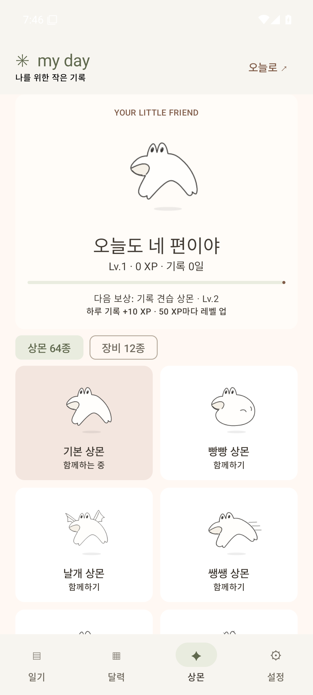

# MyDay Android 0.7.0 소스

Windows의 일기·상몬·성장·장비 기능을 갤럭시용 Kotlin / Jetpack Compose 앱으로 옮겼습니다. 일기·달력·상몬·설정 네 탭과 Windows의 크림·숲·라벤더, 갈색·올리브 색을 사용합니다.

[APK·설치 안내](https://github.com/parkhookjung-debug/myday-diary/releases/tag/v0.4.0-android-preview) · [기능별 수정 파일](../app/src/main/java/com/myday/diary/README.md) · [플랫폼 비교·햅틱](ANDROID-PARITY.md)

## 기능

- 날짜별 글·할 일·습관·감정·사진, 완료 현황, 자동 저장·실패 재시도
- Windows 원본 질문·배치의 일기 형식 100종, 검색·미리보기
- 자동 정렬·길게 눌러 순서 변경·자유 배치·크기 조절·화면 이동·확대
- 내 레이아웃 저장·이름 변경·검색·삭제·다른 날짜에 빈 칸으로 재사용
- 월간 달력·기록 및 사진 표시·전체 본문과 사진 설명 검색
- 상몬 64종: 자유 선택 56종 + 성장 보상 8종, 출석·일기·사진·완료 미션 하루 최대 40 XP·10/20/30/50 XP 구간별 레벨 상승
- 장비 300종·8슬롯 독립 장착·해제, 종류·속성·이름 검색
- 사진·좌표·성장·장비를 포함한 버전 7 JSON 백업, 같은 변경을 포함한 Windows와 가져오기·내보내기, 버전 1~6 읽기
- 같은 상몬·장비를 쓰는 홈 위젯과 라이브 배경화면
- 체크·블록 잡기/놓기·장착·상몬 터치에 짧은 햅틱, 설정에서 끄기

감정처리반은 마음을 적는 기록 기능입니다. AI 답변·영상·계정·클라우드 자동 동기화·누적 습관 통계는 아직 없습니다. JSON을 직접 옮겨 두 기기의 기록을 이동합니다.

최신 소스에는 [300종 장비](SANGMON-ITEMS.md)·[새 성장 규칙](SANGMON-GROWTH.md)이 반영되어 있습니다. 아래 v0.4.0 Releases APK는 이전 기능이며 새 소스를 빌드하거나 최신 CI artifact에서 받습니다.

## APK 설치와 기존 기록

Android 8.0 이상에서 실행됩니다. Releases → Assets → `MyDay-Android-v0.4.0-preview.apk`를 받아 휴대폰에서 엽니다. 설치 출처 허용은 휴대폰 시스템 안내에 따라 선택합니다. 이번 공개 APK는 **개발용 debug 서명**입니다.

**이전 앱에 일기가 있다면 삭제하거나 앱 데이터를 지우기 전에 백업하세요.** 기존 v0.3.0 APK는 임시 Android Debug 인증서로 서명되어 있어 새 개발 빌드와 덮어 설치가 안 될 수 있습니다. 전용 배포 서명 설정은 준비했으며 키 생성·보관·GitHub 비밀 저장소 등록은 소유자 승인 후 진행합니다. [서명 안내](ANDROID-SIGNING.md)

1. 기존 앱이 백업 메뉴를 제공하면 설정 → 백업 다운로드로 JSON을 저장합니다.
2. 백업 메뉴가 없는 v0.3.0 debug 앱은 USB 디버깅을 켜고 PC에 연결합니다. Android SDK의 ADB로 아래 도구를 실행합니다. 도구는 기록을 읽어 백업하며 설치·삭제·데이터 변경을 하지 않습니다.

```powershell
./tools/backup-android.ps1 -Adb 'C:/Users/YOUR_NAME/AppData/Local/Android/Sdk/platform-tools/adb.exe'
```

3. `.bootstrap/phone-backups/`의 JSON을 안전한 개인 폴더로 복사합니다. 날짜 수와 파일을 확인하고 Windows에서 가져오기로 실제 내용을 확인할 수 있습니다. 공개 저장소에 커밋하지 마세요.
4. 백업 확인 후 서명 충돌로 재설치가 필요한 경우에만 기존 앱을 제거하고 새 APK를 설치합니다. 설정 → 백업 복원으로 JSON을 가져옵니다. 백업 실패 시 앱을 삭제하지 마세요.

같은 서명으로 덮어 설치하면 이전 `diary` SharedPreferences를 `files/notebook.json`으로 이전합니다. 기존 SharedPreferences는 지우지 않습니다. 저장본이 손상되면 읽기 오류를 보여주며 빈 기록으로 덮어쓰지 않습니다.

## 휴대폰에서 배치와 사진

일기 탭의 자유 배치 → 배치 편집을 누릅니다. 카드를 길게 눌러 끌고, 오른쪽 아래 ↘를 끌어 크기를 바꿉니다. 두 손가락으로 화면을 이동·확대하고, 슬라이더·방향 버튼·블록으로 이동으로 먼 위치의 카드를 찾습니다. 편집 완료 후 카드를 누르면 글을 쓰는 편집 창이 열립니다.

자동 정렬에서는 카드의 ⋮⋮ 제목 영역을 길게 잡아 위·아래로 옮깁니다. ↑ 위로 / ↓ 아래로 버튼도 제공합니다. 자동 정리는 블록을 세로로 정돈합니다. Windows의 큰 좌표도 보존하고 휴대폰에서 확대·이동해 확인합니다.

하루 조각 추가 → 사진 또는 빈 사진 자리의 사진 선택으로 시스템 선택기를 엽니다. 원본을 수정하지 않고 회전을 바로잡아 긴 변 1600px 이하 JPEG로 저장합니다. 입력 20MB·12000px/2500만 픽셀, 저장 사진 2MB 이하를 검사하며 EXIF 메타데이터를 제거합니다.

## 성장·위젯·배경화면

실제 내용을 바꿔 **저장에 성공한 날** 하루 한 번 +10 XP를 받습니다. 과거 날짜에 써도 오늘 지급하며 빈 블록·테마·좌표·장비 변경은 지급하지 않습니다. 지급 날짜 5개마다 레벨이 오르고 성장 보상 8종이 열립니다. 백업의 지급 날짜를 합쳐 중복 보상을 방지합니다.

설정에서 홈 위젯 추가·라이브 배경화면 설정을 엽니다. 적용은 Android 시스템 화면에서 확정합니다. 선택한 상몬·장비는 전역으로 유지하며 테마는 오늘 날짜의 것을 사용합니다.

배경화면 상몬은 돌아다니며 점프·눈 깜박임·두리번거림·휴식·잠·하품을 합니다. 끌어서 옮기고 터치/놓기로 0.7초 불꽃 반응을 보여줍니다. 평소 불꽃을 뿜지 않고 하품에 별도 입을 추가하지 않습니다. 런처의 터치 전달에 따라 드래그·탭 동작은 달라질 수 있습니다. 안 보이면 루프를 멈추며 보일 때 최대 약 30fps입니다.

위젯은 연속 애니메이션 없이 탭하면 포즈·응원 문구가 바뀝니다. 일기 본문·사진을 노출하지 않고 날짜·완료 수만 표시합니다. 저장 직후 갱신하며 자정 이후 시스템 갱신 또는 탭으로 오늘 날짜를 반영합니다. 배경화면은 3초마다 작은 설정 캐시만 읽고 전체 일기·사진을 반복 파싱하지 않습니다.

## 빌드와 검증

Android Studio에서 저장소 루트를 Open → SDK 35 설치 → Gradle JDK 17 이상 선택 → app 실행을 사용합니다. 갤럭시 USB 디버깅을 허용하거나 에뮬레이터를 선택합니다. Windows 한글 경로의 테스트 실행기 문제가 있으면 `C:/Projects/myday-diary`처럼 영문 경로에 clone합니다.

```powershell
./gradlew.bat :app:assembleDebug :app:lintDebug :app:testDebugUnitTest
./gradlew.bat :app:connectedDebugAndroidTest
```

APK는 `app/build/outputs/apk/debug/app-debug.apk`입니다. 단위 검사는 지급·저장 실패·백업·이전 형식을 확인합니다. Android 35 에뮬레이터 검사는 Compose 입력·사진·달력·상몬 장착·자유 배치·형식·내 레이아웃, 사진 회전·AtomicFile 저장과 실제 ViewModel의 연속 입력·실패 재시도·종료 직전 저장을 격리된 기록으로 확인합니다. Android JSON을 실제 Windows 코드로 읽는 CI 검사도 제공합니다.

진동의 실제 느낌, 갤럭시 런처의 위젯·배경화면 터치, 절전 복귀·접근성·다른 화면 크기는 실기기에서 추가 확인합니다.

## 실제 에뮬레이터 화면



[일기·사진·배치·형식·장비·설정 화면](../previews/README.md#android-040-실제-화면)

성장은 10·20·30·50 XP 구간으로 세분화했으며 [선물 상자·수집 도감](SANGMON-COLLECTION.md)을 함께 제공합니다. 새 뽑기·교환 내역은 버전 7 JSON을 사용하고 이전 버전 1~6도 읽습니다.

기본 소품 8종은 무료이며 나머지는 뽑기·꽃잎 교환으로 얻어야 착용합니다. 옷장 잠금·보유 필터를 제공하고, 업데이트 직전 저장된 착용 소품은 소유권을 보존합니다. [소품 획득 규칙](SANGMON-COLLECTION.md)
