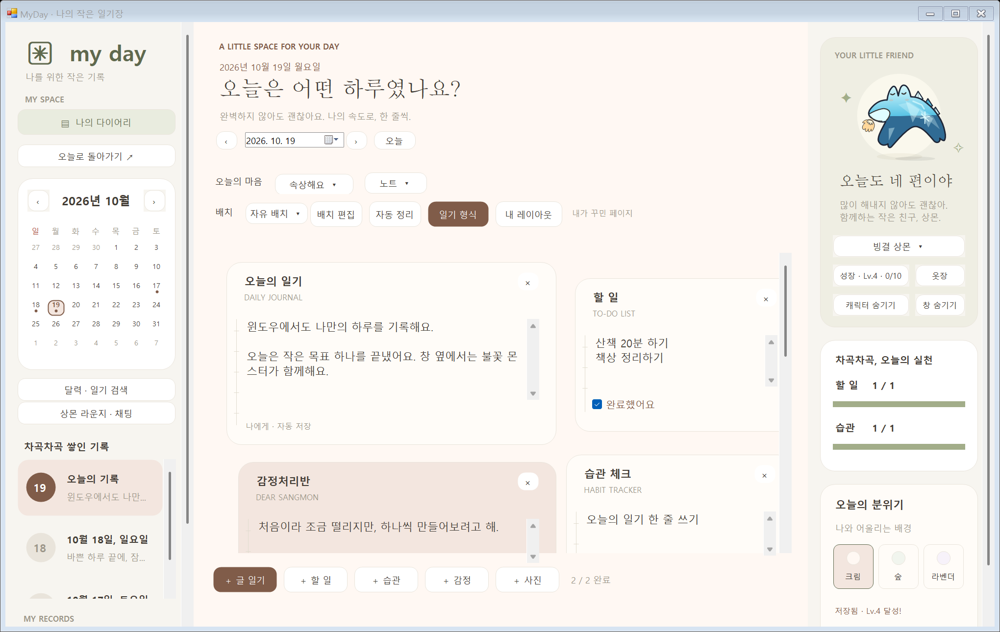

# 공동 작업자 디자인을 Windows에 반영하기

디자인 기준은 `ceed3927`이 2026-10-10에 올린 [공통 웹 디자인](https://github.com/parkhookjung-debug/myday-diary/tree/codex/share-web-design/web)과 [PR #8](https://github.com/parkhookjung-debug/myday-diary/pull/8)입니다. 두 브랜치의 `web/index.html`, `web/desktop.css`는 검토 시점에 같은 내용입니다. 작성·반영 기준 커밋과 파일 해시는 [design-source.json](../shared/design-source.json)에 기록합니다.

## 2026년 10월 29일 추가 반영

`ceed3927`의 직접 푸시 `546d154`를 검토해 형식·블록 추가 화면을 통합하고 `MoodStickers.swift`의 다섯 표정을 Windows 기본 컨트롤에 맞춰 옮겼습니다. 기존 100종 목록은 유지하며 디자이너의 20종을 공통 추천 목록으로 제공합니다. [통합 기준과 수정 파일](INTEGRATION-2026-10-29.md).

## 현재 Windows 반영 내용

기존의 크림·올리브 색과 3단 구성을 유지하면서 웹 원본의 큰 명조 제목, 별도 날짜 표시, 선택된 다이어리 메뉴, 연한 올리브 상몬 카드·원형 배경·작은 별, 올리브 완료 막대, 세 가지 테마 색상 버튼과 하단 문구를 적용했습니다. 캐릭터는 기존 상몬을 사용하며 성장·옷장·채팅·사진·자유 배치도 같은 창에서 사용합니다. 좁은 창에서는 오른쪽 영역을 왼쪽 스크롤 영역으로 옮깁니다.

검증: Windows 빌드, 기존 검사 210개, 공통 원본 생성 검사 5개, 실제 창의 넓은/작은 배치·세 가지 테마 버튼·날짜·저장·자유 배치·성장·300소품·뽑기 검사가 통과했습니다. 캡처에는 격리된 예시 기록만 사용했습니다.

| 웹 원본에서 바뀐 부분 | Windows에서 수정할 파일 |
| --- | --- |
| 공통 색·배경·카드 강조색 | [shared/desktop.json / design](../shared/desktop.json), 수정 후 `python tools/sync-desktop.py` |
| 글꼴·버튼·카드 모양 | [Design.cs](../windows/UI/Design.cs) |
| 큰 제목·날짜·중앙 메뉴 | [DiaryWindow.cs](../windows/UI/DiaryWindow.cs) |
| 왼쪽 메뉴·상몬 카드·진행 막대·영역 배치 | [DiaryWindow.Shell.cs](../windows/UI/DiaryWindow.Shell.cs) |
| 테마 색상 선택 버튼 | [ThemePicker.cs](../windows/UI/ThemePicker.cs) |
| 상몬 카드의 원형 배경·별·그림자 | [MonsterView.cs](../windows/UI/MonsterView.cs)의 ShowScene |
| 일기 카드·입력·체크 | [BlockCard.cs](../windows/UI/BlockCard.cs) |

Windows 화면은 WinForms, Mac 화면은 SwiftUI를 유지합니다. HTML/CSS는 디자인 기준이며 앱에 그대로 실행하거나 브랜치 전체를 덮어쓰지 않습니다. 기록 모델과 템플릿 ID·테마 번호는 유지합니다.

## 다음 디자인이 올라오면

1. `git fetch origin` 후 `ceed3927`의 PR·브랜치 활동과 실제 디자인 파일 변경을 확인합니다. 기존 파일은 `design-source.json`의 커밋·파일 해시와 비교하고, 새 파일도 검토합니다. 커밋 작성자가 `codex`로 표시될 수 있으므로 PR 작성자와 GitHub 활동도 함께 확인합니다.
2. 변경된 문구·배치·스타일을 위 표에 맞춰 옮깁니다. 공통 색을 바꾸면 생성기를 실행하고 생성 파일도 함께 커밋합니다.
3. Windows 빌드, `--self-test`, `--smoke-test <출력 폴더>`를 실행하고 넓은 창·작은 창·테마 선택·기존 기능을 확인합니다. 실제 화면을 보고 잘림·겹침을 점검합니다.
4. 검토한 원본 커밋·파일 해시·대응 파일을 갱신하고 작업 브랜치에 커밋·푸시합니다. 변경을 검증하지 못했다면 반영 완료로 기록하지 않습니다.

이 작업을 요청한 Codex 채팅에 **24시간 간격 확인**을 설정했습니다. 새 디자인이 없으면 알리지 않으며, 반영 완료·검사 실패·충돌·사용자 조치가 필요한 경우 결과를 알립니다. 자동화 실행은 Codex 앱에서 관리하며 저장소 자체의 GitHub Action은 아닙니다. 결과는 작업 브랜치에 올리고 main 병합과 Releases 배포는 별도 작업으로 진행합니다.
