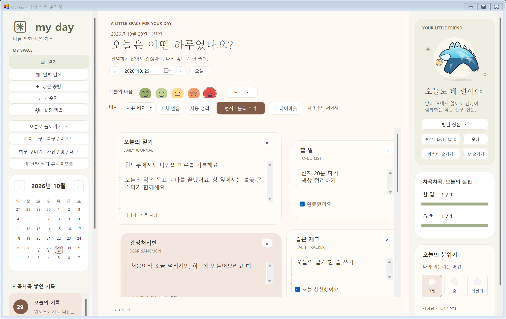
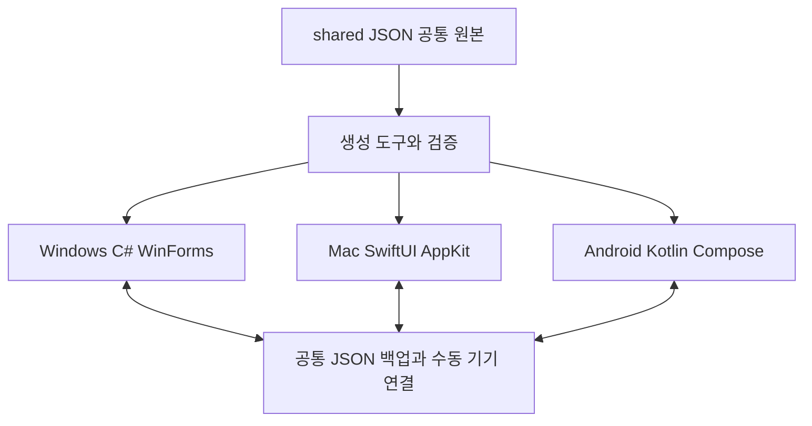

# 마이데이 발표 기초 자료

앱 0.14.0 · 2026-10-29 · 기준 소스 73f9c20ed0002a46eff23115359462eedec94a37

[Word 자료](presentation/MyDay-Presentation-Brief-0.14.0.docx) · [오픈소스 조사 CSV](presentation/open-source-inventory.csv) · [팀 기여 근거](presentation/contributions-evidence.json)

## 목차

- [01 발표에서 전달할 핵심](#chapter-1)
- [02 개발 목적과 사용자](#chapter-2)
- [03 현재 기능과 지원 범위](#chapter-3)
- [04 프로그램 구조와 동작 원리](#chapter-4)
- [05 앱에 사용한 주요 오픈소스](#chapter-5)
- [06 개발과 검사에 사용한 오픈소스](#chapter-6)
- [07 오픈소스를 적용한 세 가지 사례](#chapter-7)
- [08 프로젝트가 직접 구현한 부분](#chapter-8)
- [09 라이선스와 출처를 설명하는 방법](#chapter-9)
- [10 팀원별 역할과 확인된 기여](#chapter-10)
- [11 협업 과정에서 보여 줄 사례](#chapter-11)
- [12 검증 결과와 남은 범위](#chapter-12)
- [13 10분 발표 구성안](#chapter-13)
- [14 시연 순서와 예상 질문](#chapter-14)
- [15 발표 전 확인할 자료](#chapter-15)
- [16 근거와 참고 자료](#chapter-16)

## 01 발표에서 전달할 핵심

마이데이 MyDay는 글·사진·할 일·습관·감정 조각을 자유롭게 배치하고, 상몬을 꾸미며 기록을 이어가는 Windows·Mac·Android 일기 프로그램입니다. 발표에서는 사용자 기능, 오픈소스 활용, 팀이 직접 만든 부분, 협업과 검증 결과를 연결해 설명합니다.

정리 기준은 2026년 10월 29일의 0.14.0 통합판과 소스 73f9c20입니다. 팀원 표기는 사용자 요청에 따라 GitHub 계정을 사용합니다. 역할 분담 계획은 실제 기여 기록과 구분하며, 현재 확인되지 않은 성과는 발표 완료 사실로 쓰지 않습니다.

- 오픈소스 활용의 대표 사례는 Android Compose 화면, ZXing QR 인코딩·디코딩, Nayuki QR 알고리즘 적용, PGlite를 이용한 접근 정책 검사입니다.
- 팀의 주요 구현은 자유 배치와 사진 처리, 공통 JSON 규칙 생성, 저장·복구, 상몬 성장·수집, 플랫폼별 화면과 입력 방식입니다.
- 온라인 친구 기능은 선택 내용 미리보기까지 제공하며, 통합판의 외부 로그인·초대·업로드는 비활성화되어 있습니다. 로컬 채팅과 구분해 시연합니다.

[0.14 통합 안내](https://github.com/parkhookjung-debug/myday-diary/blob/73f9c20ed0002a46eff23115359462eedec94a37/docs/INTEGRATION-2026-10-29.md)

## 02 개발 목적과 사용자

처음 구상한 여러 프로젝트 가운데 사용자가 필요한 칸을 골라 배치할 수 있는 커스터마이즈 일기를 중심으로 개발했습니다. 글만 쓰는 방식에 부담을 느끼거나 사진·체크리스트·짧은 감정 기록을 한 화면에 정리하고 싶은 사용자가 주요 대상입니다.

| 문제나 요구 | 프로그램의 대응 |
| --- | --- |
| 정해진 형식이 나와 맞지 않음 | 글·사진·할 일·습관·감정 조각을 추가하고 위치와 크기를 변경 |
| 무엇을 쓸지 떠오르지 않음 | 일기 형식 100종과 추천 20종, 오늘의 질문 제공 |
| 기록을 계속하기 어려움 | 출석·기록 보상, 상몬 성장·꾸미기·소품 수집으로 반복 사용 동기 마련 |
| 휴대폰과 컴퓨터의 조작 방식이 다름 | 기능·데이터 규칙은 공유하고 마우스·터치·햅틱과 화면은 OS별로 구현 |
| 기록 유실이 걱정됨 | 자동 저장·백업·이력·휴지통·직전 저장본 복구 제공 |

꾸준한 기록을 돕는 것이 개발 목적입니다. 실제 사용자의 학습 효율이나 정신 건강 개선을 측정한 연구 결과는 없으므로 효과를 검증했다고 발표하지 않습니다. 개발에 AI 코딩 도구를 활용한 것과 앱이 AI 감정 상담을 제공하는 것은 별개의 내용입니다.

## 03 현재 기능과 지원 범위

| 기능 | 현재 제공 내용 | 범위 |
| --- | --- | --- |
| 일기와 배치 | 날짜별 글·사진·체크·감정, 자유 배치, 내 레이아웃 | 세 OS 공통 |
| 일기 형식 | 전체 100종 유지, 추천 20종 별도 제공 | 세 OS 공통 |
| 상몬과 소품 | 외형 64종, 소품 300종, 8개 장착 위치 | 세 OS 공통 |
| 성장과 수집 | XP·출석·레벨·등급 뽑기·중복 교환·조각 합성·제작 | 세 OS 공통 |
| 기록 보관 | 검색·사진 앨범·감정 달력·태그·백업·이력·복구 | 세 OS 공통 |
| 기기 이동 | 공통 JSON 백업과 임시 Wi-Fi QR 연결 | 수동 확인·가져오기 |
| 채팅 | 같은 로컬 서버 주소와 초대코드로 텍스트 대화 | 공개 서비스 아님 |
| 바탕화면과 홈 | 컴퓨터 캐릭터, Android 위젯·라이브 배경·햅틱 | OS별 구현 |
| 여러 사진 | 한 번에 최대 10장 선택, 사진별 제목·장소·설명 | Android 0.14 |
| 친구 일기 | 공개할 항목 직접 선택과 기기 내 미리보기 | Android만 제공, 실제 전송 꺼짐 |
| 영상 | Mac 로컬 영상 원본 경로 참조 실험 | 영상 파일 자체는 백업하지 않음 |

세 앱은 핵심 기능과 공통 데이터 규칙을 맞췄으며 화면을 하나의 코드로 공유하는 구조는 아닙니다. Mac의 기본 형식 기억, Android의 사진 여러 장 선택처럼 OS별 확장 기능은 발표 화면에 범위를 표시합니다.

## 04 프로그램 구조와 동작 원리

| 계층 | 담당 내용 | 실제 위치 |
| --- | --- | --- |
| 공통 원본 | 형식·추천 목록·성장·뽑기·메뉴·입력 제한 | shared/ 의 JSON |
| 생성 도구 | JSON을 검증하고 플랫폼별 상수와 목록 생성 | tools/sync-desktop.py 등 |
| Windows 화면과 기능 | C# Windows Forms, 파일 저장과 바탕화면 상몬 | windows/UI·Core·Character |
| Mac 화면과 기능 | SwiftUI·AppKit, 파일 저장과 Mac 입력 방식 | macos/Sources/MyDay/ |
| Android 화면과 기능 | Kotlin·Compose, 터치·햅틱·위젯·사진 선택 | app/src/main/java/com/myday/diary/ |
| 서버와 검사 | 로컬 채팅, 외부 친구 기능 원본과 격리 정책 검사 | server/·supabase/tests/ |

예를 들어 추천 일기 ID는 shared/desktop.json에서 정하고 생성 도구로 Windows·Mac에 전달하며, Android 자산 생성 도구가 같은 목록을 내보냅니다. 각 OS 화면은 이 공통 목록을 읽어 선택지를 표시합니다. 공통 규칙을 바꿀 때 생성 결과와 계약 검사를 함께 확인합니다.

사용자가 글을 입력하면 화면 상태가 바뀌고 저장 요청이 검증을 거쳐 로컬 파일에 반영됩니다. 성장 보상은 성공한 저장과 실제 활동 조건을 기준으로 계산합니다. 다른 기기로 옮길 때는 JSON 사본을 내보내고 받는 기기에서 날짜·사진·성장·경제 내역을 검증한 뒤 가져옵니다. 계정 기반 자동 동기화는 현재 제공하지 않습니다.

| 하나의 기능 흐름 | 우리가 작성한 처리 | 기반 기술 |
| --- | --- | --- |
| 입력과 화면 갱신 | 블록 모델·컨트롤러·날짜 전환·저장 상태 | Android Compose와 OS별 UI |
| 사진 추가 | 입력 제한 확인·회전·축소·JPEG 사본·배치 유지 | 운영체제 사진 선택·이미지 API |
| 기기 QR 연결 | 주소·임시 토큰·만료·내보내기·검증·가져오기 | ZXing·Nayuki·Mac Core Image |
| 로컬 채팅 | 입장·초대코드·세션·메시지·제한·저장 | HTTP JSON·폴링과 로컬 서버 |

채팅은 현재 HTTP JSON 요청과 폴링을 사용하는 구조입니다. 단지 실시간처럼 보인다는 이유로 WebSocket 서버라고 설명하지 않습니다. 서버가 실행되는 PC와 같은 네트워크에서 접속해 시연합니다.

[공통 규칙과 생성 도구](https://github.com/parkhookjung-debug/myday-diary/blob/73f9c20ed0002a46eff23115359462eedec94a37/shared/README.md)

## 05 앱에 사용한 주요 오픈소스

아래는 발표 본문에 넣기 좋은 대표 구성요소입니다. 전체 직접 의존성과 주요 전이 의존성, 개발·검사 도구는 함께 제공하는 CSV에서 확인할 수 있습니다. 버전은 최신 버전 추천이 아니라 현재 프로젝트의 해석된 의존성 기준입니다.

Jetpack Compose UI와 Foundation 1.8.0 — 선언형 화면, 카드·목록·입력·드래그 UI의 기반. 확인 라이선스: Apache-2.0.

BOM은 2025.04.01이며 숫자가 실제 UI 라이브러리 버전과 같지는 않음.

[Jetpack Compose UI와 Foundation 출처](https://github.com/androidx/androidx/blob/androidx-main/LICENSE.txt)

Compose Material 3 1.3.2 — 버튼·탭·대화상자·테마 등의 UI 컴포넌트. 확인 라이선스: Apache-2.0.

[Compose Material 3 출처](https://github.com/androidx/androidx/blob/androidx-main/LICENSE.txt)

Kotlin Coroutines 1.7.3 — 사진 처리·저장·통신을 비동기로 수행. 확인 라이선스: Apache-2.0.

Gradle에는 전이 의존성으로 제공되고 코드에서 직접 import함.

[Kotlin Coroutines 출처](https://github.com/Kotlin/kotlinx.coroutines/blob/1.7.3/LICENSE.txt)

ZXing Core 3.5.3 — 기기 연결 주소의 QR 생성과 이미지에서 QR 읽기. 확인 라이선스: Apache-2.0.

[ZXing Core 출처](https://github.com/zxing/zxing/blob/zxing-3.5.3/LICENSE)

Project Nayuki QR Code generator commit 3c6d0b3cefb4e049dc337e82237c9644399716a8 — Windows 고정 규격 QR 알고리즘의 기반, Python 전송 도구의 QR 생성. 확인 라이선스: MIT.

Windows는 전체 라이브러리를 그대로 탑재한 것이 아니라 제한된 byte-mode v6-L 인코더로 적용.

[Project Nayuki QR Code generator 출처](https://github.com/nayuki/QR-Code-generator/blob/3c6d0b3cefb4e049dc337e82237c9644399716a8/python/qrcodegen.py)

Kakao Android SDK v2-user 2.26.0 — 친구 확장 원본의 카카오 로그인 연결. 확인 라이선스: POM 표기 Apache-2.0.

SDK 아티팩트의 라이선스 표기와 카카오 서비스 사용 조건은 별개. 통합판에서 초기화·콜백·로그인·전송은 꺼져 있음.

[Kakao Android SDK v2-user 출처](https://devrepo.kakao.com/nexus/content/groups/public/com/kakao/sdk/v2-user/2.26.0/v2-user-2.26.0.pom)

| 함께 들어간 구성요소 | 실제 쓰임 | 구분 |
| --- | --- | --- |
| Activity Compose 1.10.1 | Compose 화면과 Activity, 사진 선택 연결 | 직접 의존성 |
| AndroidX Lifecycle 2.8.7 | ViewModel과 생명주기 상태 관리 | 직접 의존성 |
| OkHttp 4.9.3·Retrofit 2.9.0 | 카카오 SDK 쪽 네트워크·API 구성 | 전이 의존성 |
| Kakao SDK 2.26.0 | 외부 로그인 확장 원본에 포함 | APK 포함, 초기화·연결은 꺼짐 |

Kakao SDK의 해당 아티팩트 POM은 Apache-2.0을 표기합니다. 카카오 로그인 서비스·키 등록·사용 조건까지 오픈소스 라이선스로 대체되는 것은 아닙니다. 이 통합판은 공개 서버 URL과 키를 비워 빌드하며 SDK 초기화와 콜백도 꺼 둡니다.

[Kakao SDK 공식 사용 조건과 배포 정보](https://developers.kakao.com/docs/ko/android/download)

## 06 개발과 검사에 사용한 오픈소스

| 도구와 버전 | 프로젝트에서의 사용 | 확인 라이선스 |
| --- | --- | --- |
| Gradle 8.11.1·AGP 8.9.2 | Android 빌드·의존성·Lint·테스트 실행 | Apache-2.0 |
| Kotlin·Compose Compiler 2.0.21 | Android 소스 컴파일 | Apache-2.0 |
| JUnit 4.13.2 | 로컬 JVM 자동 테스트 | EPL-1.0 |
| JSON-java 20240303 | JVM 테스트에 JSON 구현 제공 | Public Domain |
| Compose UI Test·AndroidX Test | 에뮬레이터에서 실제 UI 조작 | Apache-2.0 |
| TypeScript 5.9.3 | Workers 서버의 타입 검사 | Apache-2.0 |
| Vitest 4.1.11 | 로컬 서버의 동작 검사 | MIT |
| Wrangler 4.151.1 | 로컬 Workers 개발과 dry-run | MIT OR Apache-2.0 |
| Miniflare 5.20261012.1-beta | Workers 환경 로컬 에뮬레이션 | MIT |
| PGlite 0.5.8 | 격리 PostgreSQL 접근 정책 검사 | Apache-2.0 |
| Python 표준 라이브러리 | 생성 도구·검사·로컬 채팅 서버 | PSF-2.0 등 |

테스트 도구를 최종 사용자 앱의 핵심 실행 라이브러리로 소개하지 않습니다. JUnit과 JSON-java는 testImplementation에 있고, PGlite는 supabase/tests에서만 사용합니다. JSON 파일 형식 자체나 HTTP 프로토콜은 특정 오픈소스 제품명이 아닙니다.

Windows Forms와 .NET Framework 4.8, SwiftUI·AppKit·Core Image·AVKit는 이번 프로그램이 사용하는 운영체제·플랫폼 API로 별도 표시합니다. 특히 현재 Windows 대상이 .NET Framework 4.8인데 최신 .NET의 공개 소스 WinForms 프로젝트를 그대로 가져왔다고 설명하면 정확하지 않습니다. Mac Package.swift에는 외부 Swift 패키지 의존성이 선언되어 있지 않습니다.

Git은 협업 도구이며 GitHub 저장소·PR·Actions는 협업과 빌드 플랫폼으로 사용합니다. Cloudflare Workers·Supabase·Kakao도 서비스 또는 플랫폼 이름과 공개 소스 도구를 구분해 소개합니다. 이 통합판에서 공개 클라우드 운영은 활성화하지 않았습니다.

[JUnit 라이선스](https://github.com/junit-team/junit4/blob/r4.13.2/LICENSE-junit.txt)

[JSON-java 해당 버전 라이선스](https://github.com/stleary/JSON-java/blob/20240303/LICENSE)

[PGlite 라이선스](https://github.com/electric-sql/pglite/blob/main/LICENSE)

## 07 오픈소스를 적용한 세 가지 사례

사례 하나는 Android 화면입니다. Compose와 Material 3의 상태·목록·입력·버튼을 사용하되, 일기 블록 모델과 자유 배치 좌표, 저장 중 표시, 날짜 변경 제한, 사진 편집과 연결은 프로젝트 코드로 구현했습니다. 외부 UI 라이브러리를 사용한 부분과 서비스의 동작 규칙을 만든 부분을 함께 보여 줄 수 있습니다.

[일기 화면 코드](https://github.com/parkhookjung-debug/myday-diary/blob/73f9c20ed0002a46eff23115359462eedec94a37/app/src/main/java/com/myday/diary/ui/diary/PhoneNotebookScreen.kt)

사례 둘은 기기 연결 QR입니다. 프로그램이 사설 주소·임시 포트·토큰과 만료 시간을 가진 초대 주소를 만든 뒤, Android에서는 ZXing으로 QR 행렬을 만들고 사진의 QR을 읽습니다. Windows는 Nayuki 알고리즘을 제한된 v6-L 인코더로 적용했습니다. Mac은 Core Image QR API를 사용합니다. QR 라이브러리는 주소를 읽고 쓰는 역할이며, 기록 검증과 전송 확인·백업 병합은 프로젝트가 담당합니다.

| QR 연결 단계 | 담당 구현 |
| --- | --- |
| 보내는 기기에서 현재 기록 사본 만들기 | 우리 앱의 공통 JSON 내보내기와 검증 |
| 임시 연결 주소와 QR 만들기 | 우리 앱의 주소·토큰·10분 만료 + OS별 QR 인코딩 |
| 받는 기기에서 주소 읽기 | ZXing 또는 Mac Core Image, 주소 형식 검증 |
| 기록 확인 후 가져오기 | 우리 앱의 날짜·사진·성장·경제 내역 검사와 병합 |

[Android QR 사용 위치](https://github.com/parkhookjung-debug/myday-diary/blob/73f9c20ed0002a46eff23115359462eedec94a37/app/src/main/java/com/myday/diary/ui/diary/PhoneDeviceLink.kt)

[Windows QR 적용 코드](https://github.com/parkhookjung-debug/myday-diary/blob/73f9c20ed0002a46eff23115359462eedec94a37/windows/Core/DeviceQr.cs)

사례 셋은 친구 공유의 접근 정책 검사입니다. SQL과 인증 코드는 확장 원본으로 보존하고, PGlite에 인증·Storage 역할을 흉내 낸 격리 데이터베이스를 구성해 초대 재사용·수락 전 접근·타인의 사진 조회·공개 철회 등을 검사합니다. 카카오 인증 테스트는 모의 응답으로 잘못된 앱·만료·회원 불일치를 거부하는지 확인합니다. 이 검사가 실제 두 휴대폰 계정의 온라인 공유를 완료했다는 증거는 아닙니다.

[PGlite 정책 검사 코드](https://github.com/parkhookjung-debug/myday-diary/blob/73f9c20ed0002a46eff23115359462eedec94a37/supabase/tests/policies.test.mjs)

## 08 프로젝트가 직접 구현한 부분

| 우리 구현 | 외부 기술과의 관계 | 설명할 근거 |
| --- | --- | --- |
| 글·사진·체크·감정 블록 모델 | UI 컴포넌트 위에 일기 데이터와 규칙을 정의 | DiaryData.cs·NotebookJson.kt·DiaryModels.swift |
| 자유 배치와 내 레이아웃 | 좌표·크기·추가·저장·재사용 로직 구현 | DiaryLayout·PhoneFreeBoard·SavedLayouts |
| 사진과 여러 장 추가 | OS 선택기 결과를 제한·압축·검증 후 저장 | DiaryPhoto·NotebookPhoto·PhoneNotebookRoute |
| 상몬 64종과 소품 300종 | 그림 레이어·외형 선택·장착·반응을 연결 | windows/Character·SangmonItems |
| 성장·뽑기·합성 | 공통 정책과 보상·중복 방지·경제 이력 구현 | shared/collection.json·성장/수집 코드 |
| 백업·휴지통·복구 | 기존 기록 검증·원자적 저장·이력·복구 흐름 | RecoveryStore·SafeStorage·JournalHistory |
| 공통 규칙 생성과 호환성 | 하나의 규칙에서 OS별 코드 생성·실제 교환 검사 | tools/sync-*.py·compare-desktop.py |
| 친구 공유의 선택 사본 | 사용자가 고른 항목만 투영하는 데이터 모델 | SharedDiaryDraft.kt |

300종 소품은 50가지 모양과 6가지 색감의 조합입니다. 300개가 모두 서로 다른 원화라고 발표하지 않습니다. 성장 만렙은 3,590 XP이며 99일·200일·295일은 가정한 활동 패턴의 시뮬레이션 결과입니다. 실제 사용자가 그 기간에 반드시 만렙에 도달하거나 기록 습관이 개선된다는 측정 결과는 아닙니다.

상몬 원안은 대화에서 제공된 스케치를 기준으로 발전시켰습니다. 원안 제작자·그림·아이콘·폰트의 최종 출처 표기는 팀에서 확인해 작성합니다. 외부 라이브러리 고지와 시각 자산의 출처는 별도로 관리합니다.

## 09 라이선스와 출처를 설명하는 방법

마이데이 저장소 자체는 MIT 라이선스로 공개했습니다. 외부 구성요소에는 각 원본 라이선스가 적용됩니다. 발표에서는 우리 코드 공개 방식과 외부 코드의 재사용 방식을 나누어 설명합니다.

| 현재 확인한 사항 | 발표와 문서에 표시할 내용 |
| --- | --- |
| 저장소 LICENSE | MyDay contributors의 MIT 라이선스 |
| Nayuki 원본과 적용 코드 | 고정 커밋·MIT 고지·Windows의 제한된 적용 범위 |
| Android 라이브러리 | Gradle 좌표·해석된 버전·POM 또는 원본 LICENSE |
| Node 개발·검사 도구 | package-lock.json의 고정 버전과 라이선스 표기 |
| SDK와 호스팅 서비스 | 코드 라이선스와 서비스 조건·계정·실제 사용 상태를 구분 |
| 전이 의존성과 시각 자산 | 이번 목록은 발표용 조사표이며 전체 배포 SBOM이나 고지 완결 확인서는 아님 |

라이선스 원문과 저작권·NOTICE 등 필요한 고지를 함께 보관하고, 수정해 적용한 코드는 원본 출처와 변경 범위를 기록하는 방식으로 관리합니다. 이번 조사에서는 알려진 직접 의존성과 대표 전이 의존성의 출처를 연결했습니다. 실제 배포 시 통합 제삼자 고지와 전체 전이 구성요소·시각 자산 목록은 별도로 점검합니다.

[프로젝트 MIT 라이선스](https://github.com/parkhookjung-debug/myday-diary/blob/73f9c20ed0002a46eff23115359462eedec94a37/LICENSE)

[Nayuki 보관본과 고정 커밋 안내](https://github.com/parkhookjung-debug/myday-diary/blob/73f9c20ed0002a46eff23115359462eedec94a37/tools/vendor/README.md)

[Windows QR 라이선스 고지](https://github.com/parkhookjung-debug/myday-diary/blob/73f9c20ed0002a46eff23115359462eedec94a37/windows/Core/DeviceQr.LICENSE.txt)

## 10 팀원별 역할과 확인된 기여

사용자가 확정한 표기 방식은 GitHub 계정입니다. 아래의 확인된 기여는 저장소 소유자 정보, PR 작성자와 커밋 작성 계정, 변경 파일을 연결해 정리했습니다. 과거 TEAM.md의 A·B·C·D는 분담안이므로 그대로 실적 표로 바꾸지 않았습니다.

| GitHub 계정 | 발표에 쓸 수 있는 역할 | 확인된 결과와 근거 |
| --- | --- | --- |
| parkhookjung-debug | 기획·통합·저장소 관리 | 요구사항·기능 우선순위 결정, 공통 앱과 저장·성장·복구 연결, 검사·설명서·빌드 정리. PR 7과 통합 커밋 b2470bb·73f9c20 |
| ceed3927 | UI 디자인·Mac 일기 기능 | 공통 웹·Mac 앱 제안 PR 8, 546d154의 일기 화면·감정 표정·달력/검색·설정·형식 기억 변경 |
| cms6727 | Android 사진·친구 공유 확장 | PR 9의 여러 사진 선택·사진 제목·선택 공개 사본·초대와 인증 원본·정책 검사. 현재 통합판은 외부 연결 비활성 |
| mrsandwith-76 | 담당과 기여 확인 필요 | 현재 확인한 커밋·PR에서 이 계정의 구체적인 결과물을 직접 연결하지 못함. 오프라인 기획·디자인·검증 등은 팀 확인 후 추가 |
| hongmin060115-create | 담당과 기여 확인 필요 | 현재 확인한 커밋·PR에서 이 계정의 구체적인 결과물을 직접 연결하지 못함. 발표 전 실제 작업 내용과 근거를 추가 |

기록이 직접 연결되지 않는다는 것은 참여하지 않았다는 판단이 아닙니다. 회의·기획·원화 제작·실기기 확인은 Git 커밋 없이 진행했을 수 있습니다. 다른 계정이나 공동 작업으로 남은 기록도 확인한 뒤 연결합니다. 커밋 개수는 작업을 나눈 방식과 자동 생성에 영향을 받으므로 기여도 점수나 등수로 사용하지 않습니다.

기획·통합 과정에서는 AI 코딩 도구를 활용해 구현·수정·문서화를 진행하고 테스트 결과를 확인했습니다. 저장소 계정에 남은 커밋이 해당 사람이 모든 코드를 수작업으로 작성했다는 뜻은 아닙니다. 발표와 수업에서 정한 도구 사용 공개 기준에 맞춰 개발 과정을 설명합니다.

[기존 역할 분담안](https://github.com/parkhookjung-debug/myday-diary/blob/73f9c20ed0002a46eff23115359462eedec94a37/docs/TEAM.md)

[공통 앱과 통합 PR 7](https://github.com/parkhookjung-debug/myday-diary/pull/7)

[ceed3927의 Mac·웹 작업 PR 8](https://github.com/parkhookjung-debug/myday-diary/pull/8)

[ceed3927의 새 디자인 커밋](https://github.com/parkhookjung-debug/myday-diary/commit/546d15474ce586cf34155442ff4d12ef5118f386)

[cms6727의 사진·친구 작업 PR 9](https://github.com/parkhookjung-debug/myday-diary/pull/9)

| 발표 전 채워야 할 항목 | 작성 방법 |
| --- | --- |
| mrsandwith-76의 실제 작업 | 무엇을 했는지 1문장 + 파일·그림·회의 기록·테스트 결과 등 근거 1개 |
| hongmin060115-create의 실제 작업 | 같은 방식으로 실제 결과와 담당을 확인해 추가 |
| 발표·시연 담당 | 아직 확정되지 않았으므로 아래 구성안에서 팀이 배정 |
| 기획·원안·실기기 검증 | Git 외 작업은 담당자와 날짜·결과물을 함께 기록 |

## 11 협업 과정에서 보여 줄 사례

대표 협업 사례로 10월 29일 통합 과정을 설명할 수 있습니다. 새 디자인이 현재 작업 브랜치로 직접 올라왔고, 친구·사진 확장은 별도 PR로 제안되었습니다. 변경 파일을 검토해 합치고 기존 데이터와 기능을 지키는 방향으로 조정했습니다.

| 상황 | 통합 시 한 일 | 발표에서 설명할 배움 |
| --- | --- | --- |
| 디자인 원본이 형식을 20개로 축소 | 전체 100개를 복원하고 추천 20개를 공통 목록으로 분리 | UI 개선과 기존 기능 보존을 함께 고려 |
| Android 일기 화면 충돌 | 형식·블록 추가와 친구 미리보기를 모두 유지해 충돌 해결 | 다른 기능의 연결 지점을 확인하고 합침 |
| Mac 기본 형식 기억 | 기존 날짜의 블록 ID·글·사진·좌표를 바꾸지 않도록 조정 | 새 기능의 편의와 과거 기록 호환성 검증 |
| 외부 서버 연결 원본 추가 | 소스와 테스트는 보존하되 키·SDK·콜백·전송 비활성화 | 팀이 정한 로컬 운영 조건을 통합판에 적용 |
| 기기 검사에서 적용 버튼이 가려짐 | 확인 버튼을 고정하고 실제 터치 검사를 다시 통과 | 컴파일 성공과 사용 가능 여부를 구분 |

협업 흐름은 요구사항과 이슈 정리 → 기능별 브랜치 또는 PR → 변경 검토 → 통합 충돌 해결 → 공통 생성 검사 → OS 빌드와 실제 화면 검사 → 사용법과 빌드 출처 기록 순서로 소개합니다. 현재 최신 작업은 codex/windows-app에 있으며 main 반영이나 정식 Releases 배포가 완료됐다고 말하지 않습니다.

[협업과 브랜치 안내](https://github.com/parkhookjung-debug/myday-diary/blob/73f9c20ed0002a46eff23115359462eedec94a37/CONTRIBUTING.md)

## 12 검증 결과와 남은 범위

| 검증 종류 | 확인 결과 | 근거 |
| --- | --- | --- |
| Windows 자체 검사 | 저장·성장·소품·애니메이션 등의 assertion 325개 통과 | Windows CI 40877973360 |
| Windows 실제 화면 | 입력·날짜·사진·배치·템플릿·보관·창 크기 검사 통과 | 같은 실행의 네이티브 검사 |
| 공통 원본과 대비 | 생성 결과와 주요 글자 대비 등 14개 검사 통과 | 생성 검사와 CI |
| Android JVM | 단위 테스트 59개와 Lint 오류 0개 | Android CI 40879968912 |
| Android 35 기기 | 터치·입력·템플릿·저장·사진·비활성 친구 화면 22개 통과 | 같은 실행의 connected 검사 |
| 실제 플랫폼 호환 | Windows·Mac 백업 교환 및 공통 동작 비교, Android→Windows 검사 통과 | 공통 CI와 Android CI |
| 친구 정책 모의 검사 | 격리 DB 정책 30개·카카오 모의 인증 13개 통과 | 공개 서버 접속 없이 수행 |
| 이전 로컬 친구 서버 | 모의 서비스와 로컬 서버 검사 10개 통과 | server/friends/test_friends_server.py |

검사 종류와 세는 단위가 다르므로 하나의 총점으로 단순 합산하지 않습니다. Mac 배포 파일은 Apple Silicon 개발 빌드이며 Apple 공증을 받은 스토어 배포판은 아닙니다. 갤럭시 실제 햅틱 느낌·강제 종료·OS 업데이트·Intel Mac·두 실제 친구 계정의 온라인 공유는 추가 수동 확인 범위입니다.

[Windows 통과한 검사](https://github.com/parkhookjung-debug/myday-diary/actions/runs/40877973360)

[Mac와 공통 호환성 통과한 검사](https://github.com/parkhookjung-debug/myday-diary/actions/runs/40879269834)

[Android 최종 통과한 검사](https://github.com/parkhookjung-debug/myday-diary/actions/runs/40879968912)

[실행 파일 소스와 해시](https://github.com/parkhookjung-debug/myday-diary/blob/73f9c20ed0002a46eff23115359462eedec94a37/docs/builds/myday-0.14.0.json)

## 13 10분 발표 구성안

발표 시간이 아직 정해지지 않아 시연을 포함한 10분 구성을 예시로 작성했습니다. 총 12장, 600초입니다. 실제 PPT 제작 전 수업의 제한 시간과 필수 항목에 맞춰 조정합니다. 담당자는 팀에서 정하며, 이 표가 이미 확정된 발표 분담은 아닙니다.

| 장과 제목 | 시간 | 넣을 핵심 내용 |
| --- | --- | --- |
| 1 마이데이 프로젝트 소개 | 20초 | 목표와 세 OS 지원을 한 문장으로 소개 |
| 2 개발 목적과 사용자 | 35초 | 고정 형식·작성 부담·기록 보관 문제 |
| 3 주요 기능과 사용 흐름 | 40초 | 기록·꾸미기·성장·보관의 한 사례 |
| 4 세 운영체제의 구조 | 55초 | 공통 JSON과 생성 도구, OS별 화면 |
| 5 앱에 사용한 오픈소스 | 80초 | Compose·ZXing·Nayuki와 실제 사용 위치 |
| 6 개발과 검사 도구 | 55초 | JUnit·Vitest·PGlite, 서비스와 도구 구분 |
| 7 오픈소스 적용 사례 | 60초 | QR 생성부터 사본 검증·가져오기까지 |
| 8 팀이 구현한 핵심 | 40초 | 자유 배치·성장·복구·공통 규칙 |
| 9 팀 역할과 협업 | 60초 | 계정별 확인된 기여와 하나의 통합 사례 |
| 10 동작 시연 | 70초 | 일기·형식·표정·백업과 친구 미리보기 |
| 11 검증 결과와 한계 | 55초 | OS별 검사와 실제 확인이 남은 범위 |
| 12 향후 개선 방향 | 30초 | 실사용 평가·시각 자산 고지·안정화 |

1장 발표 문장 예시 — 사용자가 필요한 일기 조각을 골라 배치하고 상몬과 함께 기록을 이어가는 프로그램입니다.

2장 발표 문장 예시 — 글만 길게 쓰기보다 사진과 체크리스트를 함께 정리하고 싶은 사용자를 대상으로 했습니다.

3장 발표 문장 예시 — 일기 한 편을 쓰는 흐름으로 기능을 연결해 보여 드리겠습니다.

4장 발표 문장 예시 — 공통 기능 규칙을 한곳에서 관리하고 마우스와 터치에 맞는 화면은 따로 구현했습니다.

5장 발표 문장 예시 — UI와 QR 같은 검증된 기반 기술을 재사용하고 일기·저장·호환 규칙을 직접 연결했습니다.

6장 발표 문장 예시 — 테스트용 PostgreSQL은 PGlite에서 실행하므로 실제 공개 DB 없이 권한 정책을 확인했습니다.

7장 발표 문장 예시 — 라이브러리는 QR 인코딩을 맡고, 초대 주소·만료·기록 검증·병합은 우리 코드가 담당합니다.

8장 발표 문장 예시 — 저장한 기록과 성장 데이터를 유지하면서 새 디자인을 적용한 부분이 통합의 핵심이었습니다.

9장 발표 문장 예시 — PR과 변경 파일을 기준으로 기여를 정리했고, 미확인 작업은 팀 회고로 보완할 예정입니다.

10장 발표 문장 예시 — 직접 선택한 기록만 미리 보고, 현재 외부 공유는 꺼져 있다는 범위를 함께 설명합니다.

11장 발표 문장 예시 — 자동 검사 결과와 실기기·온라인 확인 범위를 나누어 말씀드리겠습니다.

12장 발표 문장 예시 — 기능을 더 늘리기 전에 실제 기기 사용성과 기록 보존을 확인하고 배포 준비를 정리하겠습니다.

## 14 시연 순서와 예상 질문

| 시연 구간 | 할 동작 | 설명할 내용 |
| --- | --- | --- |
| 0~15초 | 샘플 날짜의 글·사진·할 일 열기 | 날짜별로 기록하고 자동 저장 |
| 15~30초 | 형식·블록 창과 전체 100종·추천 20종 표시 | 기존 형식을 유지하며 선택을 쉽게 구성 |
| 30~45초 | 자유 배치로 조각 이동·크기 변경, 표정 선택 | OS별 조작과 기존 데이터 유지 |
| 45~60초 | 상몬 옷장이나 성장, 백업 경로 표시 | 꾸미기·보상과 기록 보관 연결 |
| 60~70초 | Android 친구 미리보기 또는 캡처 표시 | 선택 사본만 미리보기, 외부 전송 비활성 |

시연에는 테스트용 문장과 사진을 사용합니다. 앱 실행과 메뉴 위치를 미리 확인하고 네트워크가 없어도 진행할 수 있게 실제 화면 캡처를 준비합니다. 공개 채팅·실제 카카오 로그인은 현재 시연 범위에 넣지 않습니다.

질문: 오픈소스를 가져다 쓴 부분과 직접 만든 부분은 무엇인가요
답변: 화면 기반은 Compose·Material 3, QR은 ZXing과 Nayuki를 활용했습니다. 블록 모델·배치·저장과 복구·성장과 경제 규칙·호환성·연결 흐름은 프로젝트 코드입니다.

질문: Windows와 Mac도 같은 코드인가요
답변: 공통 JSON 규칙에서 필요한 상수와 목록을 생성합니다. 화면과 파일 처리·입력 방식은 C#·Swift·Kotlin으로 OS별 구현했습니다.

질문: 300개 소품은 모두 다른 그림인가요
답변: 50개 모양과 6개 색감의 조합으로 300종을 구성했습니다. 착용 위치와 잠금·수집 규칙을 함께 구현했습니다.

질문: QR 라이브러리가 기록을 전송하나요
답변: QR 라이브러리는 연결 주소를 QR로 바꾸거나 읽습니다. 전송·토큰·만료·기록 확인·가져오기는 앱이 담당합니다.

질문: 친구끼리 실제 공유할 수 있나요
답변: 현재 통합판은 기기 내 선택 미리보기까지 제공합니다. 외부 로그인·초대·업로드는 꺼져 있으며, 원본 정책 코드는 격리 검사로 확인했습니다.

질문: 카카오 SDK가 오픈소스면 카카오 서비스도 자유롭게 쓰나요
답변: 아티팩트 POM의 Apache-2.0 표기와 카카오 서비스의 계정·등록·사용 조건은 별도로 확인해야 합니다.

질문: 모든 테스트가 통과했으면 모든 기기에서 검증된 건가요
답변: Windows 네이티브와 Mac ARM64, Android 35 에뮬레이터 등의 범위를 검증했습니다. 실제 갤럭시 햅틱과 강제 종료·OS 업데이트·Intel Mac은 추가 확인 범위입니다.

질문: 프로젝트도 오픈소스인가요
답변: 우리 저장소는 MIT로 공개했습니다. 외부 라이브러리에는 각 라이선스가 적용되며 원본 고지와 사용 출처를 함께 기록합니다.

질문: 팀원별 기여는 어떻게 확인했나요
답변: PR 작성자·커밋 계정과 변경 파일을 연결했습니다. Git 외의 기획·디자인·테스트는 팀이 실제 결과물을 확인해 추가합니다.

질문: AI 기능이 있나요
답변: 개발 과정에 AI 코딩 도구를 활용했습니다. 앱의 감정처리반은 현재 마음을 글로 기록하는 공간이며 AI 답변·진단을 제공하지 않습니다.

## 15 발표 전 확인할 자료

| 항목 | 현재 상태 | 발표 전에 할 일 |
| --- | --- | --- |
| 계정별 실제 기여 | 3개 계정의 주요 기록 확인 | 나머지 두 계정의 실제 결과와 Git 외 기여 보완 |
| 발표와 시연 담당 | 미정 | 12장 구성에 맞춰 담당·시간 배정 |
| 오픈소스 출처 | 현재 라이브러리와 주요 라이선스 정리 | 배포용 전체 제삼자 고지·전이 의존성과 자산 출처 점검 |
| 실행 파일 | 0.14.0 세 OS 빌드와 소스·해시 기록 | 발표 PC에서 실제 실행·글꼴·확대 비율 확인 |
| 시연 기록 | 샘플 네이티브 화면 있음 | 샘플 문장·사진과 로컬 백업으로 리허설 |
| 구현 범위 | 친구 전송 꺼짐 등 표시 | 미구현·실험·실기기 확인 범위를 최종 슬라이드에 반영 |

이 자료와 함께 제공하는 오픈소스 CSV에는 버전·역할·사용 파일·라이선스·출처가 있습니다. 기여 근거 JSON에는 계정·대표 PR/커밋·확인 상태를 기록합니다. 발표 PPT에서는 핵심 사례만 보여 주고 상세 목록은 부록으로 두는 구성이 적합합니다.

## 16 근거와 참고 자료

내부 기능과 기여의 근거는 아래 소스 기준 링크와 빌드 기록입니다. 외부 라이선스는 원본 LICENSE·배포 메타데이터와 로컬에 해석된 POM·package-lock.json을 함께 대조했습니다. 일부 원본 링크는 프로젝트 최신 분기를 가리키므로 사용 버전의 로컬 메타데이터 증거도 함께 보관합니다.

[Android 직접 의존성](https://github.com/parkhookjung-debug/myday-diary/blob/73f9c20ed0002a46eff23115359462eedec94a37/app/build.gradle.kts)

[Android 도구 버전](https://github.com/parkhookjung-debug/myday-diary/blob/73f9c20ed0002a46eff23115359462eedec94a37/build.gradle.kts)

[Mac 외부 패키지 선언 여부](https://github.com/parkhookjung-debug/myday-diary/blob/73f9c20ed0002a46eff23115359462eedec94a37/macos/Package.swift)

[로컬 Workers 도구와 버전](https://github.com/parkhookjung-debug/myday-diary/blob/73f9c20ed0002a46eff23115359462eedec94a37/server/cloudflare/package-lock.json)

[친구 공유 검사 의존성](https://github.com/parkhookjung-debug/myday-diary/blob/73f9c20ed0002a46eff23115359462eedec94a37/supabase/tests/package-lock.json)

[우리 프로젝트의 MIT 고지](https://github.com/parkhookjung-debug/myday-diary/blob/73f9c20ed0002a46eff23115359462eedec94a37/LICENSE)

[공통 규칙과 생성 구조](https://github.com/parkhookjung-debug/myday-diary/blob/73f9c20ed0002a46eff23115359462eedec94a37/shared/README.md)

[현재 플랫폼별 지원 범위](https://github.com/parkhookjung-debug/myday-diary/blob/73f9c20ed0002a46eff23115359462eedec94a37/docs/INTEGRATION-2026-10-29.md)

[OS별 실행 파일과 통과한 검증](https://github.com/parkhookjung-debug/myday-diary/blob/73f9c20ed0002a46eff23115359462eedec94a37/docs/builds/myday-0.14.0.json)

[Jetpack Compose UI와 Foundation 라이선스 또는 원본](https://github.com/androidx/androidx/blob/androidx-main/LICENSE.txt)

[Compose Material 3 라이선스 또는 원본](https://github.com/androidx/androidx/blob/androidx-main/LICENSE.txt)

[Activity Compose 라이선스 또는 원본](https://github.com/androidx/androidx/blob/androidx-main/LICENSE.txt)

[AndroidX Lifecycle 라이선스 또는 원본](https://github.com/androidx/androidx/blob/androidx-main/LICENSE.txt)

[Kotlin Coroutines 라이선스 또는 원본](https://github.com/Kotlin/kotlinx.coroutines/blob/1.7.3/LICENSE.txt)

[ZXing Core 라이선스 또는 원본](https://github.com/zxing/zxing/blob/zxing-3.5.3/LICENSE)

[Project Nayuki QR Code generator 라이선스 또는 원본](https://github.com/nayuki/QR-Code-generator/blob/3c6d0b3cefb4e049dc337e82237c9644399716a8/python/qrcodegen.py)

[Kakao Android SDK v2-user 라이선스 또는 원본](https://devrepo.kakao.com/nexus/content/groups/public/com/kakao/sdk/v2-user/2.26.0/v2-user-2.26.0.pom)

[OkHttp 라이선스 또는 원본](https://github.com/square/okhttp/blob/parent-4.9.3/LICENSE.txt)

[Retrofit 라이선스 또는 원본](https://github.com/square/retrofit/blob/parent-2.9.0/LICENSE.txt)

[JUnit 4 라이선스 또는 원본](https://github.com/junit-team/junit4/blob/r4.13.2/LICENSE-junit.txt)

[JSON-java 라이선스 또는 원본](https://github.com/stleary/JSON-java/blob/20240303/LICENSE)

[Compose UI Test와 AndroidX Test 라이선스 또는 원본](https://github.com/androidx/androidx/blob/androidx-main/LICENSE.txt)

[PGlite 라이선스 또는 원본](https://github.com/electric-sql/pglite/blob/main/LICENSE)

[TypeScript 라이선스 또는 원본](https://github.com/microsoft/TypeScript/blob/v5.9.3/LICENSE.txt)

[Vitest 라이선스 또는 원본](https://github.com/vitest-dev/vitest/blob/main/LICENSE)

[Wrangler 라이선스 또는 원본](https://github.com/cloudflare/workers-sdk/blob/main/packages/wrangler/package.json)

[Miniflare 라이선스 또는 원본](https://github.com/cloudflare/workers-sdk/tree/main/packages/miniflare)

[Cloudflare Vitest Plugin 라이선스 또는 원본](https://github.com/cloudflare/workers-sdk)

[Cloudflare Workers Types 라이선스 또는 원본](https://github.com/cloudflare/workerd/tree/main/types)

[Gradle 라이선스 또는 원본](https://github.com/gradle/gradle/blob/v8.11.1/LICENSE)

[Kotlin과 Compose Compiler Plugin 라이선스 또는 원본](https://github.com/JetBrains/kotlin/blob/v2.0.21/license/LICENSE.txt)

[Android Gradle Plugin 라이선스 또는 원본](https://dl.google.com/dl/android/maven2/com/android/tools/build/gradle/8.9.2/gradle-8.9.2.pom)

[Python과 표준 라이브러리 라이선스 또는 원본](https://docs.python.org/3/license.html)

[Kakao SDK 공식 사용 조건](https://developers.kakao.com/docs/ko/android/download)
