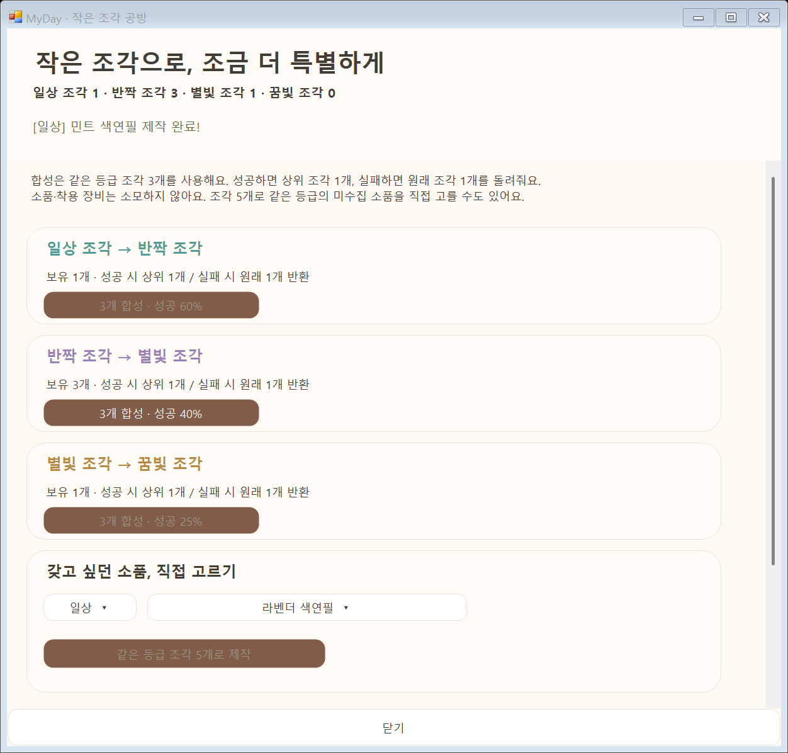
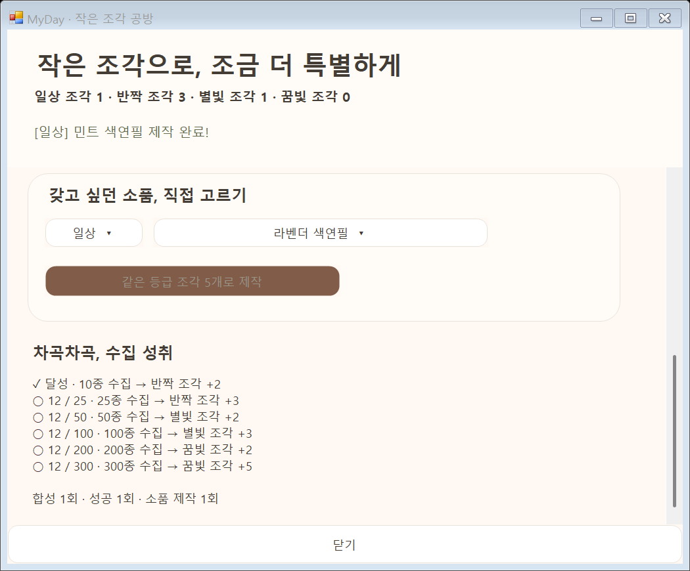

# 등급 선물과 작은 조각 공방

Windows는 **옷장 → 소품 뽑기 → 조각 합성·성취 도감**, Android는 **상몬 → 소품 뽑기 → 조각 합성·성취 도감**에서 엽니다. 실제 결제·유료 재화는 없으며 기존 Lv.100 / 약 100·200·300일 성장 규칙은 유지합니다.

## 재화와 등급

| 등급 | 기본 뽑기 확률 | 중복 꽃잎 | 원하는 소품 꽃잎 교환 |
| --- | ---: | ---: | ---: |
| 일상 | 65% | 3 | 15 |
| 반짝 | 25% | 6 | 30 |
| 별빛 | 9% | 12 | 60 |
| 꿈빛 | 1% | 24 | 120 |

**클로버**는 기존 출석·기록·성장으로 모아 20개에 한 번 뽑습니다. **꽃잎**은 중복 소품에서 얻어 미수집 소품을 직접 고릅니다. 새 뽑기는 소품과 함께 **동일 등급 조각 1개**를 지급합니다. 조각은 등급별로 따로 보관하며 합성이나 제작에 사용합니다. 이미 보유한 소품은 합성 재료가 되지 않습니다.

300종의 ID·외형·착용 효과는 유지하고, 50가지 소품 모양에 고정 등급을 부여합니다. 무료 기본 8종은 일상 등급으로 보존하고 뽑기에서 제외합니다. 등급은 수집 희소도이며 활동 경험치를 늘리거나 상대보다 강해지는 기능이 아닙니다.

먼저 등급을 뽑고 그 등급의 대상 소품을 균등하게 고릅니다. 일반 뽑기 대상은 일상 145·반짝 90·별빛 46·꿈빛 11종입니다. 따라서 개별 소품 확률은 해당 등급 확률 ÷ 등급 내 대상 수입니다. **10번째마다 미수집 소품을 보장**하며 이때 수집이 끝난 등급은 제외하고 남은 등급 가중치를 비례 배분합니다. 예를 들어 꿈빛만 남았다면 보장 회차는 꿈빛 100%입니다. 모두 모으면 일반 뽑기로 돌아갑니다. 교환·제작은 뽑기 횟수에 포함하지 않습니다.

## 조각 합성과 확정 제작

| 합성 | 사용 조각 | 성공률 | 성공 | 실패 |
| --- | ---: | ---: | --- | --- |
| 일상 → 반짝 | 일상 3개 | 60% | 반짝 1개 | 일상 1개 반환 |
| 반짝 → 별빛 | 반짝 3개 | 40% | 별빛 1개 | 반짝 1개 반환 |
| 별빛 → 꿈빛 | 별빛 3개 | 25% | 꿈빛 1개 | 별빛 1개 반환 |

합성에는 클로버·꽃잎·소품을 사용하지 않습니다. 실패하면 원래 조각 1개가 돌아오므로 실제 조각 감소량은 2개입니다. 꿈빛은 최상위로 추가 승급하지 않습니다. 매회 독립 확률이며 연속 성공이나 특정 횟수 내 성공을 보장하지 않습니다.

**같은 등급 조각 5개**로 해당 등급의 미수집 소품 하나를 골라 확정 제작합니다. 원하는 목표를 정해 모을 수 있고, 이미 보유한 소품에는 재료를 쓸 수 없습니다. 성공·실패·제작 결과 모두 저장에 성공해야 확정되며 저장 실패 시 재료와 소유권을 되돌립니다.

## 수집 성취

| 서로 다른 보유 소품 | 자동 추가 보상 |
| ---: | --- |
| 10종 | 반짝 조각 2개 |
| 25종 | 반짝 조각 3개 |
| 50종 | 별빛 조각 2개 |
| 100종 | 별빛 조각 3개 |
| 200종 | 꿈빛 조각 2개 |
| 300종 | 꿈빛 조각 5개 |

기본 8종과 이전에 보존한 소품도 보유 수에 포함합니다. 이미 달성한 구간은 새 앱에서 자동 반영합니다. 같은 지급 이력을 다시 읽거나 백업을 반복 병합해도 보상은 한 번만 계산됩니다. 공방에는 수집 목표·달성 표시와 합성 시도/성공·제작 횟수가 나옵니다.

## 이전 기록과 백업

버전 1~7의 일기·XP·소품·클로버·꽃잎·뽑기 내역은 계속 읽습니다. 예전 `draw`는 기존 균등 뽑기/중복 꽃잎 3개, 예전 `exchange`는 당시 꽃잎 15개 비용으로 재생합니다. 이미 사용한 꽃잎을 새 등급 가격으로 소급 차감하지 않습니다. 예전 뽑기에 조각을 소급 지급하지 않으며 달성한 수집 성취 조각만 추가됩니다.

새 뽑기·등급 교환·합성·제작은 **버전 8**에 저장합니다. 행동 종류와 결과로 재화·조각을 재계산하고 임의 잔액 필드를 신뢰하지 않습니다. 같은 백업을 다시 가져와 재료를 복구할 수 없으며 두 기기에서 따로 진행한 뽑기·합성·제작 이력은 병합을 거부합니다. Windows·Android 모두 이 버전을 지원하는 최신 앱을 사용하세요. Mac 앱의 버전 1~4 백업 호환 범위는 별도입니다.

개발 시 확률·표시 색을 바꿔도 이미 저장한 결과는 다시 뽑지 않습니다. 등급 분류·교환 비용·합성 소모/환급·성취 보상은 이력 재계산에 영향을 주므로, 배포 이후 변경할 때는 이전 정책을 보존하는 새 정책 버전과 마이그레이션을 함께 구현해야 합니다. 같은 정책 버전의 값을 덮어써 이전 지출을 소급 변경하지 마세요.

## 수정 파일

| 바꿀 내용 | 원본/연결 |
| --- | --- |
| 등급 이름·확률·색·중복 꽃잎·교환 비용·합성률·성취 보상 | [shared/collection.json](../shared/collection.json), 수정 후 `python tools/sync-desktop.py` |
| Windows 재화·뽑기·이력 병합 | [SangmonCollection.cs](../windows/Core/SangmonCollection.cs) |
| Windows 등급·합성·제작·성취 | [SangmonAtelier.cs](../windows/Core/SangmonAtelier.cs) |
| Windows 선물 상자·공방 | [CollectionWindow.cs](../windows/UI/CollectionWindow.cs), [AtelierWindow.cs](../windows/UI/AtelierWindow.cs) |
| Windows 저장 확정·실패 복구 | [DiaryWindow.Collection.cs](../windows/UI/DiaryWindow.Collection.cs) |
| Android 같은 규칙·화면·저장 연결 | [CollectionRules.kt](../app/src/main/java/com/myday/diary/diary/CollectionRules.kt), [PhoneCollection.kt](../app/src/main/java/com/myday/diary/ui/diary/PhoneCollection.kt), [PhoneAtelier.kt](../app/src/main/java/com/myday/diary/ui/diary/PhoneAtelier.kt), [NotebookController.kt](../app/src/main/java/com/myday/diary/diary/NotebookController.kt) |
| 확률 경계·소모·환급·중복 지급·예전 이력·저장 검사 | [AtelierTests.cs](../windows/AtelierTests.cs), [AtelierTest.kt](../app/src/test/java/com/myday/diary/diary/AtelierTest.kt) |
| 실제 Windows → Android → Windows 버전 8 검사 | [WindowsAtelierInterop.cs](../tools/WindowsAtelierInterop.cs), [windows-v8.json](../app/src/test/resources/windows-v8.json) |

## 검증 결과

소스 `e68d4e6`의 [Windows 전체 CI](https://github.com/parkhookjung-debug/myday-diary/actions/runs/39445233044)와 [공통 Mac·Windows CI](https://github.com/parkhookjung-debug/myday-diary/actions/runs/39445233055)가 통과했습니다. Windows 기본 검사 241개, 공통 원본 생성 검사 7개, 실제 공방의 합성·제작·실패 환급·파일 잠금 시 복구·작은 창 검사를 확인했습니다.

[Android CI](https://github.com/parkhookjung-debug/myday-diary/actions/runs/39445233123)의 APK·Lint·JVM 단계도 통과했습니다. 새 `AtelierTest` 5개는 확률 경계·합성·보존·실패 복구와 실제 Windows 버전 8 fixture를 확인합니다. Android가 내보낸 `android-v8-to-windows.json`을 실제 Windows 직렬화 도구로 읽어 조각 `[1,1,1,0]`, 클로버 10,975, 꽃잎 24, 합성 2회·제작 1회·성취 10종이 일치하는 왕복 검사도 통과했습니다. 문서 작성 시점의 Android 에뮬레이터 전체 화면 검사는 진행 중입니다.
