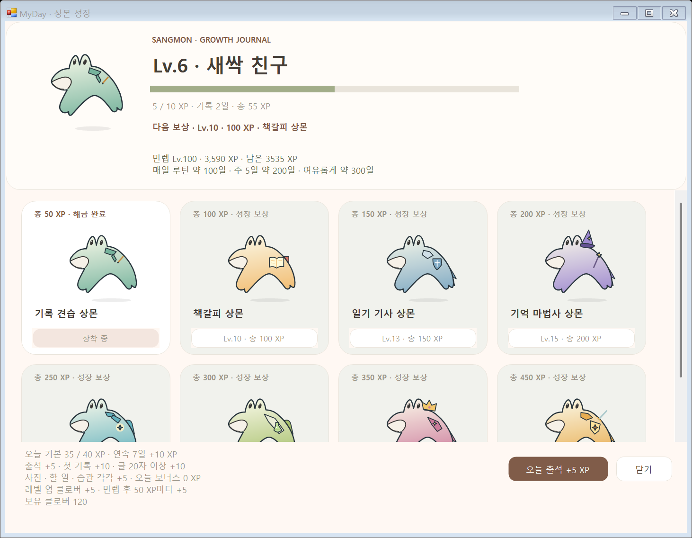
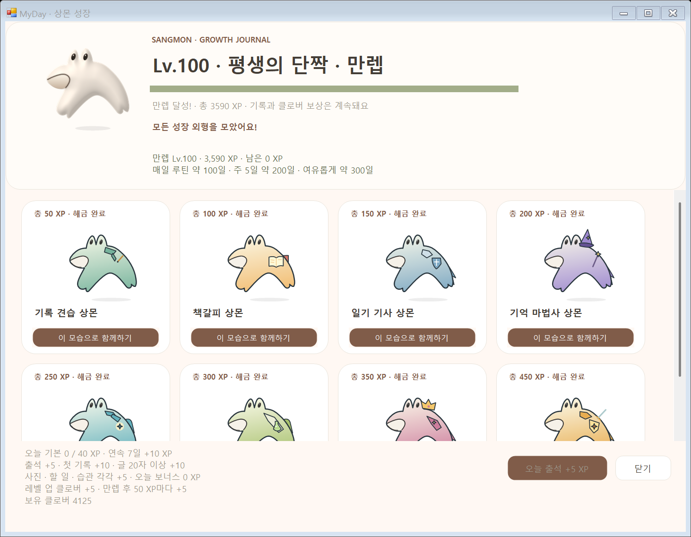

# 상몬 레벨업 · 출석과 일기 미션

Windows는 **상몬 성장**, Android는 **상몬 탭 → 오늘의 미션**에서 확인합니다. 오늘 출석 버튼을 누르거나 일기를 작성·저장하면 경험치가 쌓입니다.

## 만렙 목표: 약 100·200·300일

**Lv.100 / 누적 3,590 XP**가 만렙입니다. 2026-10-20에 기존 무제한 레벨을 조정했습니다. 기존 10/20/30/50 XP 레벨 구간과 활동 점수를 유지하고 **연속 7일 출석마다 10 XP**를 더합니다. 사진을 매일 올리지 않아도 꾸준한 루틴으로 100일 안에 도달합니다.

| 사용 패턴 | 실제 활동 예시 | 처음부터 만렙까지의 계산 결과 |
| --- | --- | ---: |
| 꾸준한 매일 루틴 | 매일 출석·20자 이상 일기·할 일 완료·습관 완료 = 기본 35 XP/일 + 7일 연속 보너스 | **99일** |
| 보통 | 매주 5일 출석·20자 이상 일기 = 25 XP/활동일, 이틀 휴식 | **200일** |
| 여유롭게 | 매주 3일 출석·20자 이상 일기, 다른 이틀은 출석만, 이틀 휴식 | **295일** |

위 기간은 새 기록에서 같은 7일 패턴을 반복한 달력 일수이며 Windows와 Android에서 실제 활동 지급 함수를 사용해 검사합니다. 참여량에 따라 성장 속도가 달라집니다. 기존 XP가 있거나 사진 등 추가 미션을 하면 빨라지고, 더 오래 쉬면 기간이 늘어납니다. ‘매일 연락’은 상몬 출석과 기록·체크 루틴으로 반영했습니다. 채팅 전송에는 XP를 주지 않습니다.

2026-10-23 공통화부터 **Windows·Mac·Android**에 같은 성장 규칙을 적용합니다. Mac의 기존 지급 날짜와 XP는 보존합니다. [세 플랫폼 구현·수정 위치](THREE-PLATFORMS.md)

검증 소스 `c9fea68`: [Windows 전체 CI](https://github.com/parkhookjung-debug/myday-diary/actions/runs/39408289256)와 [공통 Mac·Windows CI](https://github.com/parkhookjung-debug/myday-diary/actions/runs/39408289285)가 통과했습니다. Windows 기본 검사 220개·실제 UI/만렙 검사와 공통 원본 검사 6개를 확인했습니다. [Android CI](https://github.com/parkhookjung-debug/myday-diary/actions/runs/39408289409)의 APK 빌드·Lint·JVM 검사(세 성장 패턴 포함) 단계도 통과했습니다. 문서 기록 시점에 Android 에뮬레이터 전체 검사는 진행 중이며 기존 화면 검사 실패 이력은 별도 확인 대상입니다. 로컬 Android Gradle 대기는 종료했고 Android 빌드 검증은 CI에서 수행했습니다.

| 활동 | 점수 | 인정 기준 |
| --- | ---: | --- |
| 출석 | +5 XP | 오늘 출석 버튼, 하루 한 번 |
| 첫 기록 저장 | +10 XP | 글·사진 설명·감정·사진·할 일/습관 완료 등 실제 내용 변경 후 저장 성공 |
| 글 20자 이상 | +10 XP | 글·감정 블록의 공백을 제외한 합계 20자 이상, 해당 글 내용을 새로 작성·수정 |
| 사진 첨부 | +5 XP | 실제 사진 새 첨부 또는 교체 |
| 할 일 완료 | +5 XP | 미완료 → 완료 체크 또는 완료된 새 블록 |
| 습관 완료 | +5 XP | 미완료 → 완료 체크 또는 완료된 새 블록 |
| 연속 출석 보너스 | +10 XP | 연속 출석 7·14·21…번째 날, 기본 일일 미션과 별도 |

**기본 항목별 하루 한 번, 기본 최대 40 XP**입니다. 출석 보너스를 받는 날은 최대 50 XP입니다. 짧은 글을 먼저 저장해 +10을 받은 후 20자를 채우면 같은 날 추가 +10을 받을 수 있습니다. 사진이나 체크를 여러 개 추가해도 해당 항목은 한 번입니다. 글을 고쳐도 예전 사진·이미 완료된 체크에는 새 점수를 주지 않습니다.

## 레벨과 보상

레벨을 네 구간으로 세분화했습니다. 기존 누적 XP를 그대로 사용하며 레벨 숫자는 새 기준으로 다시 표시합니다. 쉬는 날·일기 삭제에도 받은 점수는 유지합니다.

| 현재 레벨 | 성장 단계 | 다음 레벨 필요 XP |
| --- | --- | ---: |
| 1~9 | 새싹 친구 | 10 |
| 10~29 | 일상 친구 | 20 |
| 30~49 | 다정한 동행 | 30 |
| 50~99 | 오래된 단짝 | 50 |
| 100 | 평생의 단짝 · 만렙 | 진행 막대 가득 표시 |

예: 총 50 XP는 Lv.6, 90 XP는 Lv.10, 490 XP는 Lv.30, 1,090 XP는 Lv.50, 3,590 XP는 Lv.100입니다. 레벨마다 클로버 5개를 얻습니다. 만렙 후에도 누적 XP·미션·뽑기를 계속 사용할 수 있고 50 XP마다 추가 클로버 5개를 얻습니다. 이전 Lv.100 초과 사용자의 XP와 이 구간에서 이미 얻고 사용한 클로버도 보존하며 표시 레벨은 100으로 통일합니다.

**캐릭터 해금에 필요한 누적 XP는 이전과 같습니다.** 레벨 중간에 해금될 수 있으므로 화면에 표시되는 누적 XP도 확인하세요.

| 당시 레벨 | 누적 XP | 성장 보상 |
| --- | ---: | --- |
| Lv.6 | 50 | 기록 견습 상몬 |
| Lv.10 | 100 | 책갈피 상몬 |
| Lv.13 | 150 | 일기 기사 상몬 |
| Lv.15 | 200 | 기억 마법사 상몬 |
| Lv.18 | 250 | 별빛 탐험가 상몬 |
| Lv.20 | 300 | 일기 연금술사 상몬 |
| Lv.23 | 350 | 페이지 군주 상몬 |
| Lv.28 | 450 | 추억 용사 상몬 |

기존 캐릭터 56종과 기본 소품 8종은 자유롭게 사용합니다. 나머지 소품은 [선물 상자와 꽃잎 교환](SANGMON-COLLECTION.md)으로 얻어야 입힐 수 있습니다. 꾸미기·뽑기·교환은 XP를 지급하지 않습니다.

## 중복 지급과 이전 기록

- 기준 날짜는 **저장에 성공한 기기의 현지 날짜**입니다. 일기에서 선택한 과거/미래 날짜가 아닙니다. 같은 날 다른 날짜의 일기를 여러 개 써도 하루 한도가 같습니다.
- 글자 수만 판정하며 AI로 글의 질을 평가하지 않습니다. 빈 블록·빈 사진 자리·테마·기분 선택·배치·장비 변경·단순 순서 변경은 기록 점수를 주지 않습니다.
- 마지막으로 저장된 내용과 비교합니다. 자정을 지나 글을 새로 수정하면 새 날짜의 기록/글 미션을 받을 수 있지만, 그대로 재저장하거나 기존 사진·체크를 그대로 두는 것만으로 받지는 않습니다.
- 저장 실패 시 출석·활동·레벨은 확정하지 않습니다. 일기 초안은 남기고 재시도 성공 시 한 번만 지급합니다.
- 기존 AwardedDays의 **하루 10 XP는 그대로 보존**합니다. 과거 기록에서 새로운 미션 점수를 소급 계산하지 않습니다.
- 기존에 저장된 연속 출석 이력에도 7일 보너스를 계산합니다. 기존 경험치를 빼거나 이력을 초기화하지 않습니다. 출석이 끊기면 연속 일수만 다시 세고, 받은 XP와 보너스는 유지합니다. 출석만 반복하거나 같은 백업을 가져와 보너스를 중복 지급하지 않습니다.
- 백업 병합은 지급 날짜와 항목의 합집합으로 처리합니다. 같은 백업을 다시 가져와도 XP가 더 늘지 않습니다. Windows↔Android 자동 동기화는 아니며, 사용자가 JSON을 옮겨 병합합니다.
- 현지 시각을 사용하는 오프라인 앱입니다. 기기 시계 변경을 서버에서 검증하는 시스템은 없습니다.

## 개발 파일

| 바꿀 내용 | Windows | Android |
| --- | --- | --- |
| 만렙·주간 보너스·기간 시나리오 공통 원본 | [shared/desktop.json / growth·growthProfiles](../shared/desktop.json), 수정 후 `python tools/sync-desktop.py` | 같은 원본에서 `SharedGrowth.g.kt` 생성 |
| 점수·활동 판정·중복 방지·합병 | [SangmonGrowth.cs](../windows/Core/SangmonGrowth.cs) | [NotebookRules.kt](../app/src/main/java/com/myday/diary/diary/NotebookRules.kt) |
| 저장 성공 후 확정·실패 복구 | [DiaryWindow.cs](../windows/UI/DiaryWindow.cs), [DiaryWindow.Growth.cs](../windows/UI/DiaryWindow.Growth.cs) | [NotebookController.kt](../app/src/main/java/com/myday/diary/diary/NotebookController.kt), [NotebookViewModel.kt](../app/src/main/java/com/myday/diary/diary/NotebookViewModel.kt) |
| 레벨·출석·미션 화면 | [GrowthWindow.cs](../windows/UI/GrowthWindow.cs) | [PhoneCompanion.kt](../app/src/main/java/com/myday/diary/ui/diary/PhoneCompanion.kt) |
| 단위 검사 | [GrowthTests.cs](../windows/GrowthTests.cs), [ActivityTests.cs](../windows/ActivityTests.cs) | [WardrobeGrowthTest.kt](../app/src/test/java/com/myday/diary/diary/WardrobeGrowthTest.kt) |
| 99·200·295일 실제 활동·만렙·재화 보존 | [GrowthPaceTests.cs](../windows/GrowthPaceTests.cs) | [GrowthPaceTest.kt](../app/src/test/java/com/myday/diary/diary/GrowthPaceTest.kt) |

활동은 버전 5의 Progress.Activities에 날짜·Flags로 저장하고, XP는 지급 기록에서 계산합니다. 임의의 합계 XP 필드를 중복 저장하지 않습니다. 새 활동을 추가하려면 양쪽 Flags·점수·검증·병합·화면·검사를 함께 수정합니다.

연속 출석 보너스도 같은 지급 이력에서 계산하므로 백업 버전을 올리지 않습니다. 백업을 옮길 때는 새 보너스와 만렙 이후 재화를 같은 방식으로 계산하는 최신 Windows·Android를 함께 사용하세요. `growthProfiles.week`의 1·2·4·8·16은 기존 활동 비트, 32는 시나리오 검사용 ‘기록 저장’ 표시이며 실제 Activities.Flags에는 저장하지 않습니다.

[장비 300종](SANGMON-ITEMS.md) · [성장·뽑기 화면](../previews/applied/collection-v1/README.md)
