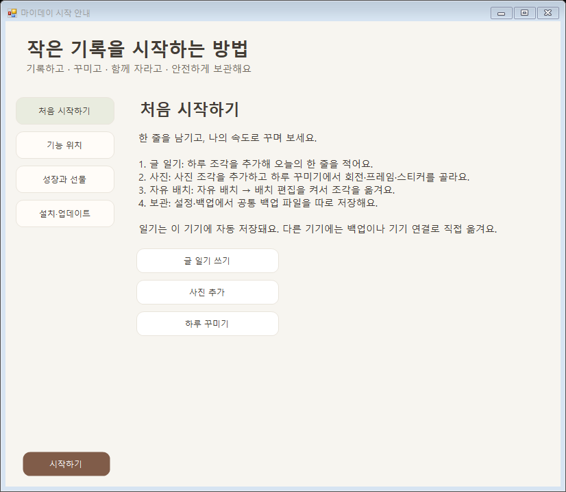
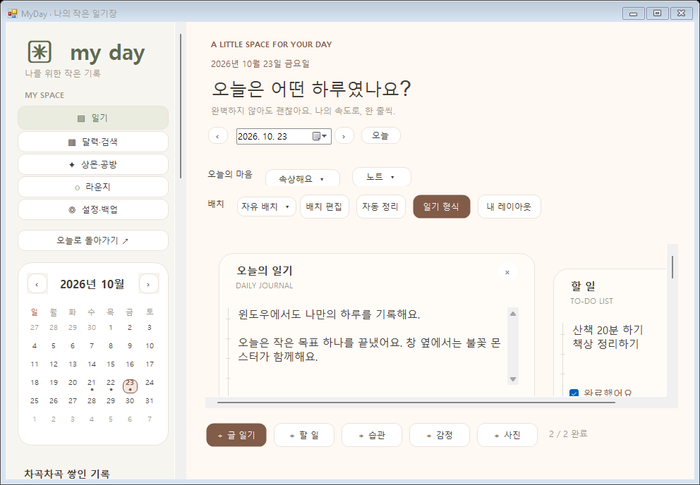
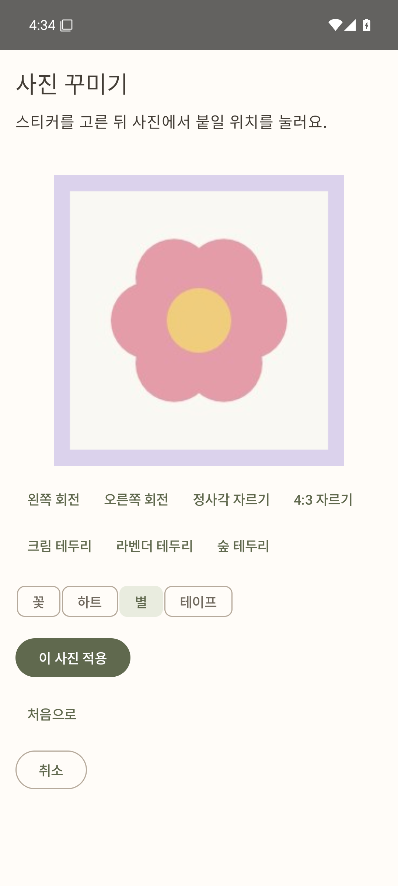
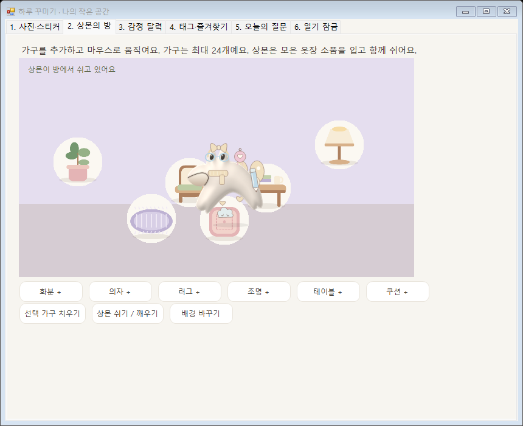
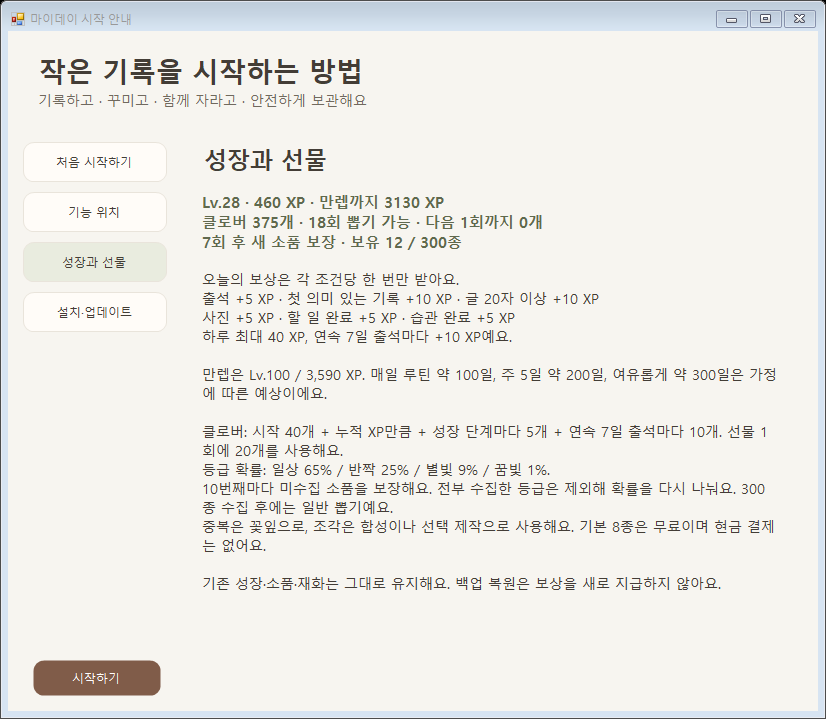
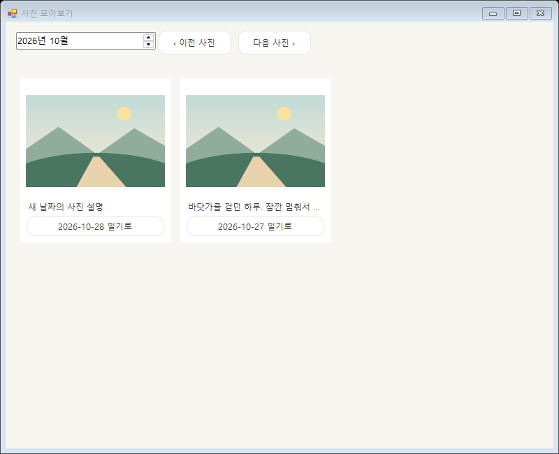
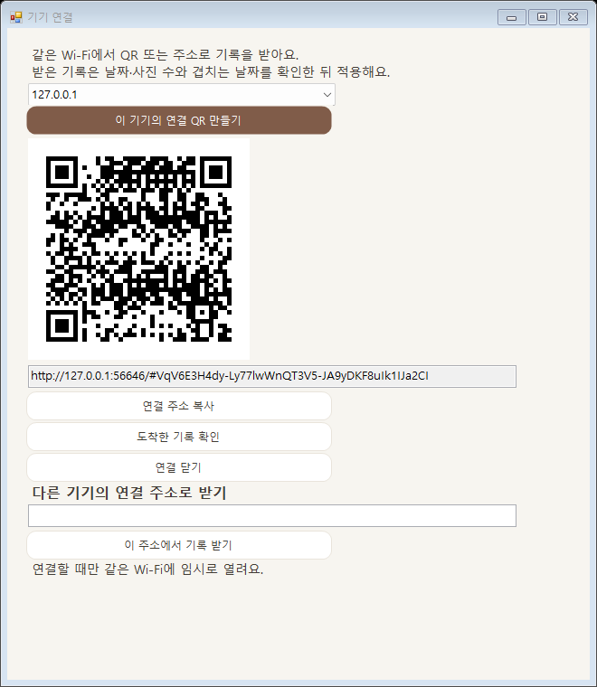

# 마이데이 상세 사용 설명서

앱 0.12.0 · 문서 기준일 2026-10-28 · 소스 cc358ae

설치부터 기록·꾸미기·성장·백업·문제 해결까지 설명합니다. Windows·Mac·Android의 차이와 현재 지원 범위를 함께 확인하세요.

[편집 가능한 Word 설명서](manual/MyDay-0.12.0-User-Manual.docx)

## 목차

- [01 프로그램 소개와 이 설명서를 읽는 방법](#chapter-1)
- [02 실행파일 다운로드와 설치](#chapter-2)
- [03 처음 실행하고 화면 익히기](#chapter-3)
- [04 첫 일기 한 편 완성하기](#chapter-4)
- [05 일기 조각 입력과 자동 저장](#chapter-5)
- [06 날짜와 배경과 종이 스타일](#chapter-6)
- [07 일기 형식 100종 선택하기](#chapter-7)
- [08 조각을 자유롭게 배치하기](#chapter-8)
- [09 내 레이아웃 저장과 재사용](#chapter-9)
- [10 사진 추가와 사진 편집](#chapter-10)
- [11 상몬의 방 꾸미기](#chapter-11)
- [12 감정 달력과 태그와 즐겨찾기](#chapter-12)
- [13 오늘의 질문으로 기록 시작하기](#chapter-13)
- [14 상몬 선택과 일상 반응](#chapter-14)
- [15 출석과 경험치와 레벨](#chapter-15)
- [16 소품 300종과 옷장](#chapter-16)
- [17 선물 상자와 클로버와 꽃잎](#chapter-17)
- [18 조각 합성과 원하는 소품 제작](#chapter-18)
- [19 달력과 검색과 사진 앨범](#chapter-19)
- [20 월간 리포트와 일기 알림](#chapter-20)
- [21 휴지통과 수정 이력으로 복원하기](#chapter-21)
- [22 수동 백업과 자동 백업](#chapter-22)
- [23 백업 가져오기와 여러 기기의 충돌](#chapter-23)
- [24 같은 Wi Fi에서 QR로 기록 이동하기](#chapter-24)
- [25 PIN 잠금과 저장 오류 복구](#chapter-25)
- [26 로컬 라운지 채팅](#chapter-26)
- [27 기기별 조작과 데이터 보관 위치](#chapter-27)
- [28 문제 해결과 자주 묻는 질문](#chapter-28)
- [29 팀 사용성 점검과 발표 시연](#chapter-29)
- [30 부록 자주 쓰는 기능 바로 찾기](#chapter-30)
- [31 부록 숫자와 저장 범위 요약](#chapter-31)
- [32 부록 오늘의 질문 전체 목록](#chapter-32)
- [33 부록 일기 형식 100종 찾아보기](#chapter-33)
- [34 부록 상몬 64종과 소품 모양 찾기](#chapter-34)
- [35 부록 공동 작업자가 수정할 파일](#chapter-35)
- [36 부록 실행파일 출처와 상세 자료](#chapter-36)

<a id="chapter-1"></a>

## 01 프로그램 소개와 이 설명서를 읽는 방법

마이데이 MyDay는 날짜별 일기를 글·사진·할 일·습관·감정 조각으로 구성하고, 페이지를 자유롭게 배치하며 상몬을 꾸미고 성장시키는 프로그램입니다. 이 설명서는 처음 설치한 사용자와 팀원이 0.12.0의 기능을 직접 사용하고 확인할 수 있도록 작성했습니다.

기준 앱 버전은 0.12.0이며 설명서 작성일은 2026년 10월 28일입니다. 앱 버전과 백업 형식 버전은 다릅니다. 현재 앱은 공통 백업 형식 1~9를 읽으며 방·태그·즐겨찾기를 포함한 꾸미기 기록은 형식 9를 사용합니다. 나중에 올라온 다른 버전이나 예전 Releases 실행파일은 이 설명서의 화면과 다를 수 있습니다.

| 하고 싶은 일 | 먼저 읽을 장 |
| --- | --- |
| 처음 설치하고 일기 한 편 쓰기 | 설치와 업데이트 → 처음 실행 → 일기 조각 |
| 나만의 일기 형식 만들기 | 일기 형식 → 자유 배치 → 내 레이아웃 |
| 사진과 상몬을 아기자기하게 꾸미기 | 사진 → 상몬의 방 → 상몬 선택 → 옷장 |
| 레벨과 뽑기 규칙 이해하기 | 성장과 출석 → 선물 상자 → 합성과 제작 |
| 다른 기기로 기록 옮기기 | 수동 백업 → 기기 연결 → 경제 기록 충돌 |
| 기록이 사라졌거나 앱이 열리지 않기 | 휴지통과 이력 → 시작 오류 복구 → 문제 해결 |

### 지원 환경과 공통 기능

| 구분 | Windows | Mac | Android |
| --- | --- | --- | --- |
| 지원 환경 | Windows 10 또는 11과 .NET Framework 4.8 | macOS 13 이상 Apple Silicon 개발 빌드 | Android 8 이상 갤럭시와 호환 기기 |
| 주요 메뉴 | 왼쪽 사이드바 | 왼쪽 사이드바 | 하단 다섯 탭 |
| 글과 사진과 자유 배치 | 지원 | 지원 | 지원 |
| 상몬과 성장과 소품 | 64종과 300소품 및 공통 규칙 | 같은 공통 규칙 | 같은 공통 규칙 |
| 기기 전용 기능 | 바탕화면 상몬과 트레이 | 바탕화면 상몬과 메뉴 막대 | 햅틱과 홈 위젯 및 라이브 배경화면 |

Mac용으로 제공한 실행파일은 Apple Silicon ARM64용입니다. Intel Mac은 해당 환경에서 소스 빌드가 필요하며 이 설명서의 배포 ZIP을 Intel 실행파일로 설명하지 않습니다. Android의 터치와 진동, 각 운영체제의 파일 선택기와 알림 창은 서로 다릅니다.

### 현재 제공하지 않는 기능

- 동영상 첨부와 재생 및 영상 편집
- 감정처리반 캐릭터의 AI 답변이나 감정 진단
- 회원가입과 계정 기반 자동 동기화 및 공개 채팅 서버
- 친구 목록과 일대일 대화 및 채팅 사진 첨부
- 장비에 따른 전투 능력치나 경쟁 시스템
- PIN을 통한 일기 파일 전체 암호화와 계정 기반 PIN 찾기

화면 예시는 테스트용 기록으로 촬영했습니다. 일부 그림은 0.8~0.11에서 촬영한 기존 기능 화면이므로 세부 색·여백·버튼 번호가 다를 수 있습니다. 0.12에서 촬영한 안내와 Android 사진 편집 화면은 캡션에 구분했습니다. 버튼 번호보다 기능 이름을 기준으로 찾아주세요.

<a id="chapter-2"></a>

## 02 실행파일 다운로드와 설치

### GitHub에서 현재 버전 받기

1. 이 설명서 끝의 실행파일 출처 링크 또는 저장소 작업 브랜치의 README를 엽니다. 작업 브랜치는 codex/windows-app입니다. main이나 예전 Releases의 실행파일이 자동으로 새 버전으로 바뀌는 것은 아닙니다.
2. 자신의 운영체제에 해당하는 성공한 GitHub Actions 실행을 엽니다. 실패한 실행이나 소스만 올라온 커밋을 실행파일로 착각하지 않습니다.
3. 페이지의 Artifacts에서 해당 항목을 내려받습니다. GitHub 로그인이 필요할 수 있습니다. 받은 ZIP을 먼저 압축 해제합니다.
4. 아래 표에서 실제 실행할 파일을 찾습니다. Windows EXE를 Mac에서 열거나 Mac 앱을 Windows에서 실행할 수는 없습니다.

| 운영체제 | Artifacts 항목 | 압축을 푼 뒤 사용할 것 |
| --- | --- | --- |
| Windows | myday-windows-63 | bin/MyDay.exe |
| Mac | myday-chat-macOS-ARM64 | MyDay-macOS-arm64-v0.12.0-preview.zip 안의 MyDay.app |
| Android | myday-debug-69 | outputs/apk/debug/app-debug.apk |

Artifacts는 영구 배포 저장소가 아닙니다. 현재 설정의 보관 기간은 플랫폼에 따라 7~14일입니다. 만료되었다면 공동 작업자가 해당 브랜치에서 빌드를 다시 실행하거나 소스에서 빌드해야 합니다. 설명서에 기록된 0.12.0 파일의 소스와 해시는 부록의 빌드 출처에서 확인합니다.

### Windows 설치와 첫 실행

1. 압축을 푼 폴더에서 MyDay.exe를 찾습니다. 공유받은 전체 묶음에서는 이름이 MyDay-Windows.exe일 수 있습니다.
2. 실행파일을 보관할 폴더에 둡니다. 실행파일의 위치와 개인 기록 저장 폴더는 분리되어 있습니다.
3. 파일을 실행합니다. 처음 시작하는 빈 사용자에게는 일기 창과 사용 안내가 열립니다. 기존 사용자에게는 바탕화면 상몬을 중심으로 시작할 수 있습니다.
4. 일기 창이 보이지 않으면 상몬을 클릭하거나 작업 표시줄 알림 영역의 MyDay 아이콘을 두 번 클릭합니다. 숨겨진 아이콘은 Windows의 알림 영역 펼치기에서 확인합니다.

### Mac 설치와 첫 실행

1. Mac용 ZIP을 압축 해제하고 MyDay.app을 찾습니다. Apple Silicon용인지 확인합니다.
2. 응용 프로그램 폴더 등 원하는 앱 위치에 복사하고 실행합니다. 이 빌드는 개발 서명 앱이며 Apple 공증을 마친 정식 스토어 앱이 아닙니다.
3. macOS가 실행을 제한하면 해당 파일이 이 프로젝트의 검증된 출처인지 확인하고 시스템의 앱 실행 안내를 따릅니다. 조직에서 관리하는 Mac이라면 관리 정책을 우회하지 말고 담당자에게 확인합니다.
4. 일기 창과 메뉴 막대의 MyDay 메뉴를 확인합니다. 최초 안내가 표시되면 시작하기를 눌러 일기로 이동합니다.

### Android와 갤럭시 설치

1. APK를 휴대폰에 내려받거나 전송한 뒤 파일 앱에서 엽니다. ZIP 안에 들어 있다면 먼저 압축을 풉니다.
2. Android가 해당 파일 앱이나 브라우저의 설치 허용을 요청하면 현재 설치 흐름에 필요한 출처인지 확인하고 시스템 안내를 따릅니다.
3. 설치 후 MyDay를 엽니다. 처음 사용하는 빈 사용자에게 사용 안내가 나타납니다.
4. 사진·알림·위젯·배경화면 등은 실제로 해당 기능을 사용할 때 시스템 선택이나 권한 확인이 필요할 수 있습니다. 모든 권한을 한꺼번에 미리 켤 필요는 없습니다.

### 기존 사용자의 업데이트 순서

1. 기존 앱에서 설정·백업 → 공통 백업 다운로드를 실행하고 JSON을 앱 밖의 안전한 폴더에 보관합니다.
2. Windows는 트레이의 모두 종료, Mac은 앱 종료로 완전히 끝냅니다. 창 숨기기와 앱 종료는 다릅니다.
3. Windows는 새 EXE로, Mac은 새 MyDay.app으로 교체합니다. 개인 기록 폴더를 삭제하지 않습니다.
4. Android는 앱 ID와 서명이 일치해야 덮어 설치할 수 있습니다. 개발용 APK는 실행마다 같은 서명이라고 보장하지 않습니다. 서명 불일치가 나오면 백업 확인 없이 기존 앱을 삭제하거나 데이터를 지우지 않습니다.
5. 새 버전에서 최근 일기·사진·자유 배치·상몬·소품·재화가 그대로인지 확인합니다. 백업 파일은 확인이 끝나도 별도로 보관합니다.

<a id="chapter-3"></a>

## 03 처음 실행하고 화면 익히기

### 사용 안내에서 시작하기

0.12.0의 사용 안내는 처음 시작하기, 기능 위치, 성장과 선물, 설치·업데이트의 네 부분입니다. 처음 시작하기에서 글 일기 쓰기, 사진 추가, 하루 꾸미기로 이동할 수 있습니다. Mac의 사진 바로가기는 사진 조각을 만든 뒤 그 조각에서 사진을 선택하는 흐름입니다.

1. 처음 시작하기에서 일기의 기본 흐름을 읽습니다.
2. 기능 위치에서 일기·상몬·보관 기능이 어디 있는지 확인합니다.
3. 글 일기 쓰기로 이동하거나 시작하기로 안내를 닫습니다.
4. 나중에는 설정·백업 → 처음 시작하기 · 사용 안내에서 다시 엽니다. 안내 완료 여부는 이 기기에만 남고 다른 기기로 옮기는 백업에는 포함되지 않습니다.



### 다섯 가지 기본 메뉴

| 메뉴 | 여기서 할 수 있는 일 |
| --- | --- |
| 일기 | 날짜 선택, 글과 사진과 체크 조각, 형식 선택, 자유 배치 |
| 달력·검색 | 월별 날짜 선택, 저장된 내용과 사진 설명 찾기 |
| 상몬·공방 | 캐릭터 선택, 옷장, 출석과 성장, 선물 상자, 합성과 제작 |
| 라운지 | 운영자가 실행한 로컬 채팅방 입장과 텍스트 대화 |
| 설정·백업 | 테마와 기기 설정, 사용 안내, 꾸미기와 기록 도구, 백업과 복원 |

### 하루 꾸미기와 기록 도구의 차이

| 기능 묶음 | 들어 있는 기능 | 대표 진입 위치 |
| --- | --- | --- |
| 하루 꾸미기 | 사진·스티커, 상몬의 방, 감정 달력, 태그·즐겨찾기, 오늘의 질문, 일기 잠금 | Windows와 Mac 사이드바 또는 설정, Android 일기 칩 또는 설정 |
| 기록 도구 | 휴지통·이력, 월간 리포트, 알림, 기기 연결, 사진 모아보기, 자동 백업, 업데이트 | 사이드바 또는 설정·백업 |

Windows와 Mac은 기능별 창이나 시트를 따로 열 수 있고 Android는 전체 화면 대화상자나 탭으로 이동합니다. 화면을 닫으면 보통 원래 일기로 돌아갑니다. 실제 기능 이름은 같지만 버튼의 구두점과 번호는 조금 다를 수 있습니다.

<a id="chapter-4"></a>

## 04 첫 일기 한 편 완성하기

아래 예제는 프로그램의 주요 흐름을 한 번에 익히는 연습입니다. 실제 개인 기록 대신 샘플 내용을 사용해도 됩니다. 상몬 보상은 저장 성공 여부와 실제 사용 날짜를 기준으로 계산합니다.

1. 일기 메뉴에서 오늘 날짜를 선택합니다. 다른 날짜를 보고 있다면 오늘 또는 오늘로 돌아가기를 누릅니다.
2. Windows는 아래의 ＋ 글 일기, Android는 하루 조각 추가 → 글 일기, Mac은 글 조각 추가 버튼을 사용합니다. 처음부터 빈 글 조각이 있다면 그 조각을 그대로 사용해도 됩니다.
3. 글 칸에 오늘 한 일을 적습니다. 예를 들어 “오늘은 산책을 하고 프로젝트 사용법을 함께 정리했다”처럼 적습니다.
4. 할 일 조각을 추가하고 “일기 사용법 익히기”를 적은 뒤 완료 체크를 합니다.
5. 습관 조각을 추가하고 “잠들기 전 하루 정리”처럼 반복하고 싶은 행동을 적습니다. 이 조각은 해당 날짜의 기록이며 전체 날짜에 자동 생성되는 습관 예약은 아닙니다.
6. 사진 조각을 추가해 샘플 사진 한 장을 선택하고 사진 설명을 적습니다.
7. 오늘의 마음을 고르고, 원하면 배경과 종이 스타일을 바꿉니다.
8. 저장 중 표시가 있다면 완료될 때까지 기다립니다. 저장 오류가 보이면 다른 날짜로 넘어가기 전에 다시 저장을 실행합니다.
9. 다른 날짜로 갔다가 오늘로 돌아와 글과 체크와 사진이 남아 있는지 확인합니다.
10. 상몬·공방에서 출석을 누르고 오늘의 미션을 확인합니다. 출석은 자동 실행이나 앱 열기만으로 대신 누른 것으로 처리되지 않습니다.

연습을 마치면 글·체크·사진이 날짜별로 보관되고 해당 날짜의 페이지를 다시 열 수 있어야 합니다. 일기 내용이 남는 것과 성장 보상을 받는 것은 별개입니다. 단순 테마 변경이나 빈 칸 추가는 기록 보상을 주지 않습니다.



<a id="chapter-5"></a>

## 05 일기 조각 입력과 자동 저장

### 조각의 종류

| 종류 | 쓰는 방법 | 저장되는 것 |
| --- | --- | --- |
| 글 일기 | 본문을 자유롭게 입력 | 입력한 글과 제목 및 질문과 배치 |
| 할 일 | 해야 할 일을 적고 완료 체크 | 글과 완료 상태 |
| 습관 | 실천할 행동을 적고 체크 | 해당 날짜의 글과 완료 상태 |
| 감정처리반 | 캐릭터에게 털어놓듯 마음을 입력 | 입력한 글 AI 응답 없음 |
| 사진 | 시스템 선택기에서 사진을 골라 설명 입력 | 일기에 포함한 사진 사본과 설명 |
| 빈 사진 자리 | 내 레이아웃 등에서 생긴 빈 조각에 사진 선택 | 사진을 넣기 전에는 배치만 존재 |

### 조각의 순서와 삭제

자동 정렬에서는 위로·아래로 버튼 등 화면의 순서 변경 도구를 사용합니다. Android는 제목 영역을 길게 잡아 순서를 옮기는 조작도 지원합니다. 자유 배치는 별도의 배치 편집으로 이동합니다. 글을 드래그해서 선택하려다가 조각 전체를 움직이지 않도록 입력 모드와 배치 편집 모드를 구분합니다.

1. 정리할 조각의 제목 또는 도구 영역을 확인합니다.
2. 순서 버튼으로 앞뒤를 바꾸거나 삭제 버튼을 누릅니다.
3. 삭제 확인이 표시되면 대상이 해당 조각인지 날짜 전체인지 확인합니다.
4. 이전 내용이 필요해지면 기록 도구의 휴지통·이력에서 해당 날짜와 저장 시각을 찾습니다.

### 자동 저장이 처리되는 방식

입력과 체크·배치 변경은 앱 내부 저장소에 자동 저장됩니다. Windows는 짧은 지연 후 저장하고, Android는 저장 요청을 순서대로 처리하며, Mac은 변경을 저장합니다. 세 기기가 인터넷 서버의 같은 문서를 동시에 고치는 방식은 아닙니다.

저장에 실패하면 기존 파일을 잘못된 새 데이터로 덮어쓰지 않도록 처리하고 오류 또는 다시 저장 동작을 제공합니다. 특히 Android의 저장 중·저장 실패 표시는 구분해서 확인합니다. 저장 중에 앱을 강제로 종료하는 것을 정상 저장 완료로 취급하지 않습니다.

- 날짜 이동은 현재 작업의 저장 상태를 확인한 뒤 진행합니다. 저장 실패 상태에서는 이동이나 추가 설정이 제한될 수 있습니다.
- 블록 종류·입력 길이·사진 용량 등 허용 범위를 넘는 기록은 거부합니다.
- 같은 날짜를 여러 기기에서 따로 수정한 뒤 가져오면 글을 문장 단위로 자동 합치지 않습니다. 날짜별 가져오기 규칙은 백업 장에서 확인합니다.

<a id="chapter-6"></a>

## 06 날짜와 배경과 종이 스타일

### 다른 날짜 열기

1. 이전·다음 날짜 버튼, 날짜 선택기, 달력·검색 중 편한 방법을 사용합니다.
2. 원하는 날짜를 선택합니다. 저장 중이거나 오류가 있다면 먼저 저장을 끝냅니다.
3. 해당 날짜에 저장한 기록이 있으면 불러오고, 없다면 빈 일기 또는 기본 조각이 보입니다.
4. 과거와 미래 날짜에 일기를 남길 수 있어도 성장 보상 날짜는 선택한 일기 날짜가 아닌 실제 저장 날짜를 기준으로 합니다.

### 배경과 종이와 마음은 서로 다른 설정

| 설정 | 선택지 | 의미 |
| --- | --- | --- |
| 배경 테마 | 크림 계열, 숲 계열, 라벤더 계열 | 해당 날짜 페이지의 전체 분위기 |
| 종이 스타일 | 노트, 카드, 도트 | 글과 조각을 보여 주는 종이 모양 |
| 오늘의 마음 | 평온해요, 행복해요, 피곤해요, 속상해요, 설레요 | 일기 날짜에 저장하는 감정 값 |
| 상몬과 착용 소품 | 캐릭터와 8개 소품 위치 | 날짜마다 다른 일기 내용이 아니라 공통 상몬 설정 |

배경과 종이는 글·사진을 바꾸지 않습니다. 오늘의 마음은 사용자가 고르거나 기본으로 저장된 값이며, AI가 글을 읽어 감정을 판단한 결과가 아닙니다. 선택을 바꾸지 않았다면 기본값인 평온해요가 남아 있을 수 있습니다.

<a id="chapter-7"></a>

## 07 일기 형식 100종 선택하기

### 형식이 필요한 경우

무엇을 적을지 막막하거나 공부·회고·여행처럼 목적에 맞는 구성이 필요하면 일기 형식을 사용합니다. 형식에는 제목과 질문, 조각 종류와 초기 위치, 종이 스타일이 들어 있습니다. 질문을 자동으로 채워주는 AI 기능은 아닙니다.

1. 일기 화면에서 일기 형식 또는 일기 형식 100종을 엽니다.
2. 이름이나 설명을 검색하거나 분야별 분류를 선택합니다.
3. 미리보기에서 제목·질문·배치와 조각 수를 확인합니다. 예상 작성 시간은 참고용입니다.
4. 사용할 형식을 선택해 적용합니다. 새 페이지에서는 그 형식으로 시작하고 기존 내용이 있으면 원래 기록을 지우지 않는 추가 방식으로 구성합니다.
5. 질문 아래에 본인의 답을 적습니다. 자동으로 만들어진 빈 제목과 질문만으로 기록 보상을 받지는 않습니다.
6. 기존 조각이 많으면 같은 형식을 여러 번 적용하기 전에 새로 추가되는 조각을 확인합니다. 날짜당 200개 제한을 넘기면 적용할 수 없습니다.

| 분야 | 사용 예 |
| --- | --- |
| 일상 기록 | 자유 일기와 하루의 사건 정리 |
| 회고와 성장 | 잘한 일과 아쉬운 점 및 다음 행동 |
| 감사와 행복 | 고마운 사람과 작은 즐거움 |
| 마음 정리 | 감정과 스트레스 및 생각 돌아보기 |
| 학습과 독서 | 공부 정리와 독서 및 코넬 노트 |
| 목표와 계획 | 오늘의 우선순위와 목표 점검 |
| 생활과 루틴 | 자기 돌봄과 생활 습관 |
| 관계와 편지 | 사람과 대화 및 편지 형식 |
| 창작과 취향 | 아이디어와 취미 및 취향 기록 |
| 여행과 추억 | 여행 준비와 돌아보기 및 기념일 |

배치 형식에는 긴 글, 질문 카드, 본문과 메모, 타임라인, 편지, 플래너, 코넬 노트, 나란히 비교가 있습니다. 형식을 적용한 뒤에도 자유 배치와 조각 편집으로 수정할 수 있습니다. 부록에 실제 100종의 이름과 용도를 정리했습니다.

<a id="chapter-8"></a>

## 08 조각을 자유롭게 배치하기

### Windows에서 이동과 크기 조절

1. 일기의 배치 선택을 자유 배치로 바꾸거나 배치 편집을 누릅니다.
2. 조각의 제목 영역을 마우스로 잡고 원하는 위치로 끕니다. 본문 입력 칸과 이동 핸들을 구분합니다.
3. 오른쪽 아래의 대각선 크기 조절 핸들을 끌어 너비와 높이를 바꿉니다.
4. 배치 편집 중에는 글 입력이 잠시 잠길 수 있습니다. 편집 완료로 돌아온 뒤 글을 씁니다.
5. 창 밖에 있는 조각은 화면을 스크롤해서 찾습니다. 드래그 중 Esc나 이동 취소는 해당 이동을 되돌리는 데 사용합니다.

### Mac에서 이동과 크기 조절

1. 자유 배치와 배치 편집을 켭니다.
2. 제목의 이동 영역과 모서리 크기 조절 영역을 마우스나 트랙패드로 끕니다.
3. 넓게 배치한 페이지는 스크롤해서 전체 구성을 확인합니다.
4. 편집을 마치고 입력 모드로 돌아와 본문·사진 설명을 수정합니다.

### Android에서 이동과 확대

1. 일기 → 자유 배치 → 배치 편집을 누릅니다.
2. 조각을 길게 잡아 끌고 오른쪽 아래 핸들로 크기를 조절합니다.
3. 두 손가락 이동과 확대, 화면의 확대 도구나 방향·이동 도구로 멀리 떨어진 조각을 찾습니다.
4. 편집 완료 후 조각을 누르면 내용을 수정하는 편집 창을 엽니다.
5. 기기 터치 피드백이 켜져 있으면 잡기와 놓기 등에 짧은 햅틱이 올 수 있습니다.

### 자동 정렬과 자동 정리

자동 정렬은 조각을 화면 폭에 맞는 순서로 보여 주는 방식이고 자유 배치는 저장한 좌표를 사용하는 방식입니다. 자동 정리는 자유 배치 조각을 정돈하는 실제 배치 변경입니다. 원래 자유 구성을 보존하려면 먼저 내 레이아웃으로 저장하세요. 조각 내용·사진·체크 상태는 배치를 바꾼다고 새로 쓰이지 않습니다.

큰 컴퓨터 화면에서 만든 배치가 휴대폰의 한 화면에 모두 들어갈 필요는 없습니다. 좌표를 보존한 상태로 이동·확대해서 확인합니다. 허용 논리 좌표는 0~10,000, 너비는 300~1,600, 높이는 180~1,400입니다. 화면 픽셀과 똑같은 단위가 아니므로 다른 DPI에서 보이는 실제 크기는 달라질 수 있습니다.

<a id="chapter-9"></a>

## 09 내 레이아웃 저장과 재사용

### 현재 구성을 저장하기

1. 원하는 종류의 조각과 배치를 만듭니다. 사진을 넣을 자리도 준비할 수 있습니다.
2. 내 레이아웃 → 현재 배치 저장을 선택합니다.
3. 찾기 쉬운 이름을 1~40자로 입력합니다. 예를 들어 “사진 두 장과 하루 회고”처럼 용도를 적습니다.
4. 목록에 저장되었는지 확인합니다. 이름 검색·이름 변경·삭제를 사용할 수 있습니다.

| 저장하는 것 | 재사용할 때 새로 시작하는 것 |
| --- | --- |
| 조각 종류와 순서 | 본문과 사진 설명 |
| 제목과 질문 | 할 일과 습관의 완료 체크 |
| 좌표와 크기 및 배치 방식 | 실제 사진 파일은 복사하지 않고 빈 사진 자리로 구성 |
| 배경과 종이 스타일 | 오늘의 마음은 저장한 틀에서 복사하지 않음 |

### 다른 날짜에서 불러오기

1. 사용할 날짜를 엽니다.
2. 내 레이아웃에서 저장한 이름을 찾고 구성을 미리봅니다.
3. 이 배치 불러오기 또는 적용에 해당하는 버튼을 누릅니다.
4. 빈 페이지는 저장한 틀로 시작하고, 이미 내용이 있는 페이지는 원래 기록을 보존하면서 새 조각을 추가합니다. 기존 자유 배치에서는 추가 조각이 원래 구성 아래에 놓일 수 있습니다.
5. 빈 사진 자리에서 사진 선택을 눌러 해당 날짜의 사진을 넣고 본문을 새로 씁니다.

레이아웃은 최대 50개이며 날짜별 조각은 최대 200개입니다. 같은 이름, 너무 긴 이름, 조각 수 초과 등이 있으면 저장이나 적용을 거부할 수 있습니다. 저장한 레이아웃을 삭제해도 이미 각 날짜에 작성한 일기는 삭제되지 않습니다. 공통 백업에는 레이아웃도 포함됩니다.

<a id="chapter-10"></a>

## 10 사진 추가와 사진 편집

### 사진을 일기에 넣기

1. 오늘 또는 원하는 날짜에서 사진 조각 추가를 선택합니다. Windows는 ＋ 사진, Android는 하루 조각 추가 → 사진, Mac은 사진 조각의 선택 버튼을 사용합니다.
2. 운영체제의 사진 또는 파일 선택기에서 한 장을 고릅니다.
3. 일기에서 사진이 표시되면 설명을 적습니다. 사진 설명은 나중에 본문 검색으로 찾을 수 있습니다.
4. 사진을 교체하려면 해당 조각의 사진 바꾸기나 사진 선택 버튼을 사용합니다. 기존 설명과 배치는 유지하는 흐름입니다.
5. 사진 조각 전체를 지우려면 조각 삭제를 사용합니다. 삭제 전 기록은 이력 보관 규칙에 따라 복구할 수 있습니다.

| 항목 | 지원과 제한 |
| --- | --- |
| Windows 입력 형식 | JPG와 JPEG 및 PNG와 BMP와 GIF 정지 이미지 변환 |
| Mac 입력 형식 | JPEG와 PNG 및 HEIC와 TIFF 선택 |
| 입력 파일 크기 | Windows와 Android 20MiB 이하 Mac은 선택 단계에서 40,000,000바이트 이하 검사 |
| 공통 편집 결과 | 긴 변 1,600px 이하의 JPEG 사본 사진 한 장 2MiB 이하 |
| 큰 원본 해상도 | Windows와 Android는 입력 해상도와 픽셀 수도 검사 원본을 작게 줄이면 호환이 쉬움 |
| 사진 저장 방식 | 사진 사본을 일기 데이터에 포함 원본 파일 자체는 수정하지 않음 |
| 애니메이션과 영상 | GIF를 움직이는 사진으로 보존하거나 영상을 첨부하는 기능은 제공하지 않음 |

서로 다른 OS로 옮길 목적이라면 입력 형식이 달라도 최종적으로 공통 규격의 JPEG로 저장되는 사진을 사용합니다. Mac에서 선택 단계가 통과했더라도 다른 OS의 공통 용량 검증에서 거부되는 큰 사진은 크기나 화질을 줄여 다시 넣습니다. 앱은 원본 고해상도 사진을 영구 보관하는 사진 관리 프로그램이 아닙니다.

### 자르기와 프레임과 사진 위 스티커

1. 하루 꾸미기 → 사진·스티커를 엽니다. 해당 날짜에 첨부된 사진 중 편집할 것을 선택합니다. Windows는 일기 사진을 두 번 눌러 편집할 수도 있습니다.
2. 사진 꾸미기에서 왼쪽·오른쪽 회전으로 방향을 맞춥니다.
3. 가운데 정사각 자르기 또는 4:3 자르기를 사용합니다. 현재 기능은 중앙을 기준으로 자르며 자유롭게 영역을 그리는 자르기는 아닙니다.
4. 크림·라벤더·숲 중 프레임을 선택합니다. 이미 프레임을 만든 상태에서 다시 누르면 효과가 겹칠 수 있으므로 미리보기를 확인합니다.
5. 꽃·하트·별·테이프 중 스티커를 고른 뒤 사진 안에서 붙일 위치를 누릅니다.
6. 처음으로는 현재 편집 결과를 초기 상태로 돌립니다. 취소는 기존 일기 사진을 유지합니다.
7. 이 사진 적용을 눌러야 편집 결과가 일기에 반영됩니다. 저장 오류가 나타나면 완료로 취급하지 말고 기존 사진과 재시도 상태를 확인합니다.



### 독립 스티커 조각

하루 꾸미기의 꽃·하트·별·테이프 추가는 사진 위에 붙이는 기능과 별개입니다. 독립 스티커는 크림색 바탕이 있는 사진 조각으로 일기에 들어갑니다. 자유 배치에서 다른 조각처럼 옮기고 크기를 조절합니다. 투명 배경 스티커 파일을 별도로 저장하거나 외부 스티커 팩을 불러오는 기능은 아닙니다.

<a id="chapter-11"></a>

## 11 상몬의 방 꾸미기

1. 하루 꾸미기 → 상몬의 방을 엽니다.
2. 화분·의자·러그·조명·테이블·쿠션 중 추가할 가구의 버튼을 누릅니다. 같은 종류를 여러 개 놓을 수 있습니다.
3. 가구를 마우스 또는 손가락으로 잡고 원하는 위치로 끕니다. 선택 표시가 있는 가구와 상몬을 구분합니다.
4. 선택 가구 치우기로 가구를 제거합니다. 다른 일기 조각이나 옷장 소품을 삭제하는 동작은 아닙니다.
5. 배경 바꾸기로 세 가지 방 분위기를 바꿉니다.
6. 상몬 쉬기 / 깨우기로 방 안 상몬의 휴식 동작을 바꿉니다. 이 동작 상태는 방을 보는 동안의 임시 상태이며 성장 점수를 소비하거나 지급하지 않습니다.
7. 방을 나갔다가 다시 열어 가구와 위치가 저장되어 있는지 확인합니다.

방 가구는 기본 무료 6종이며 최대 24개입니다. 옷장의 300소품과 별도의 기능이므로 가구를 놓기 위해 소품을 뽑을 필요가 없습니다. 방 안 상몬은 현재 선택한 외형과 착용 소품을 사용합니다. 방 배경과 가구는 공통 백업에 포함되는 전체 방 설정이며 날짜마다 별개의 방을 만드는 구조는 아닙니다.



<a id="chapter-12"></a>

## 12 감정 달력과 태그와 즐겨찾기

### 감정 달력 보기

1. 하루 꾸미기 → 감정 달력을 엽니다.
2. 원하는 달을 선택하거나 이전·다음 달로 이동합니다.
3. 날짜에 표시된 저장 감정과 색을 확인합니다.
4. 날짜를 누르면 그날의 일기로 이동합니다. 기분을 바꾸려면 해당 일기에서 오늘의 마음을 수정합니다.

감정 달력은 저장된 기분 값을 표시하는 기능입니다. 글을 분석해 감정을 추측하지 않습니다. 기분을 따로 고르지 않았다면 기본값 평온해요가 저장될 수 있으므로 색이 표시되었다는 이유만으로 사용자가 그날 감정을 적극적으로 입력했다고 해석하지 않습니다. 기록이 없는 날짜의 감정을 만들어내지도 않습니다.

### 태그 저장과 즐겨찾기

1. 분류할 날짜의 일기를 열고 하루 꾸미기 → 태그·즐겨찾기로 이동합니다.
2. 태그 입력칸에 “학교, 산책, 프로젝트”처럼 쉼표로 구분해서 입력합니다.
3. 중요한 날은 이날을 즐겨찾기에 체크합니다.
4. 이날의 분류 저장 또는 저장 버튼을 누릅니다. 체크나 입력만 하고 저장 버튼을 누르지 않은 상태와 구분합니다.
5. 아래 태그 검색이나 즐겨찾기만 필터에서 날짜를 찾아 누릅니다.

| 규칙 | 동작 |
| --- | --- |
| 태그 개수 | 하루 최대 10개 |
| 태그 길이 | 각 태그 최대 20자 |
| 기호와 중복 | 앞의 #는 생략 가능 영문 대소문자 중복 정리 |
| 검색 범위 | 태그 검색은 분류한 태그를 찾음 본문 검색과 별개 |
| 결과 표시 | 최신 날짜부터 최대 100개 |
| 성장 보상 | 태그와 즐겨찾기 변경 자체는 XP를 주지 않음 |

태그와 즐겨찾기는 날짜별 분류 정보입니다. 태그에 일기 본문을 길게 넣는 대신 짧은 검색어를 사용합니다. 일기 내용을 수정하거나 사진 설명을 찾으려면 달력·검색을 사용합니다. 꾸미기 자료를 가져오면 같은 날짜의 태그·즐겨찾기는 가져온 정보가 우선할 수 있습니다.

<a id="chapter-13"></a>

## 13 오늘의 질문으로 기록 시작하기

1. 하루 꾸미기 → 오늘의 질문을 엽니다.
2. 현재 일기 날짜의 질문을 읽습니다.
3. 이 질문으로 일기 쓰기를 누릅니다. 질문과 제목이 들어 있는 빈 글 조각이 추가됩니다.
4. 일기 화면에서 질문 아래에 자신의 답을 씁니다.
5. 이미 같은 질문을 추가했다면 중복 추가가 제한되므로 기존 질문 조각을 찾아 이어 씁니다.

질문은 기기 안의 공통 목록 12개에서 날짜에 따라 정합니다. 같은 날짜에는 Windows·Mac·Android가 같은 질문을 제공합니다. 매번 AI가 새로운 질문을 만들어 주거나 답변을 외부로 전송하지 않습니다. 날짜를 바꾸어 질문을 확인하는 것과 질문만 추가하는 것으로는 작성 보상을 받지 않습니다.

예를 들어 “오늘 나를 웃게 한 작은 일은?”이라는 질문이 나오면 그날 있었던 장면을 적습니다. 질문이 다시 돌아오는 것은 오류가 아니라 12개 공통 목록을 날짜별로 사용하는 현재 방식입니다. 전체 질문 목록은 부록에 실었습니다.

<a id="chapter-14"></a>

## 14 상몬 선택과 일상 반응

### 캐릭터 바꾸기

1. 상몬·공방 → 상몬 64종을 엽니다.
2. 원하는 외형을 미리 보고 사용할 수 있는 것을 선택합니다.
3. 현재 선택 표시와 일기 화면 또는 바탕화면 상몬을 확인합니다.
4. 잠긴 외형은 요구 누적 XP를 확인하고 성장 조건을 채운 뒤 다시 선택합니다.

64종 중 기존 외형 56종은 자유 선택이고 성장 보상 외형 8종은 누적 XP로 해금합니다. 외형을 바꾸는 것은 별개의 상몬을 새로 키우는 동작이 아닙니다. 선택을 바꿔도 기존 성장·출석·소품 보유 기록을 초기화하지 않습니다. 잠금 외형의 기준은 표시 레벨만이 아니라 누적 XP입니다.

| 성장 보상 외형 | 필요 누적 XP | 현재 곡선의 표시 레벨 |
| --- | --- | --- |
| 기록 견습 상몬 | 50 | Lv.6 |
| 책갈피 상몬 | 100 | Lv.10 |
| 일기 기사 상몬 | 150 | Lv.13 |
| 기억 마법사 상몬 | 200 | Lv.15 |
| 별빛 탐험가 상몬 | 250 | Lv.18 |
| 일기 연금술사 상몬 | 300 | Lv.20 |
| 페이지 군주 상몬 | 350 | Lv.23 |
| 추억 용사 상몬 | 450 | Lv.28 |

### 어떤 행동에 반응하나요

- 기본 움직임은 숨쉬기·눈 깜박임·주변 보기·휴식·잠·하품처럼 작은 동작입니다.
- 직접 상몬을 건드리면 약 0.7초 이내의 짧은 불꽃 반응을 보여 줍니다. 평소 이동이나 대기 중에 계속 불을 뿜지는 않습니다.
- 글이나 사진을 저장하거나 습관을 실천한 결과에 작은 점프와 응원 문구가 나올 수 있습니다. 연속 입력에는 반응 간격 제한이 있습니다.
- 하품에는 별도의 입 모양을 추가하지 않는 기존 디자인을 유지합니다.
- 캐릭터를 누르는 불꽃 반응이나 외형 선택 자체는 성장 XP를 주지 않습니다.

### 바탕화면과 홈 화면의 차이

| 운영체제 | 보는 방법과 다시 표시하는 방법 |
| --- | --- |
| Windows | 바탕화면 상몬 클릭으로 일기 열기 숨겼다면 트레이 MyDay에서 일기 열기 또는 캐릭터 표시 / 숨기기 |
| Mac | 메뉴 막대 MyDay와 앱 메뉴 또는 설정에서 바탕화면 상몬 표시 사용 |
| Android | 설정·백업에서 홈 위젯 추가 또는 라이브 배경화면 설정 시스템 화면에서 확정 |

Android 버전은 다른 앱 위를 항상 덮는 시스템 오버레이 캐릭터를 제공하는 방식이 아닙니다. 홈 위젯과 라이브 배경화면이 대상입니다. 위젯은 연속으로 걷는 애니메이션 대신 탭에 따른 포즈·문구 변화를 사용합니다. 라이브 배경화면의 이동·탭·드래그는 런처가 터치를 전달하는 방식에 따라 차이가 있을 수 있습니다.

<a id="chapter-15"></a>

## 15 출석과 경험치와 레벨

### 하루 점수표

| 활동 | XP | 확정되는 조건 |
| --- | --- | --- |
| 출석 | 5 | 상몬·공방에서 오늘 출석 누르고 저장 성공 |
| 첫 의미 있는 기록 | 10 | 글이나 실제 사진 또는 완료 체크 같은 기록 변경 저장 성공 |
| 글 20자 이상 | 10 | 글 일기와 감정 글의 공백 제외 분량 조건 및 실제 내용 변경 |
| 사진 첨부 | 5 | 실제 사진을 새로 넣거나 바꾸어 저장 성공 |
| 할 일 완료 | 5 | 그날 새로 완료 체크한 할 일 저장 성공 |
| 습관 완료 | 5 | 그날 새로 완료 체크한 습관 저장 성공 |
| 기본 하루 최대 | 40 | 각 조건은 하루 한 번 |
| 연속 출석 보너스 | 10 | 출석이 연속 7일이 될 때마다 기본 점수와 별도로 계산 |

출석은 직접 출석 버튼으로 처리합니다. 글 20자 조건은 앱의 문자 집계 규칙을 사용하므로 공백이나 이모지 때문에 화면에서 눈으로 센 글자 수와 다를 수 있습니다. 빈 조각·빈 사진 자리·배경·기분·태그·좌표·소품만 바꾸는 행동은 작성 점수를 주지 않습니다. AI가 글의 질을 평가하는 기능도 없습니다.

### 어느 날짜의 보상인가요

보상 날짜는 선택한 과거·미래 일기 날짜가 아니라 저장에 성공한 기기의 실제 현지 날짜입니다. 오늘 여러 날짜의 일기를 써도 오늘의 각 조건은 한 번입니다. 같은 내용을 그대로 다시 저장하거나 같은 백업을 반복해서 가져와도 보상이 늘어나지 않습니다. 오프라인 기기의 시계를 서버에서 검증하는 구조는 아닙니다.

### 레벨 곡선과 만렙

| 레벨 구간 | 다음 단계에 필요한 XP | 해당 구간 시작 누적 XP |
| --- | --- | --- |
| Lv.1~9 | 10 | 0 |
| Lv.10~29 | 20 | 90 |
| Lv.30~49 | 30 | 490 |
| Lv.50~99 | 50 | 1,090 |
| Lv.100 | 표시 만렙 | 3,590 |

만렙 뒤에도 누적 XP와 기록은 계속 쌓이며 소품 수집을 이어 갈 수 있습니다. 표시 레벨은 100이지만 재화 보상 계산은 이후 50 XP마다 추가 5클로버를 이어 갑니다. 연속 출석이 끊겨도 이미 받은 XP와 소품은 빼지 않고 연속 일수만 다시 셉니다.

### 약 100일과 200일과 300일의 의미

| 사용 패턴 | 가정한 활동 | 시뮬레이션 만렙 도달 |
| --- | --- | --- |
| 매일 루틴 | 매일 출석과 의미 있는 글 및 20자 쓰기와 할 일과 습관 기본 35 XP | 약 99일 |
| 주 5일 기록 | 주 5일 출석과 의미 있는 20자 글 기본 25 XP | 약 200일 |
| 여유로운 기록 | 주 3회 25 XP 기록과 2회 출석만 하고 나머지는 쉼 | 약 295일 |

이 기간은 지정한 활동 패턴을 계산한 결과이며 실제 사용자 조사나 특정 날짜에 만렙을 보장하는 약속이 아닙니다. 사진까지 매일 넣어 40 XP를 얻으면 더 빨라질 수 있고 활동이 줄면 오래 걸립니다. 목표 때문에 불필요한 사진이나 의미 없는 글을 반복할 필요는 없습니다.

### 계산 예제

첫날 기본 조건 40 XP를 모두 얻으면 누적 40 XP로 Lv.5입니다. 지출 전 클로버는 시작 40 + 활동 40 + 성장 단계 4회 × 5 = 100개이므로 선물 상자를 5회 열 수 있습니다. 7일 동안 매일 40 XP와 연속 출석을 채우면 누적 XP는 280 + 주간 보너스 10 = 290입니다. 지출이 없다면 Lv.20이며 클로버는 40 + 290 + 19 × 5 + 주간 재화 10 = 435개입니다.



<a id="chapter-16"></a>

## 16 소품 300종과 옷장

### 소품을 입히고 벗기기

1. 상몬·공방 → 소품 300종 또는 옷장을 엽니다.
2. 꾸밀 위치를 선택하고 이름·색감·종류 등 제공되는 필터로 소품을 찾습니다.
3. 보유 소품만 필터를 켜면 지금 착용할 수 있는 소품을 쉽게 볼 수 있습니다.
4. 보유한 소품을 선택해 입힙니다. 잠금 표시가 있다면 먼저 뽑기·꽃잎 교환·제작으로 얻어야 합니다.
5. 같은 위치에 다른 소품을 입히면 이전 소품을 대체합니다. 이전 소품의 소유권은 없어지지 않습니다.
6. 이 소품 벗기기 또는 이 위치 소품 해제로 해당 위치만 비웁니다.

| 착용 위치 | 어떤 장식인지 |
| --- | --- |
| 손 소품 | 손에 드는 문구와 도구 모양 |
| 작은 소품 | 상몬 곁의 작은 참과 장식 |
| 머리 | 머리띠와 모자 같은 장식 |
| 얼굴 | 안경과 볼 등 얼굴 장식 |
| 목 | 목도리와 리본 등 목 주변 |
| 등 | 날개와 가방 같은 등 장식 |
| 주변 장식 | 상몬 주변 효과와 무늬 |
| 발밑 | 구름과 바닥 장식 |

각 위치에는 하나씩, 총 8개 위치를 함께 꾸밉니다. 소품 색감은 크림·살구·하늘·민트·라벤더·딸기 계열이며 전체 카탈로그는 300종입니다. 소품 등급은 수집 희소도이며 레벨 경험치 배수나 공격력·방어력 같은 전투 수치가 아닙니다.

### 처음 무료로 받는 소품

| 위치 | 무료 소품 |
| --- | --- |
| 손 소품 | 하늘 색연필 |
| 작은 소품 | 딸기 동그란 참 |
| 머리 | 크림 리본 머리띠 |
| 얼굴 | 하늘 동그란 안경 |
| 목 | 크림 니트 목도리 |
| 등 | 크림 나비 날개 |
| 주변 장식 | 크림 작은 하트 |
| 발밑 | 하늘 폭신 구름 |

새 사용자는 기본 8/300부터 시작하고 나머지 292종은 획득 후 착용합니다. 기본 8종은 뽑기 대상에서 빠집니다. 이전 버전에서 이미 착용하고 있던 소품은 업데이트할 때 보존되므로 기존 사용자의 초기 보유 수는 8보다 많을 수 있습니다.

<a id="chapter-17"></a>

## 17 선물 상자와 클로버와 꽃잎

### 뽑기 전에 알아둘 재화

| 이름 | 얻는 방법 | 쓰는 곳 |
| --- | --- | --- |
| 클로버 | 시작 40개와 XP 및 성장 단계와 연속 출석 보상 | 20개로 선물 상자 1회 |
| 꽃잎 | 중복 소품을 얻었을 때 등급별 지급 | 원하는 미수집 소품 선택 교환 |
| 등급별 조각 | 새 등급 뽑기와 수집 성취 보상 | 상위 조각 합성 또는 같은 등급 소품 제작 |

현재 잔액과 뽑을 수 있는 횟수·부족한 클로버는 선물 상자와 사용 안내의 성장과 선물에서 확인합니다. 현금 충전이나 결제 기능은 없습니다. 소품을 뽑은 뒤 자동으로 입혀 주지는 않으므로 옷장에서 따로 선택합니다.

### 선물 상자 열기

1. 상몬·공방 → 소품 뽑기를 엽니다. Windows에서는 옷장 안에서도 들어갈 수 있습니다.
2. 클로버가 20개 이상인지 확인합니다. 부족하면 화면의 부족한 양과 오늘의 출석·미션을 확인합니다.
3. 선물 뽑기를 한 번 누르고 저장 결과를 기다립니다. 저장 중 반복해서 눌러 여러 번 지출하지 않도록 제한합니다.
4. 결과에서 소품 이름과 등급, 새 수집인지 중복인지 확인합니다. 새 소품은 보유 목록에 추가되고 같은 등급 조각 1개도 받습니다.
5. 소품을 사용하려면 옷장에 돌아가 해당 위치에서 입힙니다. 저장이 실패했다면 재화와 보유 상태가 확정되지 않으므로 오류를 확인합니다.

| 등급 | 기본 확률 | 중복 시 꽃잎 | 선택 교환 비용 |
| --- | --- | --- | --- |
| 일상 | 65% | 3개 | 꽃잎 15개 |
| 반짝 | 25% | 6개 | 꽃잎 30개 |
| 별빛 | 9% | 12개 | 꽃잎 60개 |
| 꿈빛 | 1% | 24개 | 꽃잎 120개 |

먼저 등급을 선택하고 그 등급 안에서 대상 소품을 같은 확률로 선택합니다. 일반 뽑기 대상은 일상 145종, 반짝 90종, 별빛 46종, 꿈빛 11종입니다. 같은 등급 안의 개별 소품 확률은 등급 확률을 대상 개수로 나눈 값입니다. 확률 1%는 100번 안에 반드시 나온다는 뜻이 아닙니다.

### 10번째 미수집 보장

10·20·30번째처럼 매 10번째 뽑기에는 아직 없는 소품만 대상으로 합니다. 미수집 소품이 없는 등급은 제외하고 남은 등급의 가중치를 다시 나눕니다. 따라서 그 회차의 실제 등급 확률은 기본 확률과 다를 수 있습니다. 예를 들어 꿈빛만 남았다면 보장 회차에는 꿈빛이 나옵니다. 300종을 모두 모은 뒤에는 일반 뽑기로 돌아갑니다. 보장 기준은 열흘이 아니라 뽑기 횟수입니다.

### 꽃잎으로 원하는 소품 얻기

1. 선물 상자나 수집 도감에서 이름을 검색합니다.
2. 아직 보유하지 않은 소품을 선택합니다.
3. 등급별 꽃잎 비용과 현재 잔액을 확인하고 교환을 확정합니다.
4. 저장 성공 후 옷장에서 입힙니다. 교환은 뽑기 횟수에 들어가지 않으므로 다음 미수집 보장까지의 횟수는 그대로입니다.

<a id="chapter-18"></a>

## 18 조각 합성과 원하는 소품 제작

### 합성 규칙

| 올릴 등급 | 필요 조각 | 성공률 | 성공 결과 | 실패 결과 |
| --- | --- | --- | --- | --- |
| 일상에서 반짝 | 일상 3개 | 60% | 반짝 조각 1개 | 일상 조각 1개 반환 |
| 반짝에서 별빛 | 반짝 3개 | 40% | 별빛 조각 1개 | 반짝 조각 1개 반환 |
| 별빛에서 꿈빛 | 별빛 3개 | 25% | 꿈빛 조각 1개 | 별빛 조각 1개 반환 |

1. 소품 뽑기 → 조각 합성·성취 도감 또는 공방을 엽니다. Mac은 상몬·공방의 조각 합성·성취에서 확인합니다.
2. 등급별 조각 수를 확인하고 3개 이상인 하위 등급을 선택합니다.
3. 성공률과 실패 반환을 읽은 뒤 합성을 실행합니다.
4. 저장 결과를 기다립니다. 성공하면 상위 조각 1개, 실패하면 원래 조각 1개가 돌아옵니다. 실패의 순소모는 2개입니다.
5. 합성에 실제 소품·꽃잎·클로버를 재료로 넣지는 않습니다. 꿈빛보다 높은 등급은 없습니다.

합성은 매번 독립 확률입니다. 여러 번 실패했다고 다음 성공이 보장되거나 확률이 올라가는 추가 규칙은 없습니다. 상위 조각을 목표로 시도하는 방법과, 현재 등급 조각을 모아 원하는 소품을 확정 제작하는 방법을 구분해서 선택합니다.

### 확정 제작과 성취 보상

같은 등급 조각 5개를 모으면 그 등급의 미수집 소품을 골라 제작할 수 있습니다. 예를 들어 별빛 조각 5개로 원하는 별빛 소품 하나를 선택합니다. 이미 보유한 소품에는 제작 재료를 사용하지 않습니다. 제작은 뽑기 횟수에 포함하지 않습니다.

| 서로 다른 보유 소품 수 | 자동 지급 조각 |
| --- | --- |
| 10종 | 반짝 2개 |
| 25종 | 반짝 3개 |
| 50종 | 별빛 2개 |
| 100종 | 별빛 3개 |
| 200종 | 꿈빛 2개 |
| 300종 | 꿈빛 5개 |

기본 8종과 이전 착용 보존 소품도 수집 수에 포함합니다. 이미 달성한 구간은 지급 이력을 읽어 반영하며 같은 백업을 다시 가져온다고 성취 보상을 여러 번 받지 않습니다. 예전 방식으로 진행한 뽑기에 새 등급 조각을 무조건 소급 지급하는 것은 아닙니다. 이전 지출은 당시 규칙으로 보존합니다.

<a id="chapter-19"></a>

## 19 달력과 검색과 사진 앨범

### 본문과 사진 설명 찾기

1. 달력·검색 메뉴를 엽니다.
2. 검색어를 비워 두면 현재 달의 저장된 날짜를 확인합니다. 달을 바꾸어 날짜를 찾을 수 있습니다.
3. 단어를 입력하면 전체 날짜의 입력 내용을 검색합니다. 일기 글·사진 설명·할 일·습관·감정 글이 대상입니다.
4. 결과 날짜를 눌러 원래 일기로 이동합니다. 한 날짜에 여러 조각이 일치해도 날짜별로 표시합니다.
5. 검색을 지우면 월별 목록으로 돌아갑니다. 컴퓨터에서는 Enter·Esc·지우기 버튼 등의 동작도 제공하지만 기기 키보드에 따라 조작은 다를 수 있습니다.

검색은 이미지 안의 글자를 인식하는 OCR이나 AI 의미 검색이 아닙니다. 질문·기본 템플릿 제목이나 사진 픽셀을 검색한다고 생각하지 마세요. 영문 대소문자를 구분하지 않는 입력 문구 검색을 사용합니다. 많은 결과는 페이지를 바꾸어 확인하며 컴퓨터·휴대폰의 상세 결과 표시 방식은 다를 수 있습니다.

### 월별 사진 모아보기

1. 기록 도구 → 사진 모아보기를 엽니다.
2. 월을 고릅니다. 일기에 실제 첨부된 사진과 날짜·설명이 보입니다.
3. 사진을 누르면 해당 사진이 있는 날짜의 일기로 이동합니다.
4. 사진 수정은 원래 일기의 사진 편집이나 설명 입력에서 진행합니다.

앨범에는 빈 사진 자리나 휴지통 속 사진이 섞이지 않습니다. 썸네일을 보여 주는 과정에서 원본 사진이나 자유 배치 좌표를 바꾸지 않습니다. 기기의 모든 사진을 자동으로 수집하거나 외부 서버에 업로드하지도 않습니다.



<a id="chapter-20"></a>

## 20 월간 리포트와 일기 알림

### 월간 리포트 읽기

1. 기록 도구 → 월간 리포트를 엽니다.
2. 확인할 달을 고릅니다.
3. 기록한 날짜 수와 연속 기록, 사진 수, 저장된 감정 분포, 습관 완료율을 확인합니다.
4. 빈 달은 기록 없음 또는 0에 해당하는 표시로 봅니다. 이 수치를 AI 평가나 생활 진단으로 해석하지 않습니다.

글·실제 사진·완료 체크 등 기록이 있는 날짜를 중심으로 집계합니다. 습관 완료율은 해당 집계에서 내용이 있거나 완료 체크한 습관 조각을 기준으로 계산합니다. 앱 밖의 실제 생활을 자동으로 관찰한 비율이 아닙니다. 감정 분포에는 일기에 남은 기본 기분 값이 포함될 수 있습니다.

### 알림 설정

1. 기록 도구 → 알림을 엽니다. 기본 상태는 꺼짐입니다.
2. 하루에 한 번 받고 싶은 시간을 선택합니다.
3. 알림을 켜고 설정 적용에 해당하는 버튼을 누릅니다.
4. 운영체제가 알림 권한을 요청하면 허용 여부를 선택합니다. 거부했다면 기기 시스템 설정에서 나중에 변경할 수 있습니다.
5. 끄고 싶으면 앱의 알림 설정을 끄고 적용합니다. 알림을 받지 못했다고 경험치가 차감되지는 않습니다.

| 운영체제 | 알림이 동작하는 조건 |
| --- | --- |
| Windows | 앱이 트레이에서 실행 중이어야 함 모두 종료하면 앱의 알림 타이머도 끝남 |
| Mac | 시스템 알림 허용 후 예약 알림 사용 앱 종료 후에는 OS가 처리 |
| Android | Android 13 이상은 알림 권한 필요 절전이나 배터리 최적화로 늦어질 수 있음 |

현재는 일기 전체를 위한 일일 알림입니다. 할 일 하나마다 다른 시간을 정하는 개별 알람이나 습관별 반복 알림 기능은 아닙니다. Windows의 오래 지난 알림을 한꺼번에 몰아서 표시하는 방식도 아닙니다.

<a id="chapter-21"></a>

## 21 휴지통과 수정 이력으로 복원하기

### 무엇을 보관하나요

기록을 덮어쓰기 전에 이전 날짜 내용의 글·사진·체크·배치를 기기 내부의 이력에 보관합니다. 일반 수정은 약 5분 간격의 체크포인트이고 블록·사진·날짜 삭제와 같은 파괴적 변경 전에는 즉시 보관합니다. 모든 키 입력을 무제한으로 기록하거나 프로그램 실행 전의 모든 과거 상태를 만들어 두는 기능은 아닙니다.

1. 기록 도구 → 휴지통·이력 또는 복구를 엽니다.
2. 복원할 날짜와 보관 시각, 삭제·수정 이유를 확인합니다.
3. 미리보기나 내용을 확인하고 이 버전 복원에 해당하는 버튼을 누릅니다.
4. 확인창에서 대상 날짜를 확인하고 적용합니다. 현재 날짜 내용이 바뀌는 작업이므로 필요한 현재 기록도 먼저 백업할 수 있습니다.
5. 복원한 날짜를 열어 글·사진·체크·배치를 확인합니다. 복원 직전 내용도 이력 보관 규칙을 따릅니다.

일기 이력 복원은 해당 날짜의 내용을 복원하는 동작입니다. XP·출석·재화·뽑기 내역을 예전 상태로 되돌리거나 보상을 새로 주지 않습니다. 시작 오류에서 직전 저장 파일 전체를 복구하는 기능과 구분합니다.

### 용량이 찼을 때

보관함은 기기당 최대 256MiB·2,000개입니다. 한도를 넘기면 기존 이력을 자동으로 영구 삭제하지 않고 정리를 요구할 수 있습니다. 필요 없는 항목을 선택해 이력 영구 삭제를 확인합니다. 이력 쓰기에 실패하면 원본 덮어쓰기도 중단될 수 있으므로 저장 오류가 계속되면 보관함 상태를 확인합니다.

공통 JSON 백업에는 현재 일기와 성장·꾸미기 자료가 들어가지만 이 기기의 이력 폴더 전체를 넣지는 않습니다. 앱 삭제나 저장 폴더 삭제 전에 이전 버전들까지 남기고 싶다면 기기별 이력 폴더도 별도로 복사해 보관해야 합니다.

<a id="chapter-22"></a>

## 22 수동 백업과 자동 백업

### 공통 백업을 직접 저장하기

1. 현재 일기 저장이 끝났는지 확인합니다.
2. 설정·백업 → 공통 백업 다운로드 또는 백업 다운로드를 누릅니다.
3. 파일 이름과 저장 위치를 선택합니다. 예를 들어 myday-2026-10-28-before-update.json처럼 목적과 날짜를 적습니다.
4. 저장 완료를 확인하고 파일을 앱 내부 폴더 밖에 보관합니다. 파일이 존재하는지와 크기가 0이 아닌지 확인합니다.
5. 중요한 기록은 다른 기기에서 샘플 백업 복원을 연습해 가져올 수 있는지 확인해 두는 편이 좋습니다.

| 공통 백업에 포함 | 기기별로 따로 관리 |
| --- | --- |
| 날짜별 글과 체크와 사진 사본 | PIN과 화면 잠금 설정 |
| 사진 설명과 조각 좌표 및 크기 | 휴지통과 수정 이력 전체 |
| 내 레이아웃과 페이지 스타일 | 알림 시간과 OS 알림 권한 |
| 상몬 외형과 소품 착용 및 소유권 | 기기 연결의 임시 초대 주소 |
| 성장 지급 날짜와 경제 행동 내역 | 채팅 메시지 DB와 채팅 세션 |
| 방 배경과 가구 및 태그와 즐겨찾기 | 첫 실행 안내 완료 상태와 각 OS의 설정 |

사진이 백업 안에 포함되므로 사진을 많이 넣을수록 JSON이 커집니다. 공통 저장·가져오기 크기 제한은 128MiB입니다. 사진의 인코딩 문자열 합계 제한도 별도로 있으므로 단순히 사진 파일 크기를 더한 값과 JSON 파일 크기가 같지는 않습니다.

### 기기 내부 자동 백업

1. 기록 도구 → 자동 백업을 엽니다. 기본 상태는 켜짐입니다.
2. 최근 성공 시각과 보관 수, 실패 메시지를 확인합니다.
3. 지금 전체 백업으로 오늘의 사본을 갱신할 수 있습니다.
4. 원하는 날짜의 자동 백업을 선택해 내용을 검토하고 기존 가져오기 절차로 복원합니다.
5. 사용하지 않으려면 끕니다. 끄더라도 기존 자동 백업 파일을 바로 지우지는 않습니다.

자동 백업은 정상 저장한 날 하루 한 번의 전체 공통 JSON 사본이며, 항상 마지막 입력 내용으로 계속 덮어쓰는 실시간 복제는 아닙니다. 같은 날 최신 상태가 필요하면 지금 전체 백업을 사용합니다. 최근 3일분·256MiB로 제한하고 새 사본 저장 성공 후 오래된 앱 생성 사본을 정리합니다. 파일이 크면 3개보다 적게 남을 수 있습니다.

앱이 종료되어 있는 동안 예약 백업을 만들거나 외부 클라우드로 올리지 않습니다. 자동 백업 실패가 정상 일기 저장을 실패로 바꾸지는 않지만 상태 화면에서 실패 원인을 확인해야 합니다. 같은 기기 안의 사본이므로 기기 분실·디스크 고장·앱 데이터 삭제에 대비한 외부 보관용 수동 백업을 대신하지는 않습니다.

<a id="chapter-23"></a>

## 23 백업 가져오기와 여러 기기의 충돌

### 가져오기 기본 절차

1. 현재 기기의 기록을 먼저 별도 공통 백업으로 저장합니다.
2. 설정·백업 → 백업 복원을 선택합니다.
3. 가져올 JSON을 선택합니다. 파일 형식·버전·사진·소유권·경제 내역을 검사합니다.
4. 표시되는 날짜 수와 사진 수, 겹치는 날짜를 확인합니다. 같은 날짜를 바꾸는 결과인지 읽습니다.
5. 가져오기를 확정하고 저장 성공을 기다립니다. 실패하면 오류를 해결한 뒤 재시도하고 기존 기록이 유지되는지 확인합니다.
6. 대표 날짜의 글·사진·좌표와 상몬·소품·재화를 확인합니다. 기기별 PIN이나 알림을 옮겼다고 생각하지 말고 새 기기에서 따로 설정합니다.

### 어떤 내용이 합쳐지고 바뀌나요

| 자료 | 가져오기 규칙 |
| --- | --- |
| 일기 날짜 | 기존에 없는 날짜 추가 같은 날짜는 가져온 일기가 우선 문장 단위 자동 합치기 아님 |
| 내 레이아웃 | 기존 목록과 합침 같은 ID 갱신과 이름 충돌 정리 한도 50개 검사 |
| 성장 지급 이력 | 날짜와 활동 조건을 합쳐 중복 XP 방지 |
| 소품과 경제 이력 | 같거나 이어지는 행동 내역만 병합 서로 갈라진 지출은 거부 |
| 방과 가구 | 가져온 Studio 자료가 있으면 해당 방 설정 적용 |
| 태그와 즐겨찾기 | 날짜별로 합침 같은 날짜는 가져온 분류 우선 |
| 오래된 백업에 Studio 없음 | 기존 방과 분류를 유지 |

### 두 기기에서 따로 뽑았을 때

예를 들어 A 백업을 Windows와 Android에 각각 가져온 뒤 Windows에서 한 번 뽑고 Android에서도 별도로 한 번 뽑으면 경제 행동 내역이 갈라집니다. 앱은 어느 잔액과 결과를 진짜 순서로 이어야 하는지 자동으로 결정하지 않고 병합을 거부합니다. 같은 백업을 반복해서 가져와 소모한 재화를 되돌리는 것을 막기 위한 규칙입니다.

1. 현재 두 기기의 기록을 각각 다른 이름의 백업으로 보관합니다.
2. 앞으로 수집을 이어 갈 주 기기를 정합니다.
3. 주 기기의 최신 경제 내역을 다른 기기에 먼저 옮긴 뒤 이어서 사용합니다. 두 기기의 갈라진 뽑기 결과를 버튼 하나로 합치는 기능은 없습니다.
4. 합치기 위해 JSON의 잔액이나 행동 ID를 임의로 지우지 않습니다. 기존 파일을 보존한 상태에서 팀에 충돌 상황을 문의합니다.

여러 기기를 쓸 때는 한 번에 한 기기를 최신 상태의 기준으로 삼고, 옮기기 전 백업을 만든 뒤 다음 기기로 넘기는 방식이 안전합니다. Mac의 예전 Mac 전용 백업은 공통 JSON과 달리 전체 복원 흐름이 있으므로 파일 형식과 확인창을 보고 사용합니다.

<a id="chapter-24"></a>

## 24 같은 Wi Fi에서 QR로 기록 이동하기

### 연결을 여는 기기

1. 두 기기를 신뢰하는 같은 Wi-Fi에 연결합니다. 이 기능의 임시 전송과 라운지 채팅 서버는 서로 다릅니다.
2. 보낼 기록의 저장을 끝내고 기록 도구 → 기기 연결 또는 Wi-Fi·QR을 엽니다.
3. 여러 사설 IPv4 주소가 보이면 현재 같은 Wi-Fi에 해당하는 주소를 선택합니다.
4. 이 기기의 연결 QR 만들기를 누릅니다. QR과 연결 주소, 남은 시간이 나타납니다.
5. 받을 기기에 주소를 복사하거나 QR을 보여 줍니다. 연결을 만든 뒤 일기를 고쳐도 처음 공개한 스냅샷이 자동으로 최신 내용으로 바뀌지는 않습니다.

### 다른 기기에서 받기

1. 받을 기기에서도 기록 도구 → 기기 연결을 엽니다.
2. 다른 기기의 연결 주소 칸에 전체 주소를 붙여넣습니다. 주소 뒤의 #를 포함한 긴 초대 부분도 필요합니다.
3. Mac과 Android는 QR 이미지 읽기로 사진이나 캡처 이미지의 QR 주소를 읽을 수도 있습니다. 현재 앱이 모두 실시간 카메라 스캐너를 내장한 것은 아닙니다.
4. 이 주소에서 기록 받기를 누릅니다.
5. 도착한 날짜·사진 수·겹치는 날짜를 확인한 뒤 가져오기를 선택합니다. 확인만 하고 취소하면 자동으로 일기에 반영하지 않습니다.
6. 이동이 끝나면 연결을 닫습니다. 창을 닫거나 10분이 지나면 주소가 만료됩니다. Android는 앱을 배경으로 보내도 닫힙니다.

휴대폰 카메라로 QR을 읽어 브라우저가 열렸다면 백업을 다운로드한 뒤 앱에서 백업 복원으로 가져오는 경로를 사용할 수 있습니다. 브라우저 화면이 업로드를 받는 경우에도 도착한 기록 확인과 앱 가져오기 확정은 별개입니다. 전송을 받았다는 이유만으로 개인 일기를 자동 교체하지 않습니다.

### 연결 제한과 문제 확인

- 앱이 임시로 로컬 전송 서버를 엽니다. 이 기능에는 Python이나 별도 채팅 서버가 필요하지 않습니다.
- 사설 IPv4와 임의 포트의 임시 HTTP 연결이며 연결 주소를 아는 사람이 접근할 수 있으므로 신뢰하는 네트워크에서 사용합니다.
- 방화벽이나 macOS 로컬 네트워크 허용이 필요할 수 있습니다. 공용 인터넷 공개나 공유기 포트 포워딩은 이 사용 절차에 포함하지 않습니다.
- 같은 Wi-Fi 이름이어도 게스트 격리·VPN·기업망 정책으로 기기끼리 통신이 막힐 수 있습니다.
- 10분이 지났거나 주소 일부가 빠졌다면 새 QR을 만들고 전체 주소를 다시 복사합니다.



<a id="chapter-25"></a>

## 25 PIN 잠금과 저장 오류 복구

### 일기 화면 잠그기

1. 하루 꾸미기 → 일기 잠금을 엽니다. 기본은 꺼짐입니다.
2. 처음 설정할 때 현재 PIN 칸은 비우고 새 PIN과 확인을 같은 숫자 6~12자리로 입력합니다.
3. PIN 설정·변경을 누릅니다. 입력 오류나 실패가 있으면 성공으로 취급하지 않습니다.
4. 지금 잠그기로 잠금 화면을 확인합니다.
5. 다시 열 때 PIN을 입력합니다. 설정 변경이나 잠금 끄기에는 현재 PIN을 입력해야 합니다.

| 동작 | 현재 규칙 |
| --- | --- |
| 자동 잠금 | 앱을 열 때와 앱 내부에서 5분간 조작하지 않았을 때 |
| Android 추가 동작 | 배경 전환 때 잠금 잠금 사용 중 화면 캡처와 최근 앱 표시 제한 및 위젯 합계 가림 |
| 잘못 입력 | 5회 실패 시 30초 대기 재실행해도 제한 유지 |
| 기기 간 이동 | PIN과 잠금 설정은 공통 JSON이나 QR로 보내지 않음 |
| 잊어버린 PIN | 앱 내부 계정 복구와 초기화 기능 없음 |

PIN은 앱 화면을 가리는 기능입니다. 저장 파일과 JSON 백업을 암호화하지 않습니다. PIN 원문을 보관하지 않고 기기별 난수와 파생값으로 확인하지만, 이 동작을 파일 암호화나 운영체제 계정 보안 전체와 동일하게 설명하면 안 됩니다. PIN을 잊었다고 개인 기록 폴더를 무작정 삭제하지 말고 먼저 보관 가능한 파일을 따로 보존하세요.

### 시작할 때 기록을 읽지 못하는 경우

0.12.0은 현재 저장 파일이 손상되었거나 직전 저장본만 남아 있는 경우 빈 일기로 덮어쓰지 않는 방향으로 동작합니다. 검증된 직전 세대가 있을 때만 명시적 복구를 제안합니다. 첫 저장뿐이거나 이전 사본도 손상되었다면 복구 선택이 없을 수 있습니다.

1. 기록을 읽지 못했다는 오류를 확인합니다. 일단 앱 재설치나 데이터 초기화를 하지 않습니다.
2. 다시 읽기를 시도할 수 있는지 확인합니다. 파일이 다른 프로그램에 잠겨 있거나 일시적인 저장 장치 문제라면 원인을 해결한 뒤 다시 읽습니다.
3. 직전 저장본으로 복구가 있으면 되돌아갈 범위를 읽습니다. 직전 저장 이후 변경은 사라질 수 있습니다.
4. 복구를 확정하면 현재 파일이 있는 경우 별도 손상 보관본으로 남기고 검증된 직전 저장본을 적용합니다.
5. 복구 후 글·사진·상몬·재화를 확인하고 공통 백업을 새로 저장합니다. 필요한 손상 보관본은 팀과 확인이 끝날 때까지 임의로 삭제하지 않습니다.

| 기기 | 직전 저장본 | 범위 |
| --- | --- | --- |
| Windows | diary.json.bak | 직전 전체 일기 저장 세대 |
| Android | notebook.previous.json | 직전 전체 노트북 저장 세대 |
| Mac | 날짜별 파일과 상몬 및 메타데이터의 .previous | 손상된 해당 파일별 이전 세대 전체 앱의 단일 시점 복원이 아님 |

이 기능은 날짜별 휴지통 복원과 다릅니다. 특히 전체 파일이나 경제 메타데이터를 이전 세대로 되돌리면 그 세대 이후의 소품·재화 행동도 되돌아갈 수 있습니다. 반면 날짜별 이력 복원은 경제 내역을 되돌리지 않습니다. 기기의 저장 장치 자체가 손상되거나 모든 사본이 삭제된 상태를 자동으로 복원하는 기능은 아닙니다.

<a id="chapter-26"></a>

## 26 로컬 라운지 채팅

### 참여자가 먼저 확인할 것

라운지는 운영자가 실행한 같은 로컬 서버에 주소·닉네임·초대코드로 접속하는 공용방입니다. 앱을 설치한 것만으로 인터넷 공개 채팅방에 들어가는 것은 아닙니다. 현재 공개 서버·회원가입·친구 목록·일대일 메시지·사진 첨부는 제공하지 않습니다. 개인 일기·사진·출석·성장 자료를 채팅 서버로 자동 전송하지 않습니다.

1. 서버를 맡은 사람에게 서버 주소와 초대코드를 받습니다. 이 설명서에 적힌 예시 주소를 실제 공개 서버 주소로 사용하지 않습니다.
2. 라운지에서 서버 주소·닉네임·초대코드를 입력합니다.
3. 입장하기 또는 연결에 해당하는 버튼을 누릅니다. 실패하면 주소와 코드, 서버 실행 여부를 확인합니다.
4. 텍스트를 입력하고 보내기를 누릅니다. Windows는 Enter 전송과 Shift+Enter 줄바꿈, Mac은 보내기 또는 Command+Enter 전송과 Enter 줄바꿈을 사용합니다.
5. 사용을 마치면 나가기를 누르거나 채팅 창을 닫습니다. Android는 라운지 이탈·배경 전환 때 연결을 정리하므로 다시 입장해야 할 수 있습니다.

닉네임은 계정 소유나 실명 인증을 뜻하지 않습니다. 일기를 자동 전송하지는 않지만 사용자가 직접 채팅에 붙여 넣은 글은 채팅 내용으로 서버에 남습니다. 서버 운영 폴더의 DB와 공통 일기 JSON 백업은 서로 다른 자료입니다.

### 운영자용 실행 방법 두 가지

다음은 저장소를 가진 운영자 한 명이 실행하는 개발 절차입니다. 일반 참여자는 실행 명령을 따라 할 필요 없이 운영자가 알려 준 주소로 접속합니다. 두 종류의 서버를 동시에 켤 필요는 없으며 서로 다른 초대코드와 포트를 섞어 쓰지 않습니다.

| 서버 | 같은 PC 기본 주소 | 사용 도구 |
| --- | --- | --- |
| Python 기본 서버 | http://127.0.0.1:8765/ | Python 3.11 이상과 프로젝트 소스 |
| 로컬 Workers 에뮬레이터 | http://127.0.0.1:8787/ | Node.js 24와 npm 및 프로젝트 소스 |

```text
python server/chat_server.py
# 같은 Wi-Fi에 열 때 주소는 서버 PC의 실제 사설 IPv4로 교체
python server/chat_server.py --host 192.168.0.10
```

Python 서버의 첫 실행 초대코드는 server/.local/join-code.txt에 생성됩니다. 해당 파일을 로컬에서 확인하고 참여자에게 전달합니다. 서버를 종료하려면 실행 중인 터미널에서 Ctrl+C를 누릅니다.

```text
cd server/cloudflare
npm ci --no-audit --no-fund
npm run dev
# 같은 Wi-Fi 참여자가 접속하는 로컬 실행은 대신 다음 사용
npm run dev:lan
```

Workers 로컬 초대코드는 server/cloudflare/.dev.vars의 MYDAY_CHAT_JOIN_CODE 값입니다. 이 파일과 실제 대화 DB를 GitHub에 올리지 않습니다. npm run deploy나 Cloudflare 로그인·공개 배포는 이 설명서의 운영 절차에 포함하지 않습니다. 아직 외부 서버를 배포하지 않는 조건을 유지합니다.

### 주소와 한도 읽기

다른 기기는 127.0.0.1 대신 서버 PC의 실제 사설 IP를 사용합니다. 예시 192.168.0.10은 기기마다 다릅니다. Android 에뮬레이터의 10.0.2.2는 개발 PC를 가리키는 특수 주소이며 실물 갤럭시의 PC 주소로 그대로 쓰지 않습니다.

현재 로컬 Workers 구현에는 공용방 1개·동시 세션 16개, UTC 하루 기준 API 30,000회·새 메시지 1,500개·입장 500회, 최근 메시지 1,000개 보관의 앱 제한이 있습니다. Python 서버는 별도 제한을 사용하므로 이 숫자를 두 서버에 똑같이 적용하지 않습니다. 한도·코드 불일치·닉네임 충돌·네트워크 단절이 나오면 오류 내용에 따라 재입장하거나 운영자가 확인합니다.

<a id="chapter-27"></a>

## 27 기기별 조작과 데이터 보관 위치

### Windows 창 숨기기와 완전 종료

일기 창의 닫기나 창 숨기기는 프로그램을 트레이와 바탕화면 상몬 상태로 유지할 수 있습니다. 완전히 끝내려면 트레이 MyDay → 모두 종료를 사용합니다. 캐릭터를 숨겼다면 트레이의 캐릭터 표시 / 숨기기, 일기를 열려면 트레이 두 번 클릭 또는 일기 열기를 사용합니다. 창 숨기기·캐릭터 숨기기·앱 종료를 같은 동작으로 생각하지 마세요.

### Mac 창과 메뉴 막대

일기 창을 닫아도 메뉴 막대에서 다시 접근할 수 있습니다. 바탕화면 상몬 표시는 앱 메뉴 또는 설정에서 선택합니다. 앱 업데이트 전에는 창 닫기에 그치지 말고 앱을 종료합니다. 공통 백업과 예전 Mac 전용 백업은 확인창에 따라 다른 복원 방식을 쓸 수 있습니다.

### Android 햅틱과 홈 화면

1. 설정·백업의 햅틱 반응을 켜거나 끕니다. 앱 설정 외에 휴대폰 시스템의 터치 피드백 설정도 영향을 줍니다.
2. 홈 화면에 일기 위젯 추가를 누르고 런처의 추가 화면에서 확정합니다.
3. 상몬 라이브 배경화면 설정을 누르고 Android 시스템 화면에서 적용합니다.
4. 선택한 상몬과 장비가 반영되는지 홈 화면에서 확인합니다. 런처에 따라 터치 전달·갱신 시점이 다를 수 있습니다.

홈 위젯은 일기 본문과 사진 대신 날짜와 완료 현황을 표시하고, 잠금 사용 중에는 활동 합계를 가립니다. 라이브 배경화면은 홈 화면의 캐릭터이며 모든 앱 위를 떠다니는 별도 오버레이가 아닙니다. 진동 세기·런처 터치·절전 복귀는 갤럭시 실기기에서 확인해야 합니다.

### 기록 파일이 있는 곳

| 운영체제 | 기본 개인 저장 위치 | 대표 자료 |
| --- | --- | --- |
| Windows | %LOCALAPPDATA%/MyDay/Windows | diary.json과 .bak 및 이력·자동 백업·기기별 설정 |
| Mac | ~/Library/Application Support/MyDay | 날짜별 JSON과 companion.json 및 windows-metadata.json과 이전 세대 |
| Android | 앱 내부 비공개 files 저장소 | notebook.json과 notebook.previous.json 및 이력·자동 백업과 설정 |

실행파일을 지우는 것과 개인 데이터 폴더를 지우는 것은 다릅니다. Android의 앱 제거·데이터 지우기, 컴퓨터의 개인 저장 폴더 삭제는 내부 백업과 이력도 없앨 수 있으므로 공통 백업을 먼저 앱 밖에 보관합니다. 이 설명서는 개인 저장 JSON을 직접 수정하는 사용법을 권장하지 않습니다.

<a id="chapter-28"></a>

## 28 문제 해결과 자주 묻는 질문

| 증상 | 먼저 확인할 것 | 해결 순서 |
| --- | --- | --- |
| 캐릭터를 숨긴 뒤 일기를 못 찾음 | Windows 트레이 또는 Mac 메뉴 막대 | MyDay → 일기 열기 또는 캐릭터 표시 |
| 사진이 들어가지 않음 | 지원 형식과 크기 및 해상도 | 작은 JPG로 다시 저장 후 선택 저장 오류 확인 |
| 사진 편집 결과가 없어짐 | 적용 버튼을 눌렀는지 | 편집 → 이 사진 적용 → 저장 완료 확인 |
| 조각이 화면에서 사라진 듯 보임 | 자유 배치 좌표와 확대 및 스크롤 | 화면 이동·축소·조각 찾기 자동 정리 전 레이아웃 보관 |
| 텍스트를 입력할 수 없음 | 배치 편집 모드인지 | 편집 완료로 전환 Android는 조각을 눌러 편집 창 열기 |
| 경험치가 늘지 않음 | 저장 성공과 오늘 이미 받은 조건 | 실제 변경과 글 분량 및 체크 조건 확인 같은 백업 반복 금지 |
| 잠긴 소품을 입힐 수 없음 | 소유권과 해당 슬롯 | 뽑기·꽃잎 교환·제작 후 옷장에서 선택 |
| 합성에 실패해 조각이 줄었음 | 합성 결과와 실패 반환 규칙 | 3개 사용 후 실패 시 1개 반환 순소모 2개가 정상 |
| 일기 복원이 거부됨 | 버전과 파일 크기 및 경제 이력 충돌 | 현재 백업 보관 후 같은 최신 버전 사용 충돌 내역 문의 |
| 저장 실패가 반복됨 | 저장 공간과 파일 잠금 및 이력 한도 | 다른 프로그램 잠금 해제 공간 확보 이력 명시적 정리 재시도 |
| QR 연결이 안 됨 | 같은 Wi-Fi와 주소 전체 및 만료 | 새 QR 생성 사설 IP 선택 방화벽·VPN·게스트망 확인 |
| 채팅방에 못 들어감 | 서버 실행과 포트 및 초대코드 | 8765와 8787 구분 운영자에게 주소와 코드 확인 |
| 알림이나 진동이 안 옴 | 앱과 OS 설정 및 절전 상태 | 권한과 햅틱·터치 피드백 확인 Windows 앱 실행 여부 확인 |
| Android 업데이트 설치 실패 | 기존 앱과 새 APK 서명 | 백업 확인 없이 삭제하지 말고 서명 안내 확인 |
| PIN을 잊음 | 화면 잠금과 파일 암호화의 차이 | 계정 복구 기능 없음 데이터 삭제 전에 기록 보존부터 확인 |
| 시작부터 기록을 못 읽음 | 검증된 직전 저장본 유무 | 다시 읽기 또는 명시적 복구 사본도 손상이면 현재 파일 보관 후 문의 |

### 자주 묻는 질문

### 상몬을 바꾸면 레벨이 초기화되나요

아닙니다. 외형 선택과 공통 성장 기록은 별개입니다. 소유한 소품도 계속 보관합니다.

### 일기를 삭제하면 이미 받은 경험치를 다시 받을 수 있나요

삭제·복원·반복 가져오기로 새 보상을 지급하지 않습니다. 날짜와 활동 지급 이력을 함께 관리합니다.

### 사진을 넣은 뒤 원본 파일을 지워도 되나요

일기에 저장에 성공한 사진 사본은 백업 데이터에 포함됩니다. 다만 앱은 고해상도 원본 보관소가 아니므로 원본이 필요하면 별도로 보관하세요.

### 다른 기기에 로그인하면 자동으로 이어지나요

현재 계정 로그인과 자동 동기화는 없습니다. 공통 JSON이나 임시 기기 연결로 직접 옮깁니다.

### 감정처리반이 말을 해주나요

현재는 마음을 글로 적는 공간입니다. AI 상담이나 자동 답변을 제공하지 않습니다.

### 소품을 합성하면 착용 중인 소품이 사라지나요

현재 합성은 등급별 조각을 재료로 사용합니다. 이미 가진 소품 자체를 합성 재료로 소모하지 않습니다.

### 핀을 설정하면 백업 파일도 비밀번호로 잠기나요

아닙니다. PIN은 앱 화면 잠금이며 JSON 파일을 암호화하지 않습니다.

### 창을 닫았는데 상몬이 남아 있어요

Windows와 Mac에서 창 닫기와 앱 완전 종료가 다를 수 있습니다. 트레이 또는 메뉴 막대에서 앱 종료를 선택합니다.

<a id="chapter-29"></a>

## 29 팀 사용성 점검과 발표 시연

### 샘플 기록으로 확인하는 점검 순서

1. 각 운영체제 담당자가 버전 0.12.0과 기기 정보를 기록합니다. 가능하면 세 OS를 모두 포함합니다.
2. 처음 안내를 닫고 설정에서 다시 열어 글 일기로 이동합니다.
3. 샘플 글·사진·할 일·습관을 넣고 날짜 이동과 종료·재실행 뒤 유지되는지 확인합니다.
4. 자유 배치로 두 조각을 옮기고 크기를 바꾼 뒤 내 레이아웃으로 저장합니다. 다른 날짜에 본문·사진·체크가 복사되지 않는 빈 틀로 적용되는지 확인합니다.
5. 상몬 외형을 바꾸고 무료 소품을 입힙니다. 출석·글 미션의 실제 지급과 같은 조건 반복 시 중복 미지급을 확인합니다.
6. 샘플 백업을 다른 OS로 가져와 사진·좌표·태그·방·소품을 확인합니다. 두 기기에서 따로 뽑기 전에 기준 기기를 정합니다.
7. 샘플 조각 삭제 후 이력 복원과 수동 백업을 확인합니다. 실제 개인 파일을 고의로 손상시키거나 앱 데이터를 지우며 검사하지 않습니다.
8. 일주일 동안 찾기 어려운 메뉴와 입력 불편, 뽑기 빈도·중복 느낌을 기록합니다. 개인 일기·PIN·백업 파일은 공개 이슈에 올리지 않습니다.

| 오류를 적을 항목 | 예시 |
| --- | --- |
| 환경 | Windows 11 또는 Galaxy 모델과 Android 버전 앱 0.12.0 |
| 시작 상태 | 오늘 일기와 사진 조각 한 개 |
| 재현 순서 | 자유 배치 → 배치 편집 → 조각 이동 → 날짜 이동 |
| 기대한 결과 | 다시 돌아오면 이동한 위치 유지 |
| 실제 결과 | 오류 문구와 화면 상태를 구체적으로 기록 |
| 빈도 | 매번 또는 몇 번 중 몇 번 |
| 자료 | 개인정보 없는 샘플 화면과 앱 버전 |

### 발표에서 보여 줄 흐름

발표는 기록 → 꾸미기 → 성장 → 보관을 한 사례로 연결하면 됩니다. 첫 화면에서 샘플 한 줄을 적고 사진에 프레임을 적용한 뒤 자유 배치를 보여 줍니다. 상몬의 방과 옷장, 출석과 보상 확인을 짧게 보여 주고 마지막에 공통 백업 또는 다른 OS로 가져오기를 시연합니다. 실제로 측정하지 않은 공부 효율 향상이나 습관 개선 효과를 검증된 결과처럼 발표하지 않습니다.

현재 확인한 범위는 Windows 325개 검사와 네이티브 조작, 공통 생성·대비 검사 14개, Android JVM 52개와 Android 35 에뮬레이터 21개 및 Windows 호환, Mac 네이티브 빌드·복구·화면 렌더링과 백업·공통 동작 비교입니다. 실기기 강제 종료·OS 업데이트·갤럭시 진동 느낌·Intel Mac은 별도 수동 점검 범위입니다.

<a id="chapter-30"></a>

## 30 부록 자주 쓰는 기능 바로 찾기

| 하려는 일 | 찾아갈 곳 |
| --- | --- |
| 안내를 다시 읽기 | 설정·백업 → 처음 시작하기 · 사용 안내 |
| 새 글과 사진 추가 | 일기 → 조각 추가 |
| 일기의 모양 선택 | 일기 → 일기 형식 100종 |
| 직접 화면 구성 | 일기 → 자유 배치 → 배치 편집 |
| 내 구성을 다른 날짜에 재사용 | 일기 → 내 레이아웃 |
| 사진에 프레임과 스티커 | 하루 꾸미기 → 사진·스티커 |
| 작은 방 꾸미기 | 하루 꾸미기 → 상몬의 방 |
| 감정과 태그로 찾기 | 하루 꾸미기 → 감정 달력 또는 태그·즐겨찾기 |
| 질문을 받아 글 시작 | 하루 꾸미기 → 오늘의 질문 |
| 화면 PIN 설정 | 하루 꾸미기 → 일기 잠금 |
| 출석과 오늘 미션 | 상몬·공방 → 오늘의 미션·출석 또는 미션 |
| 소품 입히기 | 상몬·공방 → 소품 300종 또는 옷장 |
| 뽑기와 꽃잎 교환 | 상몬·공방 → 소품 뽑기 |
| 조각 합성과 선택 제작 | 소품 뽑기 → 조각 합성·성취 도감 |
| 본문 찾기 | 달력·검색 |
| 첨부 사진만 모아보기 | 기록 도구 → 사진 모아보기 |
| 삭제 전 상태로 날짜 복원 | 기록 도구 → 휴지통·이력 또는 복구 |
| 월간 활동과 알림 | 기록 도구 → 월간 리포트 또는 알림 |
| 다른 기기로 직접 옮기기 | 설정·백업 → 공통 백업 또는 기록 도구 → 기기 연결 |
| 내부 자동 백업 확인 | 기록 도구 → 자동 백업 |
| 현재 앱의 새 빌드 찾기 | 기록 도구 → 업데이트 → OS별 개발 빌드 받기 |

<a id="chapter-31"></a>

## 31 부록 숫자와 저장 범위 요약

| 항목 | 현재 기준 |
| --- | --- |
| 앱 버전과 공통 백업 | 앱 0.12.0 공통 형식 1~9 읽기 꾸미기 자료 형식 9 |
| 기본 메뉴 | 일기 달력·검색 상몬·공방 라운지 설정·백업 5개 |
| 일기 형식과 캐릭터와 소품 | 100종 64종 300종 |
| 상몬 자유 외형과 성장 외형 | 자유 56종 성장 보상 8종 |
| 소품 기본 지급과 획득 대상 | 무료 8종 나머지 292종 획득 후 착용 |
| 착용 위치와 색감 | 8곳과 6가지 색감 |
| 날짜 수와 날짜별 조각 | 최대 50,000개 날짜 날짜당 200개 조각 |
| 조각 글 길이 | 조각당 최대 100,000 UTF 16 단위 공백과 이모지 계산 주의 |
| 제목과 질문 길이 | 제목 최대 80 질문 최대 300 UTF 16 단위 |
| 내 레이아웃 | 최대 50개 이름 1~40자 |
| 자유 배치 좌표와 크기 | 좌표 0~10,000 너비 300~1,600 높이 180~1,400 논리 단위 |
| 사진 사본과 공통 파일 | 편집 결과 긴 변 1,600px 및 2MiB 이하 전체 공통 파일 128MiB 이하 |
| 전체 사진 인코딩 합계 | 공통 규칙상 64MiB 수준의 문자 합계 제한 원본 JPEG 합과 다름 |
| 방 가구 | 6종 기본 무료 최대 24개 방 배경 3개 |
| 태그와 검색 결과 | 날짜당 10개 각 20자 태그 결과 최신 100개 |
| 오늘의 질문 | 공통 질문 12개 날짜별 선택 |
| 기본 XP와 만렙 | 기본 최대 40 XP 하루 연속 7일 보너스 10 XP Lv.100과 3,590 XP |
| 뽑기와 보장 | 20클로버 1회 매 10번째 미수집 소품 보장 |
| 합성과 제작 | 하위 조각 3개 합성 실패 시 1개 반환 같은 등급 조각 5개 선택 제작 |
| 이력 보관 | 최대 2,000개와 256MiB 일반 수정 약 5분 간격 삭제 전 즉시 |
| 자동 백업 | 정상 저장한 날 하루 한 번 최근 3일분과 256MiB |
| 기기 연결 | 임시 연결 10분 앱 닫기와 Android 배경 이동 시 종료 |
| PIN | 숫자 6~12자리 기본 꺼짐 5분 유휴 잠금 5회 오류 후 30초 대기 |

MiB는 1,048,576바이트입니다. 앱 화면의 MB 표현과 파일 탐색기의 계산 방식은 다를 수 있습니다. 여러 제한 중 하나라도 초과하면 저장·가져오기·추가를 거부할 수 있습니다. 표의 데이터 허용 범위와 모든 화면에서 바로 입력할 수 있는 범위가 반드시 같은 것은 아닙니다.

<a id="chapter-32"></a>

## 32 부록 오늘의 질문 전체 목록

1. 오늘 나를 웃게 한 작은 일은?
2. 오늘 가장 편안했던 순간은?
3. 오늘 고마웠던 사람에게 한마디를 쓴다면?
4. 내일의 나에게 해주고 싶은 말은?
5. 오늘 처음 알게 된 것은?
6. 오늘 마음에 남은 풍경은?
7. 오늘 나에게 잘했다고 말해줄 일은?
8. 잠깐 쉬어간 순간은 언제였어?
9. 오늘 가장 맛있게 먹은 음식은?
10. 다시 만나고 싶은 오늘의 순간은?
11. 요즘 나를 설레게 하는 것은?
12. 이번 주에 소중히 지키고 싶은 것은?

이 목록은 shared/studio.json을 기준으로 설명서 작성 시 자동으로 읽었습니다. 질문 추가나 수정은 개발자 작업이며 앱 사용자 화면에서 질문 목록 전체를 임의로 편집하는 설정은 아닙니다.

<a id="chapter-33"></a>

## 33 부록 일기 형식 100종 찾아보기

실제 공통 원본의 이름과 설명을 분야별로 실었습니다. 앱의 검색에서는 이 이름을 사용하면 됩니다. 예상 작성 시간은 형식의 참고값이며 강제 타이머가 아닙니다.

### 일상 기록

| 형식 이름 | 사용 목적 | 참고 시간 |
| --- | --- | --- |
| 자유 일기 | 형식 없이, 오늘 떠오르는 이야기를 길게 써요. | 5분 |
| 한 줄 일기 | 짧은 문장 하나로 오늘을 저장해요. | 1분 |
| 세 줄 일기 | 사건 · 마음 · 마무리를 한 줄씩 남겨요. | 3분 |
| 모닝 페이지 | 아침에 떠오르는 생각을 멈추지 않고 써요. | 10분 |
| 아침 5분 일기 | 기분과 우선순위를 짧게 확인하며 시작해요. | 5분 |
| 저녁 5분 일기 | 잘된 일과 아쉬움을 남기고 하루를 닫아요. | 5분 |
| 하루 타임라인 | 아침부터 밤까지 기억을 시간순으로 이어요. | 7분 |
| 오감 일기 | 보고 듣고 느낀 감각으로 오늘을 묘사해요. | 5분 |
| 순간 캡션 일기 | 사진 한 장을 설명하듯 장면을 글로 담아요. | 3분 |
| 주말 일기 | 쉬고 즐긴 시간을 한 장에 모아요. | 5분 |

### 회고·성장

| 형식 이름 | 사용 목적 | 참고 시간 |
| --- | --- | --- |
| 하루 회고 | 장면 · 배움 · 내일, 세 조각으로 하루를 돌아봐요. | 7분 |
| 사건·의미·다음 행동 | 경험을 세 단계로 돌아보고 다음 행동을 정해요. | 7분 |
| 깁스 6단계 회고 | 경험에서 행동 계획까지 여섯 단계로 살펴봐요. | 15분 |
| 주간 회고 | 한 주의 성과와 피로를 함께 돌아봐요. | 10분 |
| 월간 회고 | 한 달의 변화와 다음 달의 방향을 남겨요. | 15분 |
| 유지·바꾸기 회고 | 계속할 행동과 바꿀 행동을 나란히 적어요. | 5분 |
| 전환점 기록 | 마음이나 방향이 바뀐 순간을 자세히 남겨요. | 10분 |
| 실수에서 배운 일기 | 실수의 조건과 다음 준비를 분리해 살펴봐요. | 7분 |
| 성공 요인 일기 | 잘된 경험을 다시 만들 수 있게 조건을 남겨요. | 5분 |
| 선택 돌아보기 | 당시의 이유와 지금의 결과를 비교해요. | 10분 |

### 감사·행복

| 형식 이름 | 사용 목적 | 참고 시간 |
| --- | --- | --- |
| 감사 일기 | 사소한 기쁨을 놓치지 않고 남겨요. | 3분 |
| 세 가지 감사 | 오늘 고마웠던 일을 세 가지로 나눠 남겨요. | 3분 |
| 소확행 기록 | 별것 아닌 듯한 즐거움을 구체적으로 기억해요. | 3분 |
| 나에게 감사 | 오늘 나를 위해 애쓴 행동을 알아봐줘요. | 5분 |
| 감사 편지 | 고마운 사람에게 전하고 싶은 말을 써요. | 7분 |
| 당연했던 것의 감사 | 익숙해서 지나친 일상의 도움을 찾아봐요. | 5분 |
| 사람에게 받은 온기 | 주변 사람이 건넨 작은 친절을 모아요. | 5분 |
| 자연에서 찾은 감사 | 하늘과 계절에서 잠깐의 기쁨을 남겨요. | 3분 |
| 좋은 소식 일기 | 반가운 소식과 기다려지는 일을 기록해요. | 3분 |
| 한 주의 감사 모음 | 한 주에서 오래 기억할 고마움을 골라요. | 7분 |

### 마음 정리

| 형식 이름 | 사용 목적 | 참고 시간 |
| --- | --- | --- |
| 질문 일기 | 막막할 때, 세 질문을 따라 써보세요. | 5분 |
| 감정 체크인 | 지금의 감정과 필요한 것을 짧게 확인해요. | 3분 |
| 감정 타임라인 | 하루 동안 마음이 바뀐 흐름을 남겨요. | 5분 |
| 말하지 못한 마음 | 밖으로 꺼내지 못한 말을 기록 안에 남겨요. | 7분 |
| 걱정 분류 일기 | 걱정을 적고 지금 할 수 있는 일을 골라요. | 7분 |
| 화난 날의 멈춤 일기 | 상황과 원하는 말을 나눠 적어봐요. | 7분 |
| 속상한 날 일기 | 힘들었던 장면과 작은 위로를 함께 남겨요. | 5분 |
| 에너지 지도 | 기운을 준 일과 지치게 한 일을 비교해요. | 5분 |
| 나만의 위로 목록 | 편안함을 느끼는 말·장소·행동을 모아요. | 5분 |
| 복잡한 감정 일기 | 함께 존재하는 다른 마음들을 나란히 살펴요. | 7분 |

### 학습·독서

| 형식 이름 | 사용 목적 | 참고 시간 |
| --- | --- | --- |
| 코넬 학습 일기 | 핵심 질문 · 학습 내용 · 요약으로 배움을 정리해요. | 10분 |
| 공부 기록 | 학습 목표와 실제 진행을 한 장에 남겨요. | 5분 |
| 강의 복습 일기 | 강의의 핵심과 질문을 분리해 남겨요. | 7분 |
| 오답 회고 | 틀린 이유와 다시 풀 기준을 기록해요. | 7분 |
| 독서 일기 | 읽은 이야기와 내 생각을 함께 남겨요. | 7분 |
| 독서 질문 노트 | 책을 읽으며 생긴 질문을 따라 생각해요. | 10분 |
| 언어 학습 일기 | 새 표현을 내 상황에서 사용해봐요. | 5분 |
| 프로젝트 배움 일기 | 작업 중의 문제와 시도를 경험으로 남겨요. | 10분 |
| 아는 것·모르는 것 | 이해했다고 생각한 부분을 설명하며 점검해요. | 7분 |
| 기술 연습 일기 | 반복 연습의 작은 변화를 기록해요. | 5분 |

### 목표·계획

| 형식 이름 | 사용 목적 | 참고 시간 |
| --- | --- | --- |
| 불렛 저널 | 할 일 · 습관 · 메모를 짧고 간결하게 정리해요. | 5분 |
| 하루 계획 일기 | 오늘의 우선순위와 여유를 함께 정해요. | 5분 |
| 주간 계획 일기 | 이번 주에 힘을 쓸 곳과 남겨둘 여백을 정해요. | 7분 |
| 월간 방향 노트 | 이번 달의 목표와 시작점을 한 장에 담아요. | 10분 |
| 목표 쪼개기 | 큰 목표를 작고 확인 가능한 행동으로 나눠요. | 10분 |
| 목표 점검 일기 | 계획과 실제 진행을 비교하며 다음 단계를 정해요. | 7분 |
| 목표 완료 기록 | 완료한 과정과 다음에 쓸 배움을 보관해요. | 7분 |
| 프로젝트 일기 | 진행·막힘·다음 작업을 간단히 모아요. | 7분 |
| 시간 사용 회고 | 계획한 시간과 실제 사용을 비교해요. | 5분 |
| 회의 후 일기 | 논의와 내 생각, 후속 행동을 분리해 기록해요. | 7분 |

### 생활·루틴

| 형식 이름 | 사용 목적 | 참고 시간 |
| --- | --- | --- |
| 습관 관찰 일기 | 습관의 실행과 방해 조건을 함께 남겨요. | 5분 |
| 수면 기록 | 잠든 시간과 아침 느낌을 관찰해요. | 3분 |
| 식사 일기 | 먹은 것과 식사 장면을 짧게 남겨요. | 3분 |
| 움직임 일기 | 오늘의 활동과 몸의 느낌을 기록해요. | 5분 |
| 산책 일기 | 걸으며 본 풍경과 떠오른 생각을 남겨요. | 5분 |
| 휴식 일기 | 쉰 방법과 휴식 뒤의 느낌을 돌아봐요. | 5분 |
| 디지털 휴식 기록 | 화면을 본 시간과 잠시 내려놓은 순간을 적어요. | 5분 |
| 공간 정리 일기 | 작은 공간을 정리한 전후를 기록해요. | 5분 |
| 루틴 점검 일기 | 아침·낮·저녁의 반복을 관찰해요. | 7분 |
| 나를 돌본 기록 | 나에게 해준 작은 돌봄을 모아요. | 5분 |

### 관계·편지

| 형식 이름 | 사용 목적 | 참고 시간 |
| --- | --- | --- |
| 상몬에게 편지 | 누군가에게 털어놓듯, 내 마음을 자유롭게 써요. | 5분 |
| 미래의 나에게 | 나중의 내가 읽을 편지를 남겨요. | 10분 |
| 과거의 나에게 | 그때의 나에게 지금의 말을 건네요. | 10분 |
| 친구와의 하루 | 함께 보낸 시간과 남은 말을 기록해요. | 5분 |
| 가족 이야기 | 익숙한 가족의 장면을 새롭게 남겨요. | 5분 |
| 대화 회고 | 내가 말한 것과 들은 것을 나눠 돌아봐요. | 7분 |
| 갈등 돌아보기 | 각자의 관점과 다음 대화의 질문을 남겨요. | 10분 |
| 함께 만든 기억 | 둘이 함께한 순간과 작은 약속을 담아요. | 7분 |
| 친절을 나눈 일기 | 받고 건넨 작은 친절을 각각 남겨요. | 5분 |
| 조언을 만난 날 | 들었던 조언과 내 해석을 구분해 기록해요. | 7분 |

### 창작·취향

| 형식 이름 | 사용 목적 | 참고 시간 |
| --- | --- | --- |
| 아이디어 씨앗 | 떠오른 생각과 작은 시험 방법을 남겨요. | 5분 |
| 브레인스토밍 일기 | 판단을 미루고 가능한 생각을 펼쳐요. | 10분 |
| 꿈 기록 | 꿈의 장면과 깨어난 느낌을 보관해요. | 5분 |
| 이야기 만들기 일기 | 일상의 장면을 짧은 이야기로 바꿔봐요. | 10분 |
| 음악 감상 일기 | 한 곡이 남긴 장면과 감정을 적어요. | 5분 |
| 영화 감상 일기 | 줄거리보다 나에게 남은 장면을 살펴봐요. | 10분 |
| 전시 감상 일기 | 작품에서 본 것과 내가 느낀 것을 나눠요. | 7분 |
| 창작 과정 일기 | 만들며 시도한 방법과 발견을 기록해요. | 7분 |
| 취향 수집 일기 | 마음에 든 것들의 공통점을 찾아봐요. | 5분 |
| 관찰 일기 | 하나의 대상을 오래 바라보며 묘사해요. | 7분 |

### 여행·추억

| 형식 이름 | 사용 목적 | 참고 시간 |
| --- | --- | --- |
| 여행 하루 기록 | 낯선 장소에서 보낸 하루를 순서대로 남겨요. | 10분 |
| 여행 준비 일기 | 기대하는 경험과 준비할 것을 함께 모아요. | 10분 |
| 여행 후 회고 | 떠나기 전 기대와 돌아온 뒤의 기억을 비교해요. | 10분 |
| 생일 일기 | 한 살의 끝과 새로운 한 살의 시작을 남겨요. | 10분 |
| 계절 일기 | 계절의 풍경과 그때의 나를 담아요. | 5분 |
| 연말 일기 | 한 해의 변화와 다음 해의 바람을 돌아봐요. | 15분 |
| 새해 첫 페이지 | 새로운 해에 남기고 싶은 방향을 적어요. | 10분 |
| 어린 날의 기억 | 오래된 장면을 지금의 시선으로 써요. | 10분 |
| 물건에 담긴 이야기 | 간직한 물건 하나의 기억을 기록해요. | 7분 |
| 처음 해본 날 | 새로운 경험 전후의 생각을 비교해요. | 7분 |

<a id="chapter-34"></a>

## 34 부록 상몬 64종과 소품 모양 찾기

### 자유 선택 상몬 56종

| 상몬 이름 | 사용 조건 |
| --- | --- |
| 기본 상몬 | 누적 XP 제한 없음 |
| 빵빵 상몬 | 누적 XP 제한 없음 |
| 날개 상몬 | 누적 XP 제한 없음 |
| 쌩쌩 상몬 | 누적 XP 제한 없음 |
| 멍한 상몬 | 누적 XP 제한 없음 |
| 삐죽 상몬 | 누적 XP 제한 없음 |
| 뿔 상몬 | 누적 XP 제한 없음 |
| 꼬마 상몬 | 누적 XP 제한 없음 |
| 지느러미 상몬 | 누적 XP 제한 없음 |
| 등껍질 상몬 | 누적 XP 제한 없음 |
| 꼬리 상몬 | 누적 XP 제한 없음 |
| 수정 상몬 | 누적 XP 제한 없음 |
| 복슬 상몬 | 누적 XP 제한 없음 |
| 새싹 상몬 | 누적 XP 제한 없음 |
| 꽃 상몬 | 누적 XP 제한 없음 |
| 리본 상몬 | 누적 XP 제한 없음 |
| 천사 상몬 | 누적 XP 제한 없음 |
| 악마 상몬 | 누적 XP 제한 없음 |
| 왕관 상몬 | 누적 XP 제한 없음 |
| 마법사 상몬 | 누적 XP 제한 없음 |
| 해적 상몬 | 누적 XP 제한 없음 |
| 우주 상몬 | 누적 XP 제한 없음 |
| 헤드폰 상몬 | 누적 XP 제한 없음 |
| 안경 상몬 | 누적 XP 제한 없음 |
| 목도리 상몬 | 누적 XP 제한 없음 |
| 배낭 상몬 | 누적 XP 제한 없음 |
| 잠옷 상몬 | 누적 XP 제한 없음 |
| 우비 상몬 | 누적 XP 제한 없음 |
| 겨울 상몬 | 누적 XP 제한 없음 |
| 별 상몬 | 누적 XP 제한 없음 |
| 달 상몬 | 누적 XP 제한 없음 |
| 하트 상몬 | 누적 XP 제한 없음 |
| 고양이 상몬 | 누적 XP 제한 없음 |
| 토끼 상몬 | 누적 XP 제한 없음 |
| 여우 상몬 | 누적 XP 제한 없음 |
| 강아지 상몬 | 누적 XP 제한 없음 |
| 곰 상몬 | 누적 XP 제한 없음 |
| 양 상몬 | 누적 XP 제한 없음 |
| 사슴 상몬 | 누적 XP 제한 없음 |
| 용 상몬 | 누적 XP 제한 없음 |
| 나비 상몬 | 누적 XP 제한 없음 |
| 아홀로틀 상몬 | 누적 XP 제한 없음 |
| 상어 상몬 | 누적 XP 제한 없음 |
| 공작 상몬 | 누적 XP 제한 없음 |
| 거북 상몬 | 누적 XP 제한 없음 |
| 문어 상몬 | 누적 XP 제한 없음 |
| 로봇 상몬 | 누적 XP 제한 없음 |
| 선인장 상몬 | 누적 XP 제한 없음 |
| 화염 상몬 | 누적 XP 제한 없음 |
| 빙결 상몬 | 누적 XP 제한 없음 |
| 전격 상몬 | 누적 XP 제한 없음 |
| 맹독 상몬 | 누적 XP 제한 없음 |
| 그림자 상몬 | 누적 XP 제한 없음 |
| 암석 상몬 | 누적 XP 제한 없음 |
| 해류 상몬 | 누적 XP 제한 없음 |
| 비전 상몬 | 누적 XP 제한 없음 |

### 성장 보상 상몬 8종

| 상몬 이름 | 필요 XP | 표시 레벨 |
| --- | --- | --- |
| 기록 견습 상몬 | 50 | Lv.6 |
| 책갈피 상몬 | 100 | Lv.10 |
| 일기 기사 상몬 | 150 | Lv.13 |
| 기억 마법사 상몬 | 200 | Lv.15 |
| 별빛 탐험가 상몬 | 250 | Lv.18 |
| 일기 연금술사 상몬 | 300 | Lv.20 |
| 페이지 군주 상몬 | 350 | Lv.23 |
| 추억 용사 상몬 | 450 | Lv.28 |

### 300소품을 이루는 모양과 색감

소품은 50가지 모양에 6가지 색감을 조합한 300종입니다. 아래는 각 위치의 실제 모양 이름입니다. 같은 모양에도 크림·살구·하늘·민트·라벤더·딸기 색감이 있으며 처음 무료로 받는 색상 조합은 별도 기본 소품 표를 따릅니다.

### 손 소품

| 모양 이름 | 색상 구성 |
| --- | --- |
| 색연필 | 6가지 색감 |
| 크레용 | 6가지 색감 |
| 꽃 한 송이 | 6가지 색감 |
| 미니 카메라 | 6가지 색감 |
| 풍선 | 6가지 색감 |
| 막대 사탕 | 6가지 색감 |
| 머그컵 | 6가지 색감 |
| 비눗방울 막대 | 6가지 색감 |
| 초승달 쿠션 | 6가지 색감 |
| 작은 노트 | 6가지 색감 |
| 조개 부채 | 6가지 색감 |
| 도트 우산 | 6가지 색감 |

### 작은 소품

| 모양 이름 | 색상 구성 |
| --- | --- |
| 동그란 참 | 6가지 색감 |
| 편지 봉투 | 6가지 색감 |
| 반딧불 병 | 6가지 색감 |
| 작은 시계 | 6가지 색감 |
| 고양이 방울 | 6가지 색감 |
| 우유병 | 6가지 색감 |

### 머리

| 모양 이름 | 색상 구성 |
| --- | --- |
| 리본 머리띠 | 6가지 색감 |
| 보닛 | 6가지 색감 |
| 니트 비니 | 6가지 색감 |
| 버킷햇 | 6가지 색감 |
| 베레모 | 6가지 색감 |
| 데이지 핀 | 6가지 색감 |
| 도넛 머리띠 | 6가지 색감 |
| 토끼 귀 | 6가지 색감 |

### 얼굴

| 모양 이름 | 색상 구성 |
| --- | --- |
| 동그란 안경 | 6가지 색감 |
| 하트 안경 | 6가지 색감 |
| 수면 안대 | 6가지 색감 |
| 도트 선글라스 | 6가지 색감 |
| 별 스티커 | 6가지 색감 |
| 볼터치 | 6가지 색감 |

### 목

| 모양 이름 | 색상 구성 |
| --- | --- |
| 니트 목도리 | 6가지 색감 |
| 리본 | 6가지 색감 |
| 삼각 스카프 | 6가지 색감 |
| 하트 목걸이 | 6가지 색감 |
| 레이스 칼라 | 6가지 색감 |
| 폭신 헤드폰 | 6가지 색감 |

### 등

| 모양 이름 | 색상 구성 |
| --- | --- |
| 나비 날개 | 6가지 색감 |
| 체크 담요 | 6가지 색감 |
| 작은 배낭 | 6가지 색감 |
| 곰 인형 | 6가지 색감 |
| 잎사귀 가방 | 6가지 색감 |
| 미니 크로스백 | 6가지 색감 |

### 주변 장식

| 모양 이름 | 색상 구성 |
| --- | --- |
| 작은 하트 | 6가지 색감 |
| 꽃잎 바람 | 6가지 색감 |
| 반짝 별 | 6가지 색감 |
| 동글 비눗방울 | 6가지 색감 |

### 발밑

| 모양 이름 | 색상 구성 |
| --- | --- |
| 폭신 구름 | 6가지 색감 |
| 체크 쿠션 | 6가지 색감 |

<a id="chapter-35"></a>

## 35 부록 공동 작업자가 수정할 파일

이 장은 사용자가 코드를 알아야 앱을 사용할 수 있다는 뜻이 아닙니다. 팀에서 기능이나 디자인을 고칠 때 파일 위치를 찾기 위한 참고입니다. 개인 일기와 PIN 설정 파일은 소스 파일과 구분하고 GitHub에 커밋하지 않습니다.

| 바꾸려는 것 | 공통 원본 또는 진입 파일 |
| --- | --- |
| 메뉴 이름과 인사말 | shared/app-shell.json |
| 색과 공통 제한 및 성장 목표 | shared/desktop.json |
| 일기 형식 100종의 제목과 질문 | shared/catalog/templates.json |
| 질문 12개와 가구 이름 및 감정 목록 | shared/studio.json |
| 등급 확률과 꽃잎과 합성과 성취 | shared/collection.json |
| 첫 안내와 기능 위치 설명 | shared/experience.json |
| 앱 버전과 이력 및 자동 백업 정책 | shared/journal-tools.json |
| Windows 화면 | windows/UI/DiaryWindow.cs와 DiaryWindow.Shell.cs 및 기능별 Window 파일 |
| Windows 저장과 성장과 경제 | windows/Core/DiaryData.cs와 SangmonGrowth.cs 및 SangmonCollection.cs |
| Windows 캐릭터와 소품 그림 | windows/Character 및 windows/Core/RoomArt.cs |
| Mac 화면 | macos/Sources/MyDay/UnifiedViews.swift와 StudioView.swift 및 ExperienceView.swift |
| Mac 저장과 공통 경제 | MyDay.swift와 SafeStorage.swift 및 WindowsCompatibility.swift와 SharedCompanion.swift |
| Android 화면 | app/src/main/java/com/myday/diary/ui/diary |
| Android 저장과 모델 | app/src/main/java/com/myday/diary/data |
| Android 저장 요청과 성장과 경제 | app/src/main/java/com/myday/diary/diary |
| Android 햅틱과 OS 연결 | app/src/main/java/com/myday/diary/platform |
| 로컬 채팅 서버 | server/chat_server.py 또는 server/cloudflare |
| 이 설명서 원본과 생성 | docs/manual/user-manual-content.json 및 tools/build-user-manual.py |

shared의 공통 원본을 수정하면 해당 생성 도구 sync-desktop.py, sync-studio.py, sync-journal.py, sync-experience.py로 세 앱의 생성 파일을 함께 갱신합니다. .g.cs·.g.kt·.g.swift만 직접 바꾸면 다음 생성 때 덮어써지거나 검사에서 불일치가 납니다. 같은 정책 버전의 경제 규칙을 무심코 바꾸면 과거 지출 재계산에 영향을 줄 수 있으므로 이전 정책 보존을 함께 검토합니다.

### 버그와 사용성 의견 보내기

저장소의 사용성 점검 양식을 참고해 운영체제·앱 버전·재현 순서·예상 결과·실제 결과를 적습니다. 양식이 GitHub 이슈 선택 메뉴에 보이는 것은 main 반영 후일 수 있으므로 현재는 양식 내용을 새 이슈 본문에 옮겨 적을 수 있습니다. 개인 사진·일기·PIN·초대코드·세션 토큰·전체 백업 파일을 공개 첨부하지 않습니다.

<a id="chapter-36"></a>

## 36 부록 실행파일 출처와 상세 자료

이 설명서는 소스 기준 cc358ae와 0.12.0 실행파일 출처 기록을 토대로 작성했습니다. 운영체제별 마지막 실제 빌드 소스는 다를 수 있습니다. 아래 링크의 실행이 성공했는지와 Artifacts 만료 여부를 확인합니다. 새로운 실행파일이나 기능을 추가로 배포한 사실을 이 설명서가 대신 보장하지는 않습니다.

[프로젝트 작업 브랜치](https://github.com/parkhookjung-debug/myday-diary/tree/codex/windows-app)

[Windows 0.12.0 성공한 검사](https://github.com/parkhookjung-debug/myday-diary/actions/runs/40356914665)

[Mac 0.12.0 성공한 검사와 새 파일명](https://github.com/parkhookjung-debug/myday-diary/actions/runs/40361697832)

[Android 0.12.0 성공한 검사](https://github.com/parkhookjung-debug/myday-diary/actions/runs/40359386330)

[실행파일 SHA256과 소스 기록](https://github.com/parkhookjung-debug/myday-diary/blob/codex/windows-app/docs/builds/myday-0.12.0.json)

[0.12.0 품질 업데이트](https://github.com/parkhookjung-debug/myday-diary/blob/codex/windows-app/docs/QUALITY-UPDATE.md)

[사진과 방과 태그와 PIN 상세](https://github.com/parkhookjung-debug/myday-diary/blob/codex/windows-app/docs/STUDIO.md)

[기기 연결과 사진 앨범과 자동 백업](https://github.com/parkhookjung-debug/myday-diary/blob/codex/windows-app/docs/DEVICE-ALBUM-BACKUP.md)

[성장 점수와 만렙 패턴](https://github.com/parkhookjung-debug/myday-diary/blob/codex/windows-app/docs/SANGMON-GROWTH.md)

[수집과 소유권과 꽃잎](https://github.com/parkhookjung-debug/myday-diary/blob/codex/windows-app/docs/SANGMON-COLLECTION.md)

[조각 합성과 제작과 성취](https://github.com/parkhookjung-debug/myday-diary/blob/codex/windows-app/docs/SANGMON-ATELIER.md)

[로컬 채팅 운영 안내](https://github.com/parkhookjung-debug/myday-diary/blob/codex/windows-app/docs/FREE-CHAT.md)

[기능별 수정 파일 안내](https://github.com/parkhookjung-debug/myday-diary/blob/codex/windows-app/docs/EDITING-GUIDE.md)

[팀 사용성 점검 양식](https://github.com/parkhookjung-debug/myday-diary/blob/codex/windows-app/.github/ISSUE_TEMPLATE/usability.yml)
