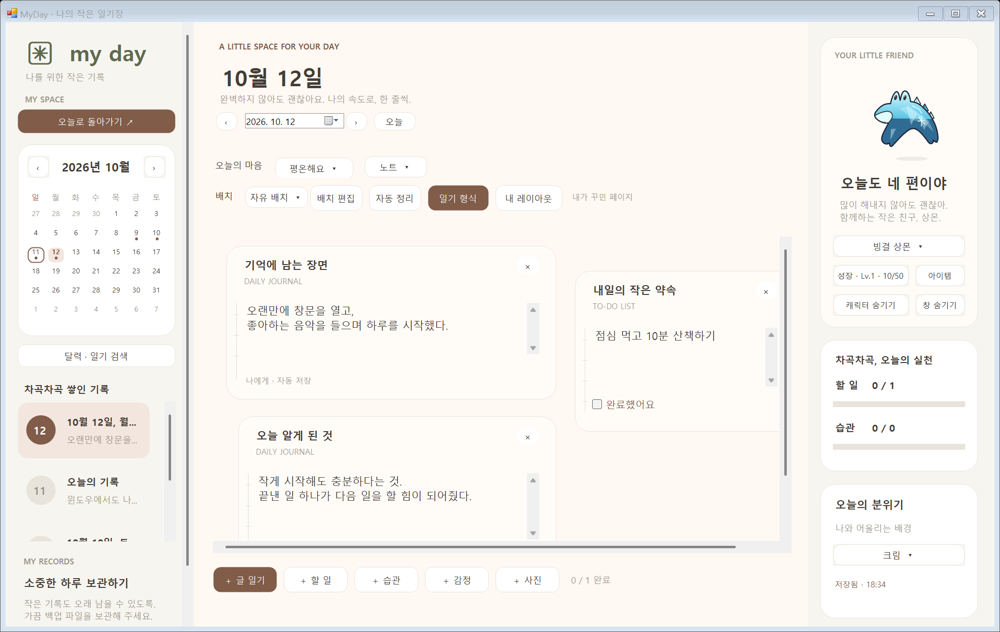
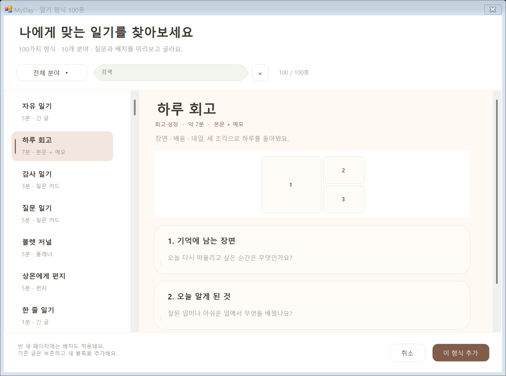
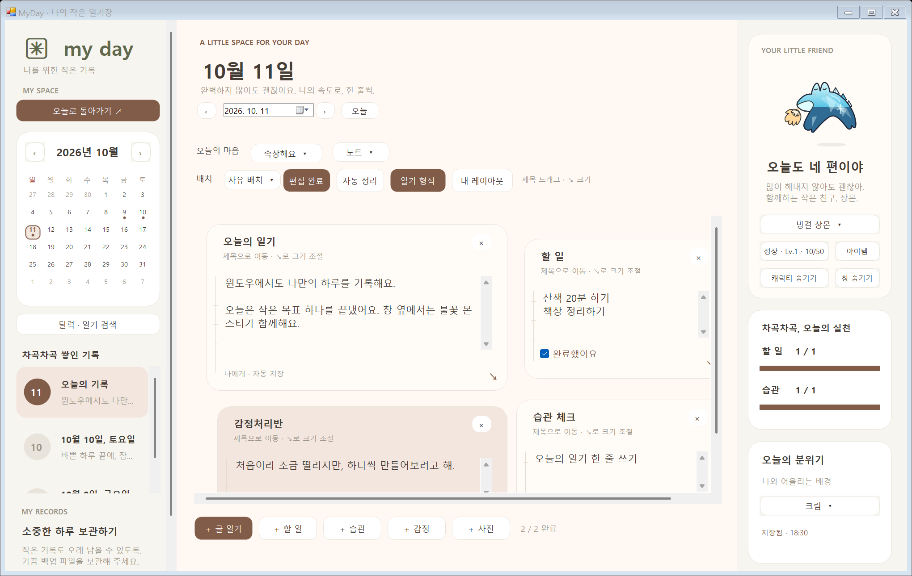

# Windows 일기 디자인

Windows v0.3.10-preview는 팀이 올린 [공유 웹 디자인](https://github.com/parkhookjung-debug/myday-diary/tree/bc0aae0adad4b4403773fced46a27a9cde130683/web)의 배치·색·문구를 Windows Forms로 적용했습니다. 크림 바탕·갈색 버튼·올리브 브랜드와 둥근 카드로 구성합니다. 브라우저나 Python 없이 기존 EXE로 실행합니다.

- 왼쪽: 브랜드, 오늘 버튼, 월간 달력, 기록 목록·검색, 백업·복원
- 가운데: 날짜와 마음, 종이·형식·자유 배치 도구, 글·사진·할 일·습관·감정 블록
- 오른쪽: 실제 움직이는 상몬, 외형·성장·아이템, 할 일/습관 완료 현황, 배경 테마·저장 상태
- 논리 너비 1,120 미만: 오른쪽 영역을 왼쪽 스크롤 아래로 이동. 창을 넓히면 다시 3단으로 전환

달력 날짜를 클릭하면 해당 일기로 이동하며 기록·사진 표시와 선택 날짜를 갱신합니다. 완료 현황은 현재 일기의 체크 상태를 반영합니다. 기존 사진·내 레이아웃·20개 형식·64종 상몬·12종 장비를 유지합니다.

기존 `Theme` 값 0·1·2는 크림·숲·라벤더로 표시합니다. 저장된 인덱스와 블록 내용·좌표·성장·장비를 변환하지 않으며 기록 형식 버전도 그대로 유지합니다.

| 바꾸려는 내용 | 파일 |
| --- | --- |
| 색·글꼴·둥근 버튼·카드 | `windows/UI/Design.cs` |
| 3단 배치·달력·상몬·완료 현황·작은 창 전환 | [DiaryWindow.Shell.cs](../windows/UI/DiaryWindow.Shell.cs) |
| 날짜 헤더·일기 도구·자동 저장·기능 연결 | [DiaryWindow.cs](../windows/UI/DiaryWindow.cs) |
| 날짜 표지의 색과 장식 | `windows/UI/JournalCover.cs` |
| 날짜 행·선택 강조·본문 미리보기 | `windows/UI/HistoryRow.cs` |
| 달력·검색 창·검색칸·결과 목록 | `windows/UI/JournalBrowser.cs` |
| 월간 달력·기록/사진 표시 | `windows/UI/MonthCalendar.cs` |
| 내 레이아웃 목록·이름·관리 | `windows/UI/MyLayoutsWindow.cs`, `windows/UI/LayoutNameDialog.cs` |
| 저장한 실제 좌표 기반 배치 미리보기 | `windows/UI/SavedLayoutDiagram.cs` |
| 블록 제목·본문·체크·편집 도구 | `windows/UI/BlockCard.cs` |
| 자유 배치와 드래그 입력 | `windows/UI/DiaryBoard.cs` |
| 형식 선택·미리보기 화면 | `windows/UI/TemplateGallery.cs` |
| 기존 형식·검색·추가 | `windows/Core/DiaryTemplates.cs` |
| 분야별 제목·질문·출처 | `windows/Core/Templates/` |
| 형식별 8종 배치 | `windows/Core/JournalLayouts.cs` |
| 형식 행과 배치 그림 | `windows/UI/TemplateOption.cs` |

색상은 `Design.Ink`, `Muted`, `Accent`, `Soft`, `Tint`, `Paper`, `Backgrounds`에서 바꿉니다. 배경은 크림·숲·라벤더, 블록 표면은 노트·카드·도트를 고릅니다. 노트와 도트의 표시가 본문 옆 여백에 나타납니다. 본문은 기존 Windows 텍스트 입력 컨트롤입니다. 간격·크기는 `Design.P/Point/Size/Pad`로 Windows 배율에 맞춥니다.

기록함에는 저장된 날짜와 오늘·현재 선택 날짜가 나타납니다. 글 일기 내용을 먼저 미리보고, 없으면 다른 블록의 내용을 표시합니다. 본문 미리보기는 120자, 한 목록은 60일로 제한해 많은 기록도 나누어 탐색합니다. 날짜 선택은 해당 목록을 자동으로 엽니다.

[달력 · 일기 검색](CALENDAR-SEARCH.md)은 왼쪽 버튼이나 Ctrl+F로 엽니다. 달력과 검색 결과를 나란히 배치하고 기록한 날·사진 있는 날을 표시합니다. 검색어가 없으면 현재 달의 목록, 입력하면 전체 날짜의 본문과 사진 설명을 최신순으로 표시합니다. 결과는 페이지당 50일이며 일치하는 부분을 짧게 미리봅니다. 작은 창에서는 결과 폭과 달력 높이를 조정합니다.

기존 저장본은 원래 블록 구성과 자유 배치를 유지합니다. 새로운 날짜는 큰 글 일기 한 칸으로 시작하며, [일기 형식 사용 안내](JOURNAL-FORMATS.md)에 따라 질문·회고·편지 형식을 추가할 수 있습니다.

[내 레이아웃](MY-LAYOUTS.md)에서는 직접 꾸민 블록·배경·종이 스타일을 저장하고 미리봅니다. 기본 20개 형식과 별도 목록으로 관리하며 사진 자리는 옅은 크림색, 글 블록은 종이색으로 표시합니다. 일기 내용과 실제 사진은 새 날짜에 복사하지 않습니다.

참고: [Day One 템플릿](https://dayoneapp.com/features/journal-templates/)의 형식 선택, [Diarium](https://diariumapp.com/en)의 날짜 중심 화면, [Notion Daily Journal](https://www.notion.com/templates/daily-journal)의 여백과 섹션 구성을 살펴봤습니다. 화면 구성·질문·장식은 프로젝트에 맞춰 직접 작성했으며 외부 로고·이미지·템플릿 파일은 포함하지 않았습니다.

상몬의 게임 외형 8종·기존 48종, 클릭 반응과 바탕화면 이동은 [상몬 디자인](SANGMON-DESIGN.md)에서 관리합니다. 감정 블록은 개인 기록이며 메시지를 전송하거나 AI 답변을 생성하지 않습니다.

검증은 `windows/build.ps1`, `MyDay.exe --self-test`, `MyDay.exe --smoke-test windows/test-output`으로 실행합니다. 네이티브 화면 검증은 격리된 예시 데이터로 3단 영역 겹침·작은 창의 상몬 메뉴 접근·왼쪽 달력 이동·테마 3종·완료 현황과 날짜 목록 클릭·날짜 이동·자동 저장·드래그·크기 변경·작은 창·캐릭터 메뉴를 확인하고 PNG를 생성합니다.

[상몬 성장](SANGMON-GROWTH.md) 화면은 `windows/UI/GrowthWindow.cs`에서 수정합니다. 레벨·경험치·다음 보상과 8종 카드를 표시하며 작은 창에서는 목록을 스크롤합니다. 의상 그림은 `windows/Character/RewardSkins.cs`, 지급 규칙은 `windows/Core/SangmonGrowth.cs`에서 바꿉니다.

[아이템 장비함](SANGMON-ITEMS.md)은 `windows/UI/EquipmentWindow.cs`에서 수정합니다. 남색 배경·금색 강조·속성색 아이템 카드와 두 슬롯 상태를 보여줍니다. 검/보주의 금속 명암·보석·광채는 `windows/Character/ItemPainter.cs`, 이름·속성·설명은 `windows/Core/SangmonItems.cs`에 있습니다.
