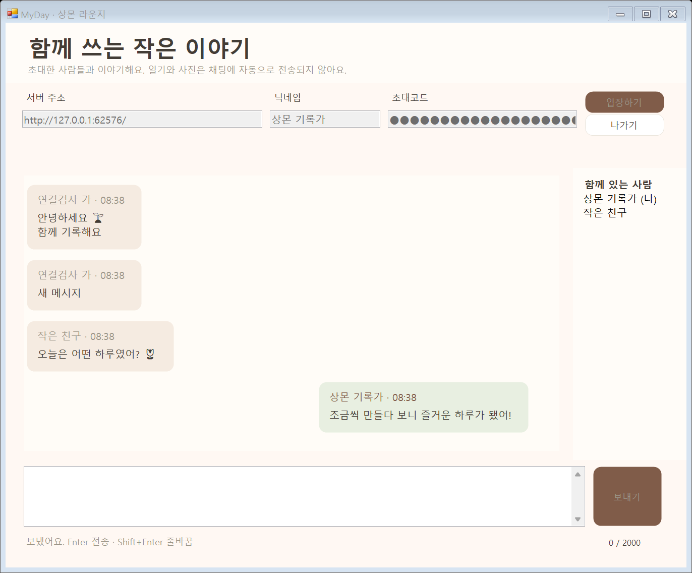

# Windows 상몬 라운지 · 실제 화면

임시 로컬 서버와 두 클라이언트로 검사한 실제 Windows 창입니다. 닉네임·내용은 격리된 테스트 예시이며 개인 일기를 사용하지 않습니다. 표시된 임시 포트는 검사가 끝난 뒤 종료됩니다.

[작은 창](windows-chat-compact.png) · [서버 실행](../../../server/README.md) · [API와 수정 파일](../../../docs/CHAT.md)

말풍선은 [ChatTranscript.cs](../../../windows/UI/ChatTranscript.cs), 접속·전송 화면은 [ChatWindow.cs](../../../windows/UI/ChatWindow.cs)에서 수정합니다. Android 채팅 화면은 아직 추가하지 않았습니다.
