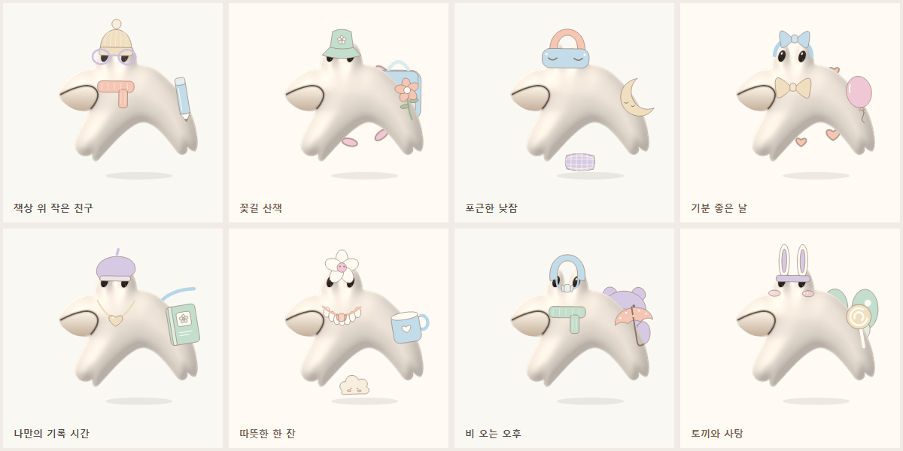
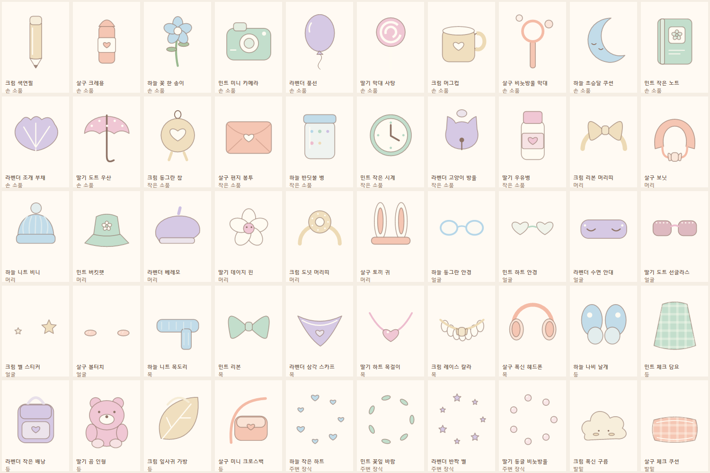
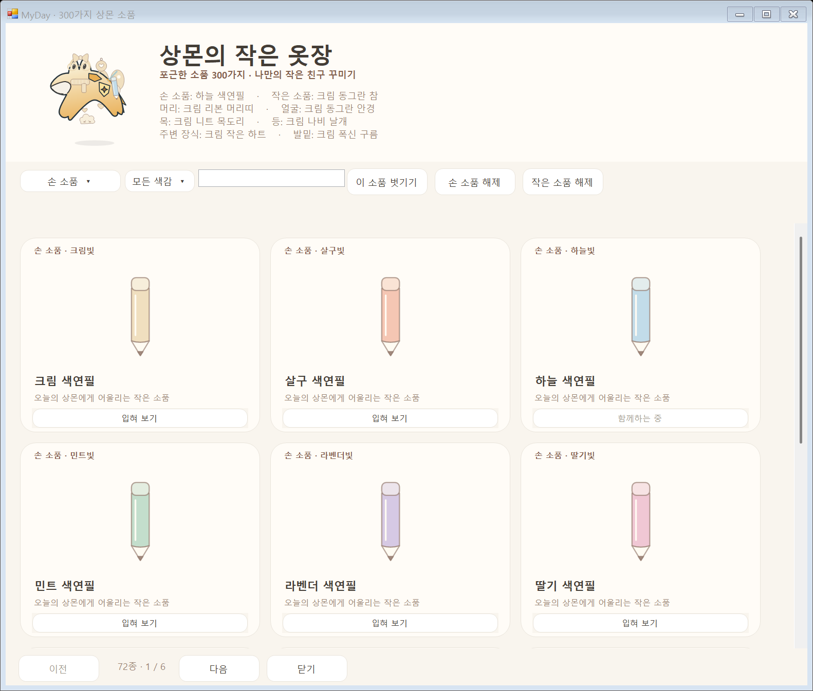

> 현재는 기본 8종만 무료이며 나머지는 획득 후 착용합니다. [현재 잠금·보유 화면](../ownership-v1/README.md)

# 상몬의 작은 옷장 · 실제 렌더링

현재 Windows 렌더러로 그린 소품입니다. 50가지 일상 소품에 크림·살구·하늘·민트·라벤더·딸기 여섯 색감을 적용해 300종을 구성합니다. 아래 조합은 상몬의 원래 얼굴·몸을 유지하며 각 3~4개 소품을 입혔습니다.

## 실제 Windows 옷장

격리된 예시 기록으로 검색·착용·저장을 검사한 실제 창입니다.

[작은 창에서의 옷장](windows-wardrobe-compact.png)

Windows와 Android는 같은 원본 그림을 사용합니다. Android에는 300개 아이콘과 투명 착용 레이어를 생성합니다. 위 이미지는 코드에서 직접 렌더링한 예시이며 휴대폰 화면 캡처가 아닙니다.

- 그림·색상: [CozyItems.cs](../../../windows/Character/CozyItems.cs)
- 이름·목록: [SangmonItems.cs](../../../windows/Core/SangmonItems.cs)
- 착용 위치: [ItemPainter.Wardrobe.cs](../../../windows/Character/ItemPainter.Wardrobe.cs)
- 이 이미지 재생성: Windows 앱의 `--wardrobe-preview <출력 폴더>`
- [사용 방법과 모든 수정 파일](../../../docs/SANGMON-ITEMS.md)

이전 RPG 스타일은 [wardrobe-v1](../wardrobe-v1/README.md)에 변경 이력으로 보관합니다.
