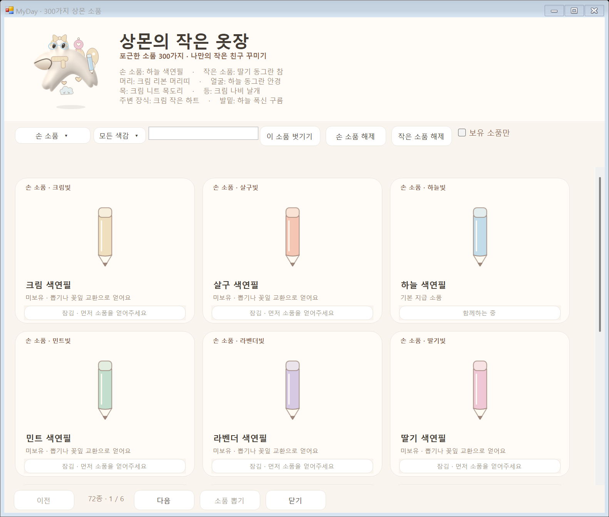
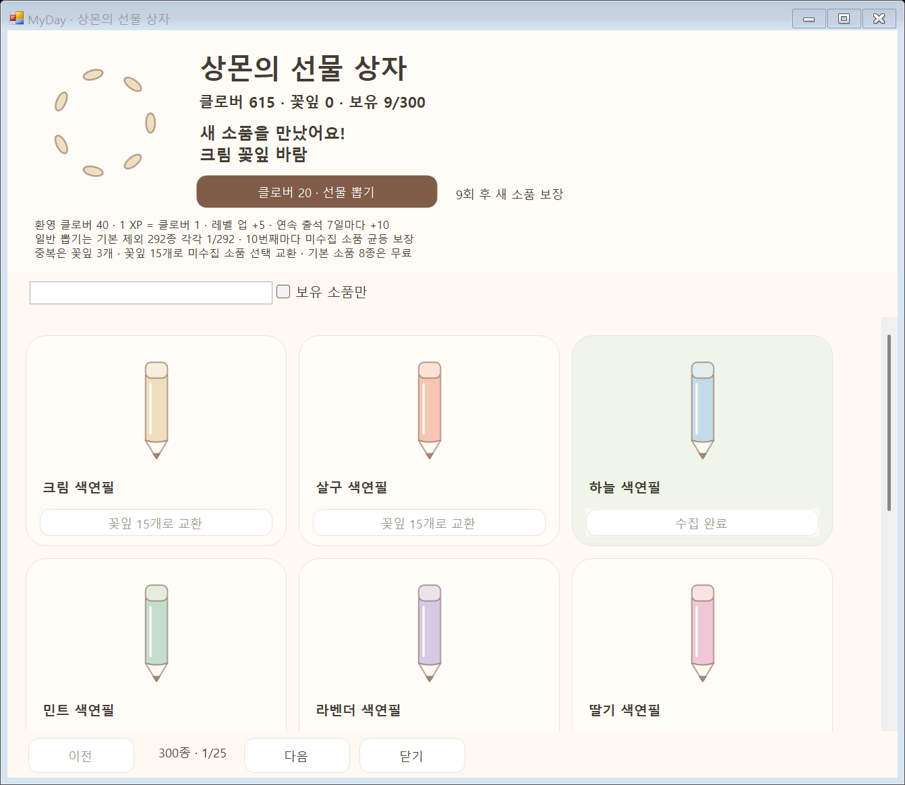

# 기본 소품·소유권·잠금 실제 적용

격리된 예시 기록을 사용한 실제 Windows 창입니다. 기본 8종을 무료 지급하고, 나머지 292종은 뽑기·꽃잎 교환으로 얻어야 입힐 수 있습니다. 그림은 잠겨 있어도 미리 볼 수 있습니다.

[작은 창](windows-wardrobe-compact.png) · [기본 8종·확률·이전 기록 보존·수정 파일](../../../docs/SANGMON-COLLECTION.md)

원본 그림은 [CozyItems.cs](../../../windows/Character/CozyItems.cs), 소유권과 기본 소품 ID는 [SangmonCollection.cs](../../../windows/Core/SangmonCollection.cs), 옷장 잠금은 [EquipmentWindow.cs](../../../windows/UI/EquipmentWindow.cs)에서 수정합니다. Android의 기본 ID 목록은 원본에서 함께 생성합니다.
