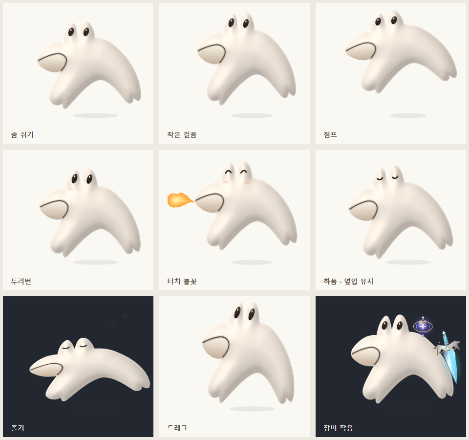

# 기본 상몬: 3D풍 클레이 외형 첫 적용

[승인된 시안](../../concepts/sangmon-3d/README.md)을 바탕으로 **실제 앱 렌더러**에서 그린 결과입니다. 시안 배경을 잘라 붙이지 않고, 기존 상몬 윤곽을 투명한 클레이 음영으로 렌더링합니다. 실제 3D 메시·리깅 파일이 아닌 2D 입체 표현입니다.



왼쪽부터 숨 쉬기·걷기·점프 / 두리번·터치 불꽃·하품 / 졸기·드래그·장비 착용입니다. `pose-0.png`부터 `pose-8.png`까지는 같은 결과의 투명 PNG입니다. 어두운 칸에서도 배경 테두리 없이 표시됩니다. 마지막 칸은 기존 빙결 장검·별빛 구슬을 함께 장착한 예입니다.

## 적용 범위

- **기본 상몬(original)**: 아이보리색 클레이 명암, 반짝이는 눈, 가는 옆입, 둥근 짧은 불꽃.
- Windows: 일기 안 미리보기·선택 화면·투명 바탕화면 캐릭터에 공통 적용.
- Android: 기본 상몬 썸네일과 8가지 행동 × 8프레임 아틀라스를 다시 생성. 앱·위젯·라이브 배경화면이 같은 자산을 사용.
- 걷기·점프·눈 깜박임·두리번·졸기·드래그와 기존 장비·성장 설정 유지. 하품에 새 입을 추가하지 않으며 평소에는 불을 뿜지 않음.
- 나머지 63종은 기존 디자인. 저장 ID·일기 데이터·선택 목록 수는 변경하지 않음.

기존 Releases의 EXE/APK는 이전 버전입니다. 이 적용본은 `codex/windows-app` 소스를 다시 빌드하거나 해당 변경의 CI artifact에서 받습니다.

## 어느 파일을 수정하나요?

| 변경할 부분 | 원본 |
| --- | --- |
| 기본 상몬 재질·조명·눈·옆입·작은 불꽃 | [ClayMaterial.cs](../../../windows/Character/ClayMaterial.cs) |
| 공통 몸 윤곽·포즈·재질 연결 | [MonsterPainter.cs](../../../windows/Character/MonsterPainter.cs) |
| 행동 전환·불꽃 반응 시간 | [PetBehavior.cs](../../../windows/Character/PetBehavior.cs) |
| 이 미리보기 생성 | [ClayPreview.cs](../../../windows/Tests/ClayPreview.cs) |
| Android PNG 다시 생성 | [export-android-assets.ps1](../../../tools/export-android-assets.ps1) |

클레이 몸은 윤곽에서 거리·높이·법선을 계산하고 부드러운 조명으로 칠합니다. 몸 7프레임만 프로세스 수명 동안 캐시하고, 눈·기울기·늘어남·장비는 기존 렌더러에서 처리합니다. 이미지 생성 도구로 만든 시안을 참고했으며 **이 폴더의 적용 이미지는 C# 코드로 생성**했습니다.

```powershell
./windows/build.ps1
$preview = Join-Path $pwd 'previews/applied/sangmon-clay'
Start-Process windows/bin/MyDay.exe -ArgumentList @('--clay-preview', ('"' + $preview + '"')) -Wait -WindowStyle Hidden
./tools/export-android-assets.ps1
```

## 검증

Windows 빌드·164개 검사·실제 UI/투명 창 smoke 검사 통과. Android debug APK·테스트 APK 빌드·lint·JVM 검사 통과. 아틀라스 64프레임 모두 셀 경계 알파가 0임을 확인했습니다. 이번 외형은 실제 갤럭시 기기에서 확인하지 않았습니다.
