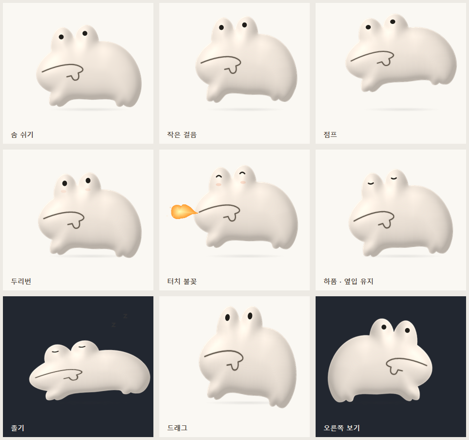
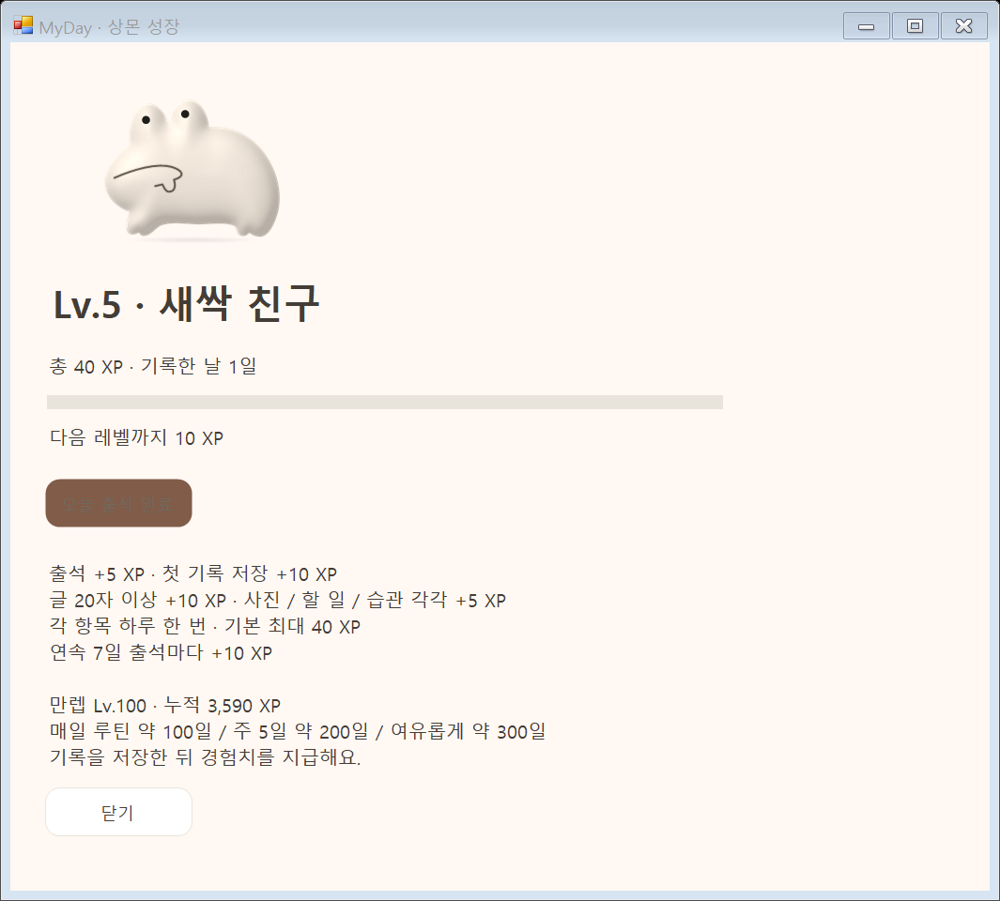

# 영상 속 새 상몬 적용 · 0.16.1

사용자가 전달한 `sangmon-2d-to-matching-3d.mp4`의 마지막 3D 모습을 기준으로, 기본 상몬을 새로 그렸습니다. 영상 파일을 재생하거나 흰 배경을 붙인 그림을 올리는 방식이 아니라 투명 배경의 네이티브 그림과 동작 프레임을 사용합니다.



통통한 몸통, 넓고 둥근 눈 돌기, 검은 점눈, 낮고 평평한 배 아래, 짧은 발, 작은 혀가 있는 얇은 입선을 반영했습니다. 하품에는 새로 벌어지는 입을 만들지 않고 옆 입선을 유지합니다. 가만히 있을 때는 불꽃이 없고 터치와 짧은 하품 반응에만 불꽃이 나옵니다.

Windows는 `MonsterPainter`와 `ClayMaterial`로 직접 그립니다. 같은 렌더러의 8동작 × 8프레임을 `original.png` 한 장으로 내보내 Android·Mac의 앱·배경화면/바탕화면·놀이터에 사용합니다. Android 위젯은 기존 텍스트 중심 위젯을 유지합니다. 저장 ID `original`과 기존 일기·경험치는 바꾸지 않습니다. 변신·코디·뽑기 자산은 복구하지 않았습니다.



원본/해시/프레임 규격은 [공통 그림 명세](../../../shared/character-art.json), 수정 위치는 [Windows 캐릭터 안내](../../../windows/Character/README.md)를 보세요.

```powershell
./tools/export-android-assets.ps1 -Focused
./tools/export-android-assets.ps1 -CheckFocused
python tools/prepare-mac-assets.py
python tools/test_character_art.py
```

`-Focused`는 기본 상몬 한 장만 갱신합니다. 이전 64종/장비/도감/백업 검사 자료를 다시 생성하지 않습니다. `-CheckFocused`는 묶인 64프레임의 모든 픽셀을 실제 Windows 렌더 결과와 비교합니다.
