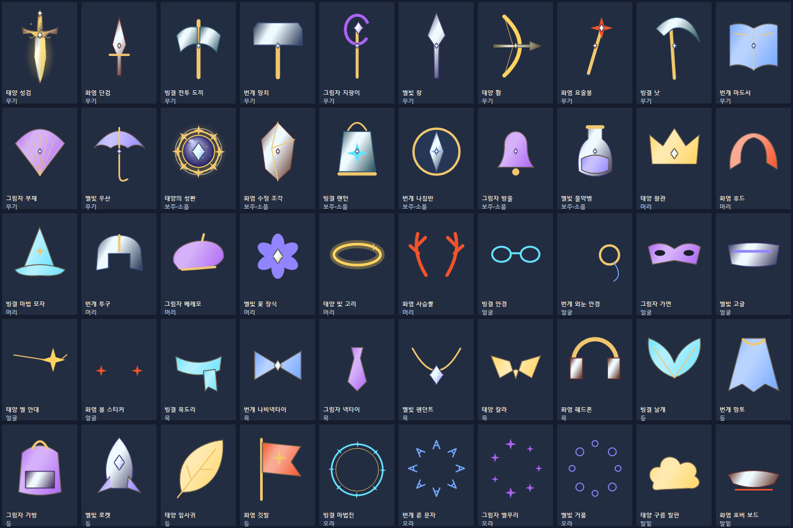
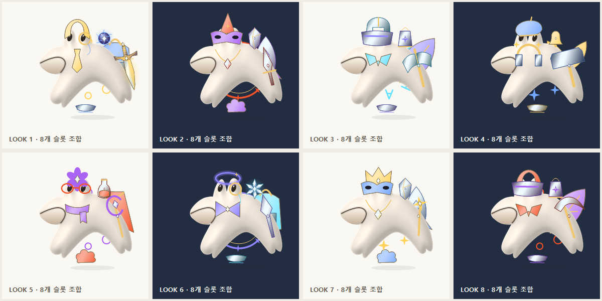
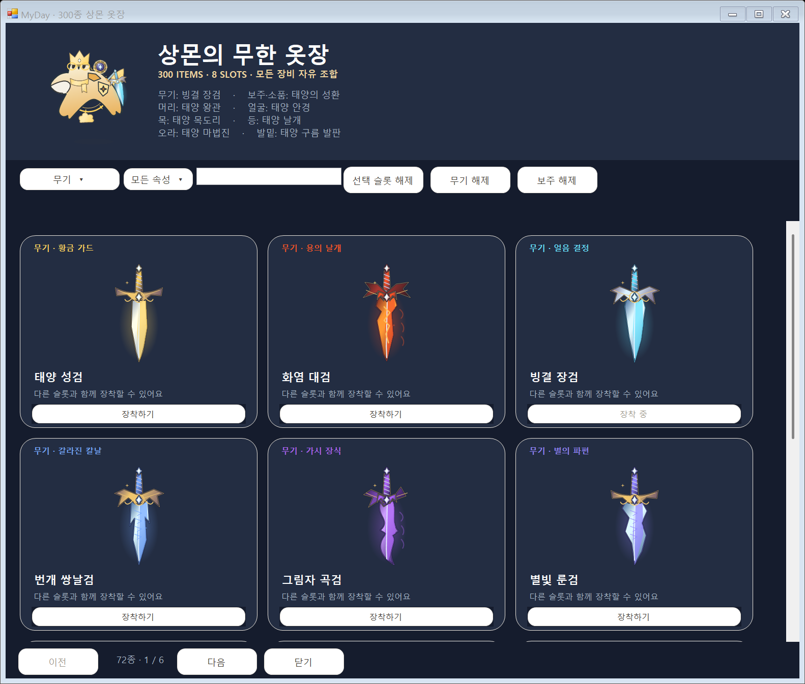
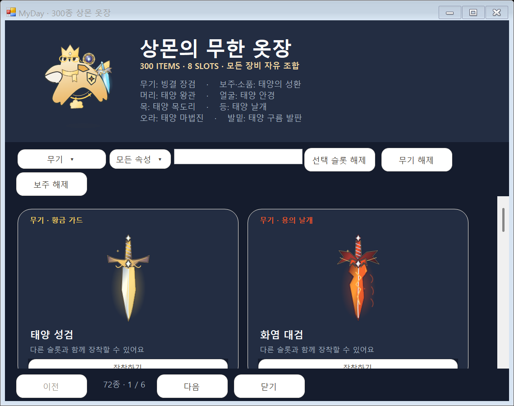
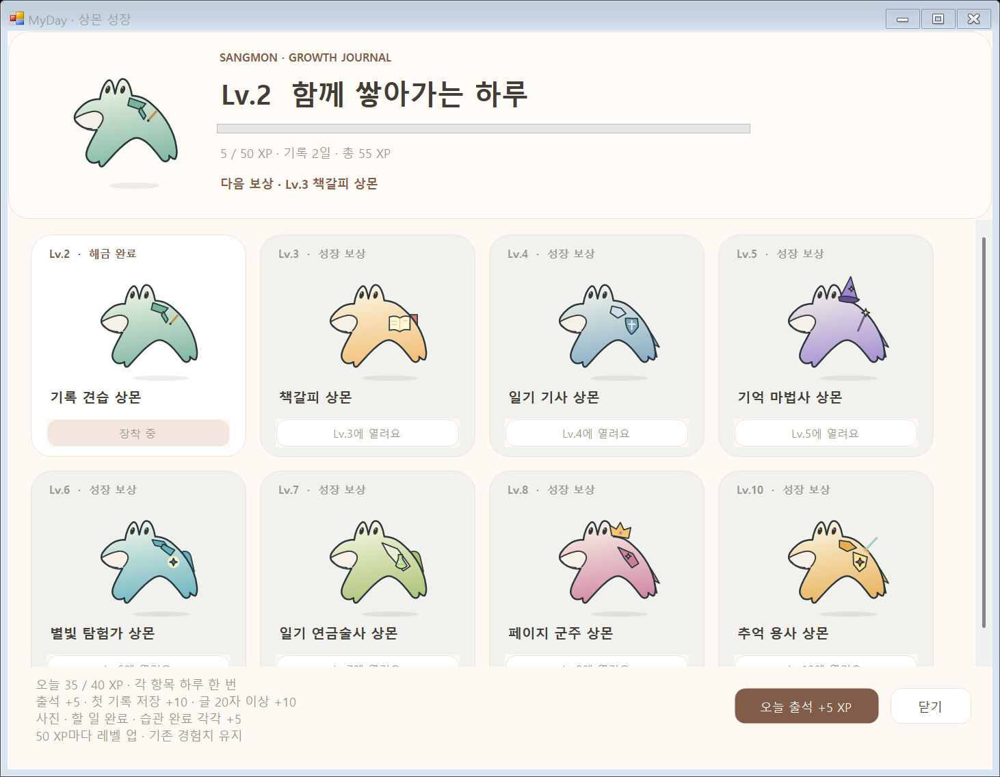

# 장비 300종과 새 성장 시스템 적용본

50가지 도형을 6가지 속성 재질로 렌더링한 총 300종입니다. 외부 게임 이미지를 복사하지 않고 실제 C# 앱의 도형 코드로 그렸습니다. 아래는 각 형태당 한 재질을 고른 50종입니다.

## 8개 슬롯 조합

무기·보주/소품·머리·얼굴·목·등·오라·발밑을 독립적으로 장착합니다. 아래는 **동일한 기본 상몬**에 여덟 슬롯을 조합한 실제 렌더링입니다.

## 실제 Windows 창

격리된 예시 일기로 실행한 네이티브 앱입니다. 개인 기록은 포함하지 않습니다.

## 수정할 파일

| 수정 | 파일 |
| --- | --- |
| 300종 이름·ID·슬롯·형태 목록 | [SangmonItems.cs](../../../windows/Core/SangmonItems.cs) |
| 추가 도형·착용 위치 | [ItemPainter.Wardrobe.cs](../../../windows/Character/ItemPainter.Wardrobe.cs) |
| Windows 장비함 | [EquipmentWindow.cs](../../../windows/UI/EquipmentWindow.cs) |
| Android 장비함·출석·미션 | [PhoneCompanion.kt](../../../app/src/main/java/com/myday/diary/ui/diary/PhoneCompanion.kt) |
| 점수·중복 방지 | [SangmonGrowth.cs](../../../windows/Core/SangmonGrowth.cs), [NotebookRules.kt](../../../app/src/main/java/com/myday/diary/diary/NotebookRules.kt) |
| 이 도형 미리보기 생성 | [WardrobePreview.cs](../../../windows/WardrobePreview.cs), `MyDay.exe --wardrobe-preview <출력 폴더>` |
| Android 그림·착용 레이어 다시 생성 | [export-android-assets.ps1](../../../tools/export-android-assets.ps1) |

[장비 사용·전체 ID](../../../docs/SANGMON-ITEMS.md) · [출석·활동 점수표](../../../docs/SANGMON-GROWTH.md)

이번 적용은 `codex/windows-app` 소스와 CI 빌드에 반영합니다. 기존 v0.3.10 Windows / v0.4.0 Android Releases에는 포함되지 않습니다. Android UI는 휴대폰용 Compose 화면이며 위 Windows 이미지는 Android 캡처가 아닙니다.
