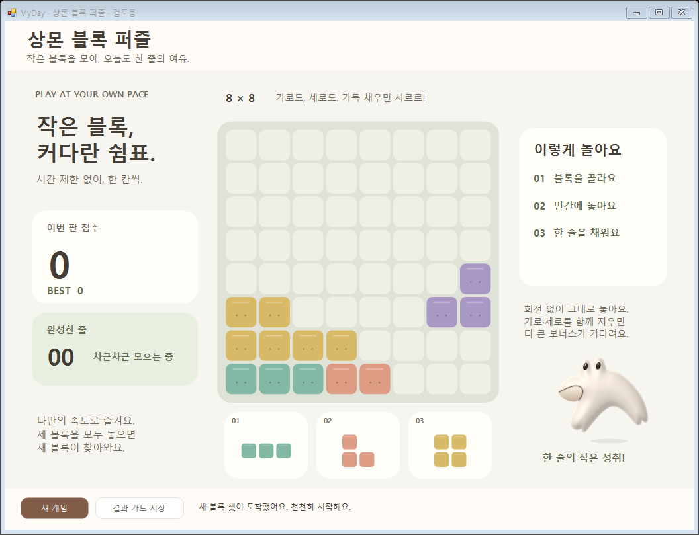
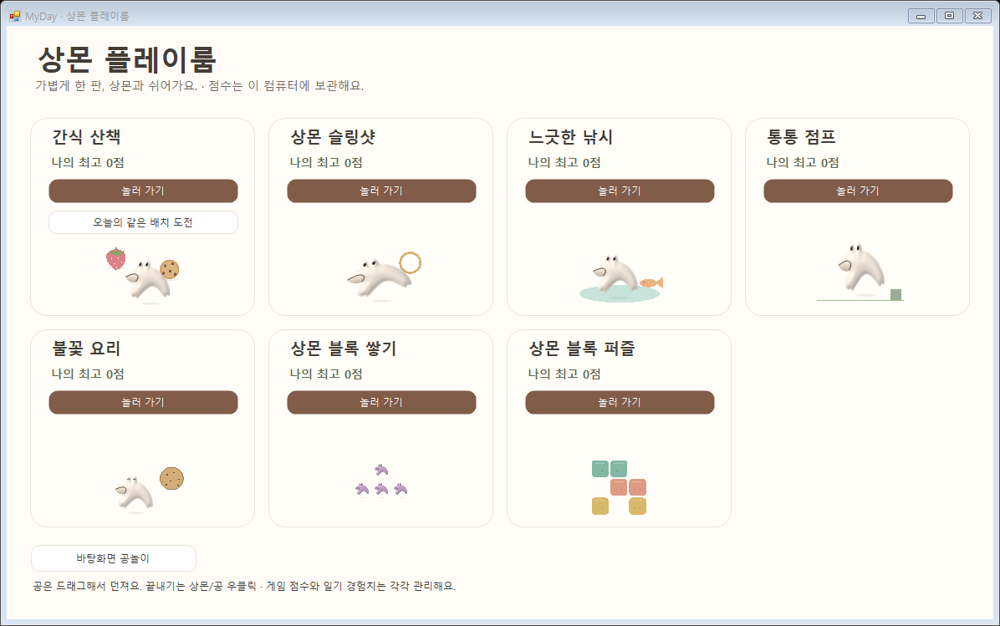

# 상몬 블록 퍼즐 · Windows

8×8 보드에 블록 셋을 놓으며 가로·세로 줄을 완성하는 퍼즐입니다. Windows 일기 앱의 상몬 게임 메뉴와 플레이룸에서 일곱 번째 게임으로 열립니다.

[조작·기록·빌드 안내](../../docs/BLOCK-PUZZLE-REVIEW.md)

## 게임 화면

## 플레이룸

`MyDay.exe --block-puzzle-preview <폴더>`가 실제 WinForms 창에서 만든 캡처입니다. 화면 검사를 위한 재현 가능한 배치이며 개인 일기·사진·게임 기록을 사용하지 않습니다. 드래그·클릭·키보드 입력, 줄 삭제, 작은 창, 게임 종료와 기록 저장, 플레이룸 진입을 자동으로 검사합니다.
