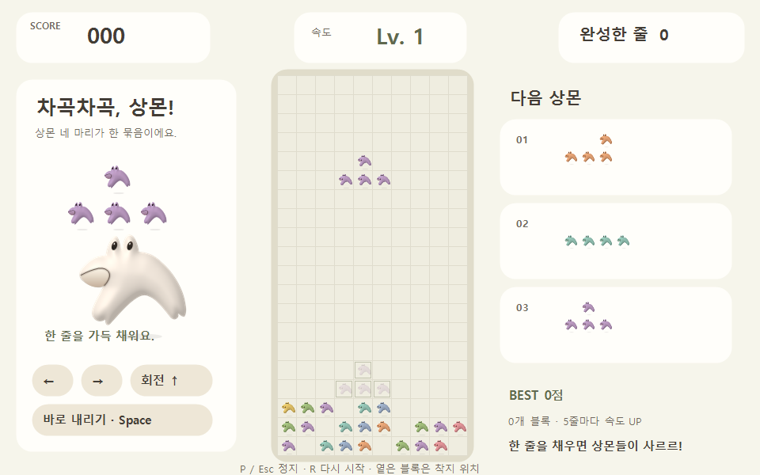
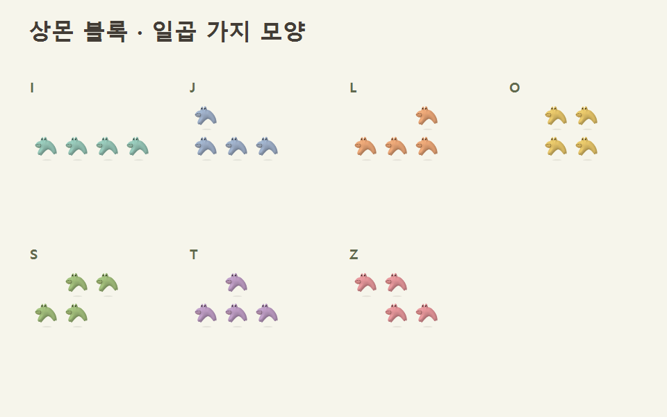
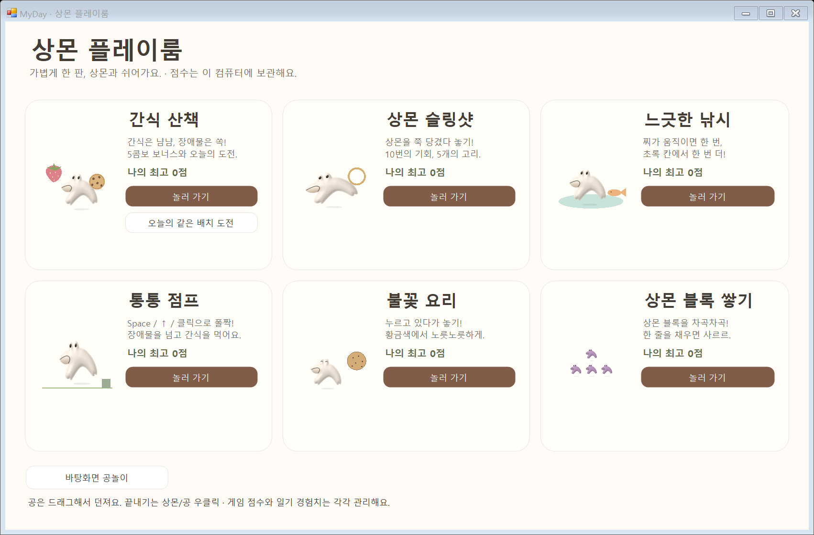
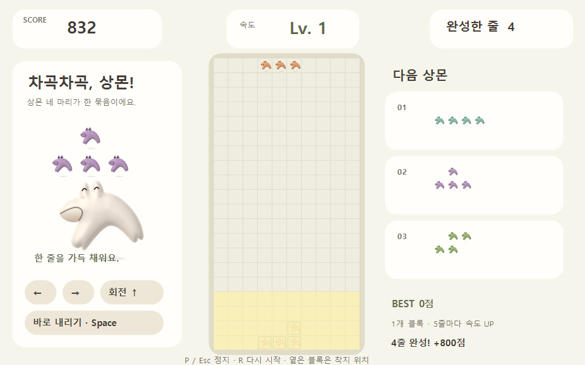
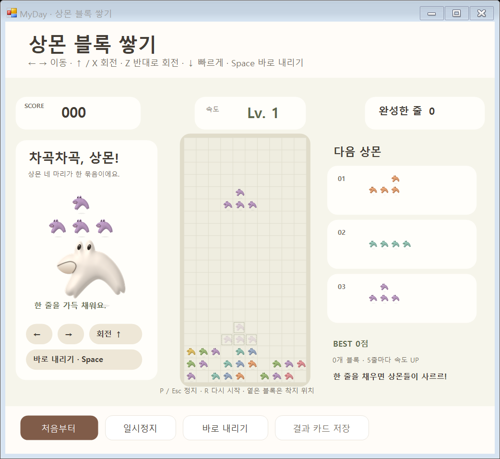
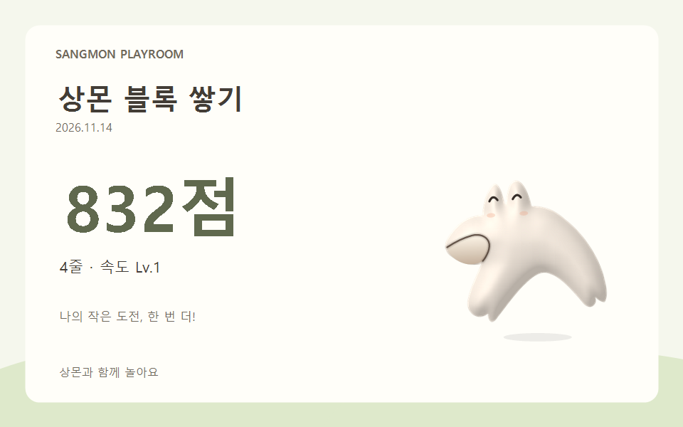

# 상몬 블록 쌓기 · 실제 Windows 화면

2026-11-14. 실제 WinForms 폼의 DrawToBitmap과 실제 게임 렌더러로 출력한 재현 가능한 검사 장면입니다. 상몬 자체의 투명 실루엣을 파스텔색 블록으로 사용합니다. 개인 기록과 바탕화면은 캡처하지 않았습니다.

[조작법·점수·기록·수정 파일](../../docs/SANGMON-BLOCKS.md)
