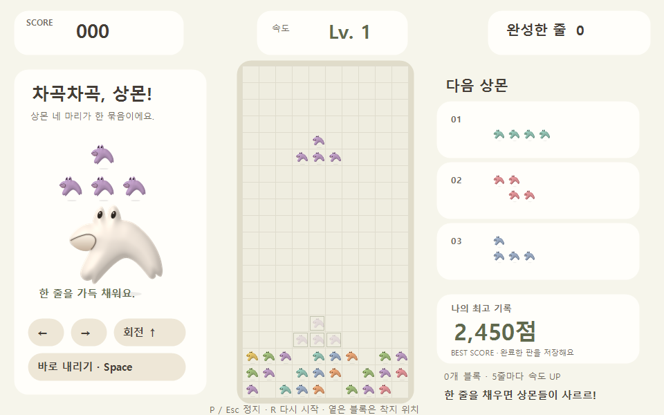
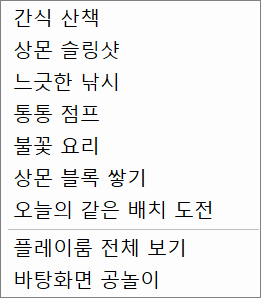
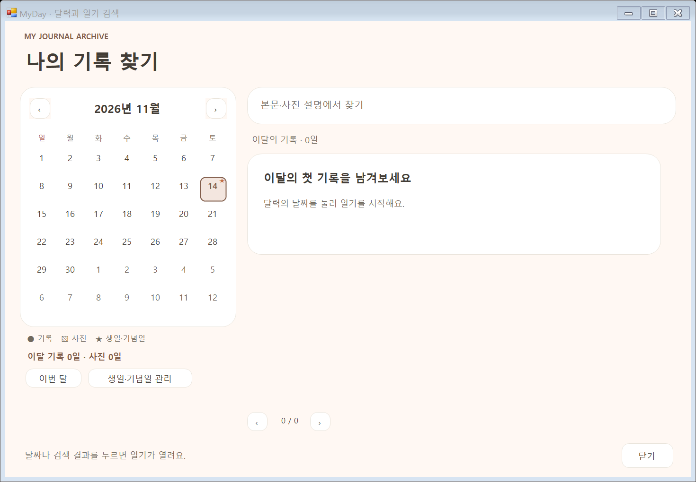
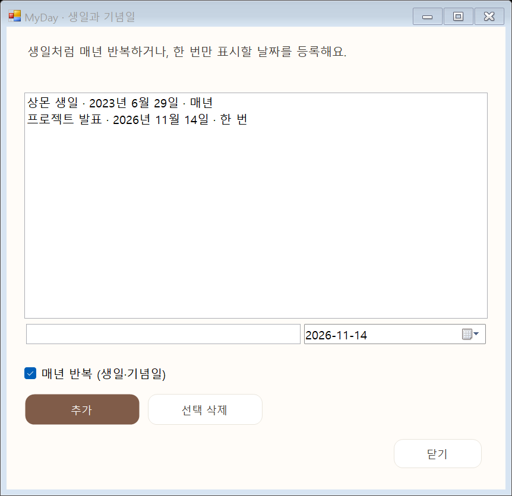

# 브랜치 기능 통합 · 실제 Windows 화면

개인 데이터 없이 실제 Windows 폼과 상몬 게임 렌더러로 출력한 검사 장면입니다. 기념일 추가/정렬 후 삭제/저장 실패 복구, 달력 표식, 간단한 게임 메뉴에서 기존 상몬 블록 열기, 최고기록 전용 카드를 확인합니다. 2,450점과 생일·발표는 검사 자료입니다.

[통합한 기능·백업·수정 파일·원본 출처](../../docs/BRANCH-INTEGRATION-2026-11-14.md)
