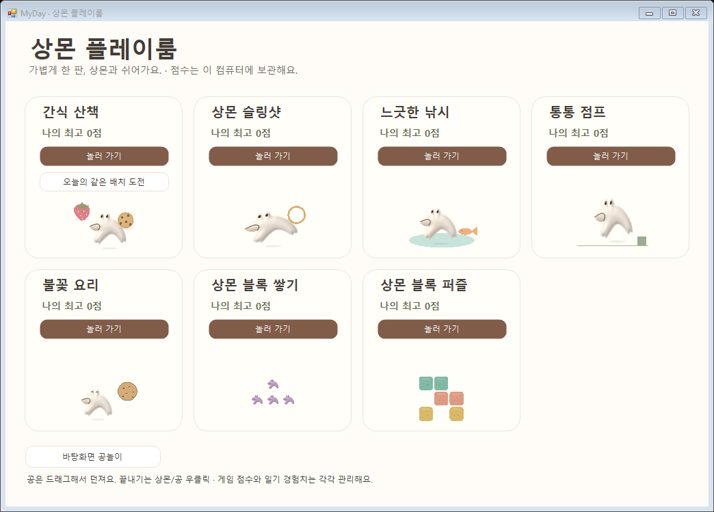
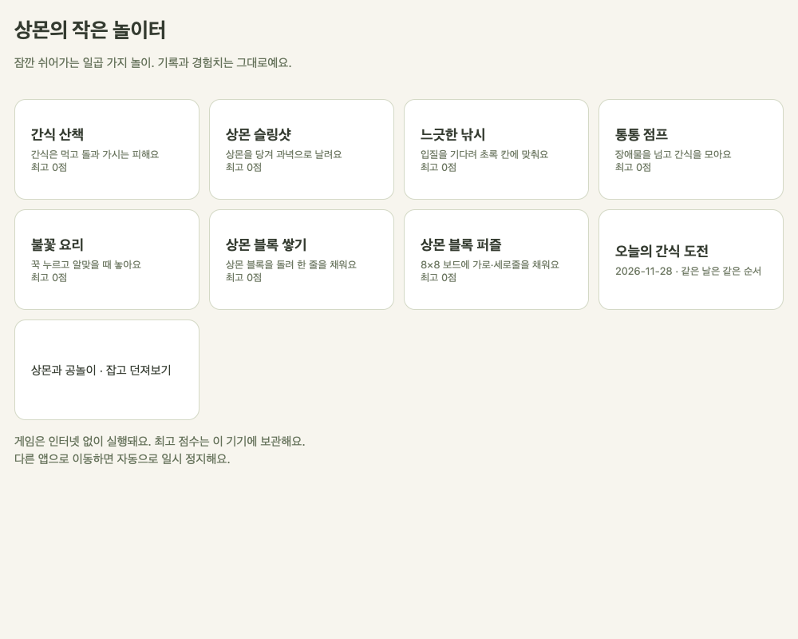
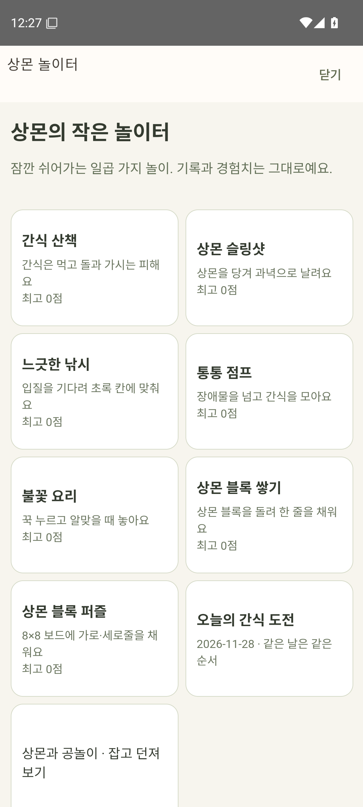

# 0.16.0 세 버전의 실제 게임 메뉴

CI에서 실행한 네이티브 앱 화면입니다. Windows는 기존 WinForms 화면을, Mac·Android는 같은 오프라인 게임 모듈을 사용합니다. 일곱 게임과 간식 도전·공놀이를 제공합니다. 기기별 조작은 [공통 기능표](../../docs/THREE-PLATFORMS.md), 설치는 [다운로드 안내](../../docs/DOWNLOADS.md)를 보세요.

이 버전은 기존 기본 상몬 외형을 사용합니다. 새로 전달된 영상의 외형 리디자인은 포함하지 않습니다. 화면은 테스트용 기록으로 촬영했고 개인 일기는 사용하지 않았습니다.

## Windows

[Windows 검사](https://github.com/parkhookjung-debug/myday-diary/actions/runs/46123765373)

## Mac

[Mac 네이티브 게임·백업·화면 검사](https://github.com/parkhookjung-debug/myday-diary/actions/runs/46144227668)

## Android

[Android 35 기기 검사 22개](https://github.com/parkhookjung-debug/myday-diary/actions/runs/46144230584)

