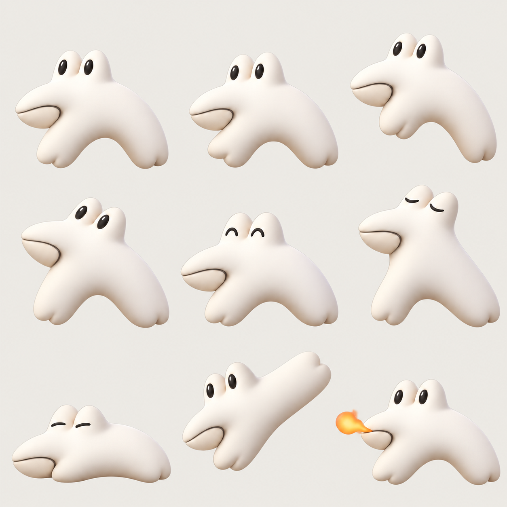

# 상몬 3D풍 외형·동작 시안 v1

원래 상몬의 두 눈·옆입·아치형 몸을 유지하고 부드러운 아이보리색 입체 재질로 만든 캐릭터 시안입니다. Codex 기본 이미지 생성 도구로 제작했습니다.

왼쪽부터 오른쪽, 위에서 아래 순서입니다.

| 위치 | 동작 |
| --- | --- |
| 1 | 기본·숨 쉬기 |
| 2 | 기존 몸 아래쪽을 움직이는 작은 걸음 |
| 3 | 짧은 점프 |
| 4 | 고개와 몸을 기울여 두리번거리기 |
| 5 | 눈을 감으며 기분 좋게 반응하기 |
| 6 | 새 입을 만들지 않는 졸린 기지개·하품 |
| 7 | 몸을 낮추고 잠들기 |
| 8 | 끌려갈 때 몸이 살짝 늘어나는 반응 |
| 9 | 건드렸을 때 짧은 불꽃 반응 |

3D처럼 렌더링한 **2D 키포즈 이미지**입니다. 실제 3D 메시·리깅 파일이나 연속 애니메이션 프레임은 아닙니다. 앱에 바로 넣을 투명 스프라이트 시트로 취급하지 않습니다. 투명 출력의 경계 품질이 충분하지 않아, 이 버전은 외형 검토용의 불투명 배경 시트로 정리했습니다. 앱용 연속 프레임·투명 경계·작은 크기에서의 가독성은 별도 작업으로 이어갑니다.

- 정체성 기준: [시안 제작 당시의 원래 상몬](sangmon-sketch-reference-v1.png)
- 다음 단계: [기본 상몬 클레이 외형 실제 앱 적용본](../../applied/sangmon-clay/README.md)
- 제작 사양·프롬프트: [PROMPTS.md](PROMPTS.md)
- 폴더 안내: [미리보기 목록](../../README.md)
