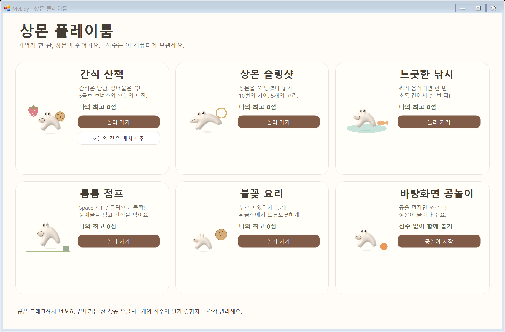
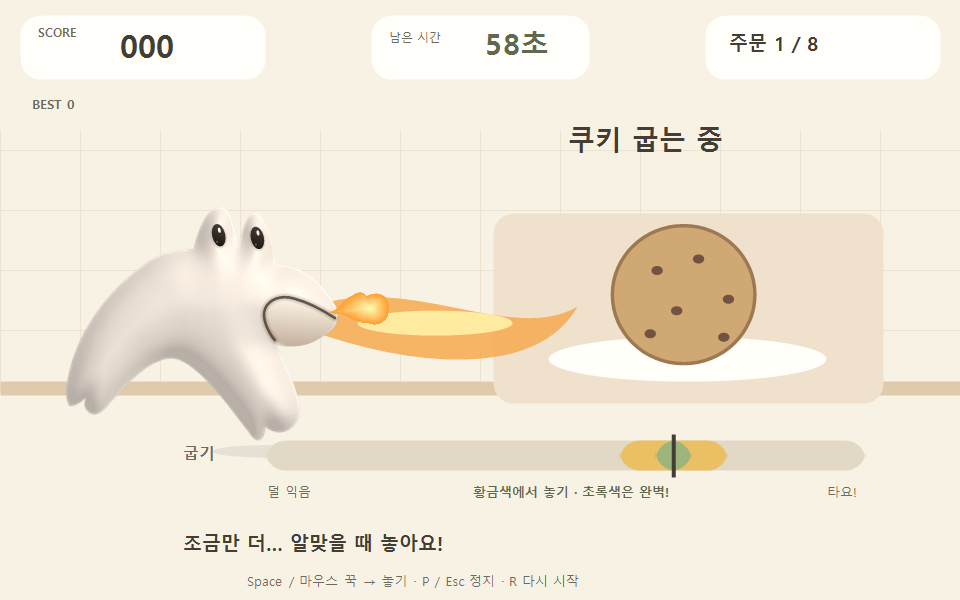
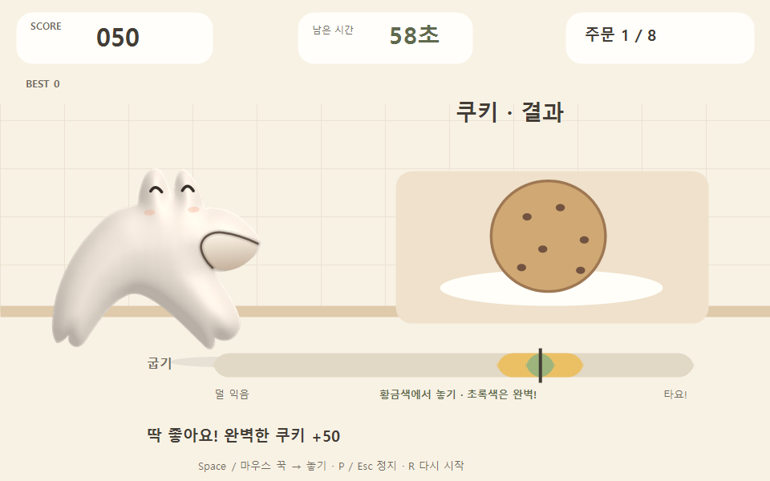
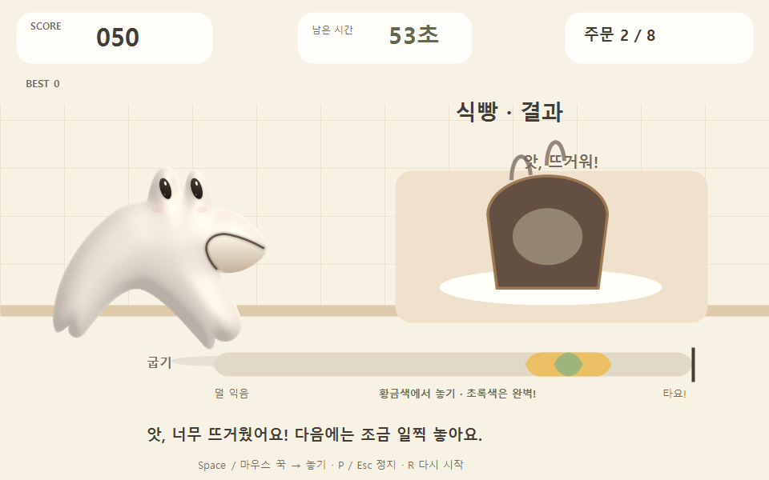
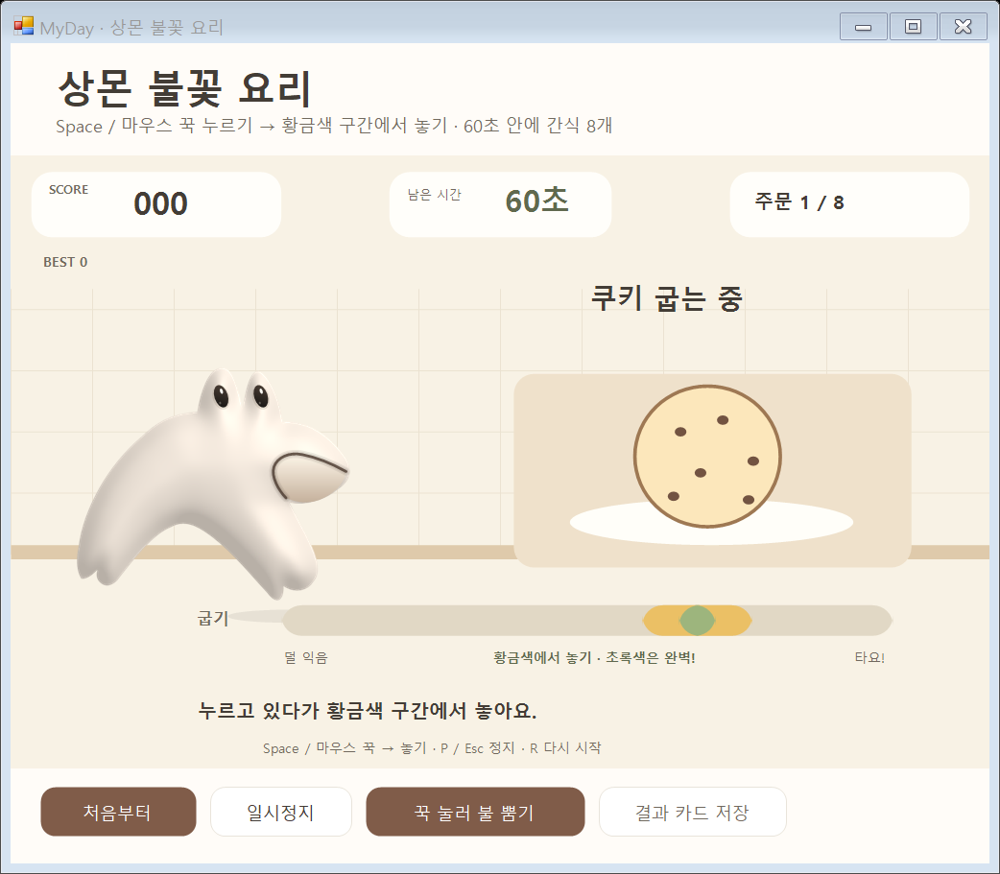
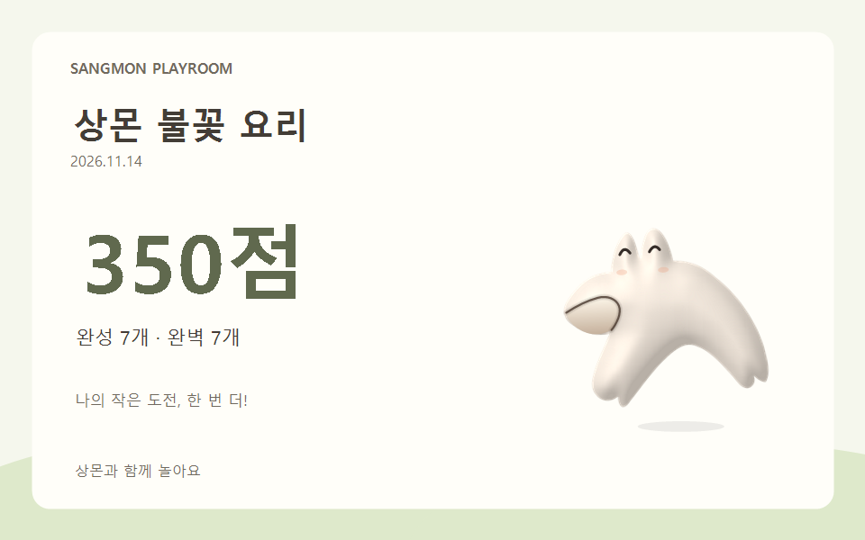

# 불꽃 요리 · 다섯 게임과 공놀이

2026-11-14. 실제 Windows 폼의 `DrawToBitmap`과 실제 게임 렌더러로 출력한 재현 가능한 검사 장면입니다. 개인 일기나 바탕화면을 캡처하지 않았습니다. 전체/작은 창의 시작 버튼, 키보드 놓기, 혼합 입력, 마우스 캡처 해제와 창 비활성화, 자동 태움, 완료 점수 한 번 저장도 함께 검사합니다.

[조작법·점수·저장·수정 파일](../../docs/SANGMON-COOKING.md)
