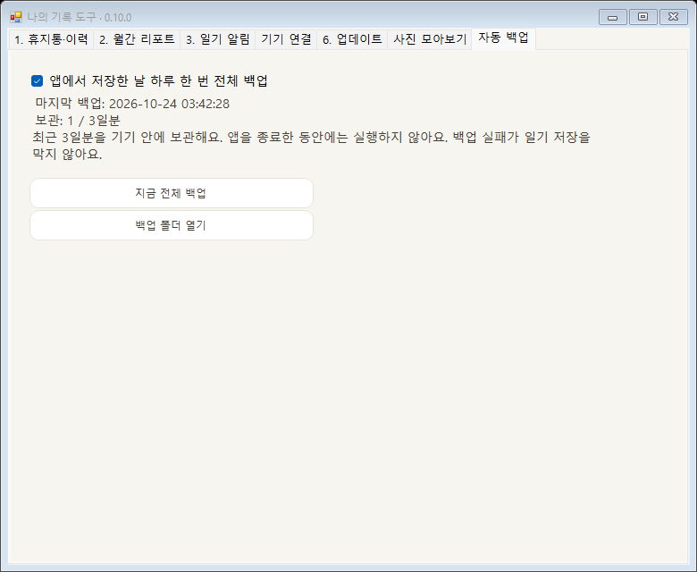
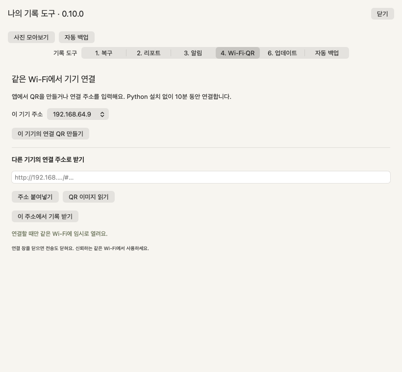
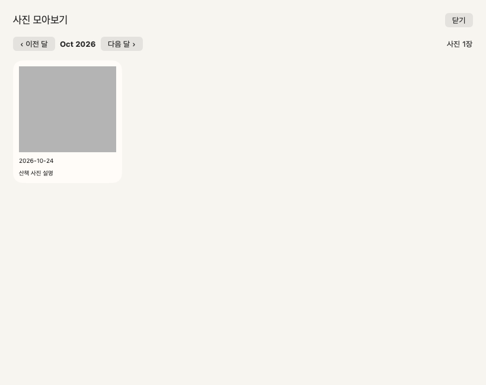
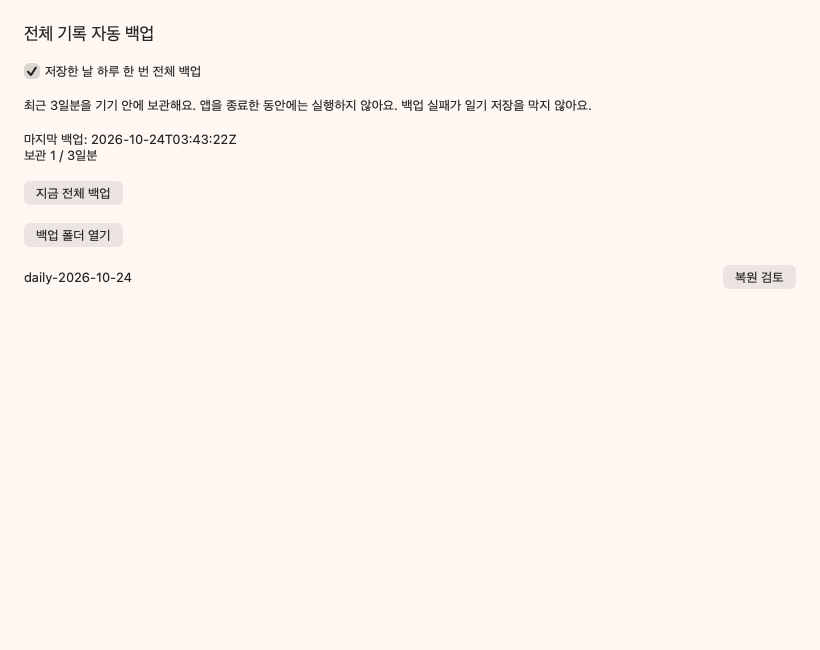
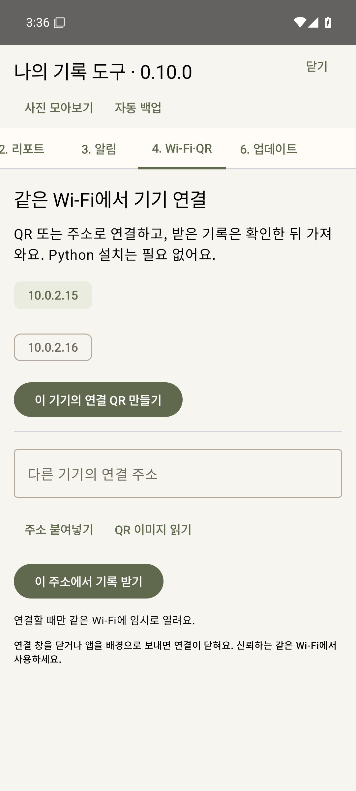
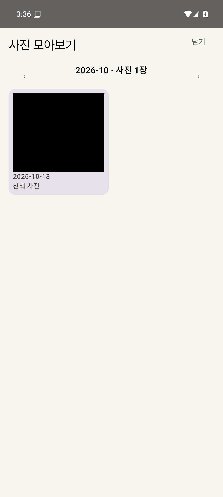
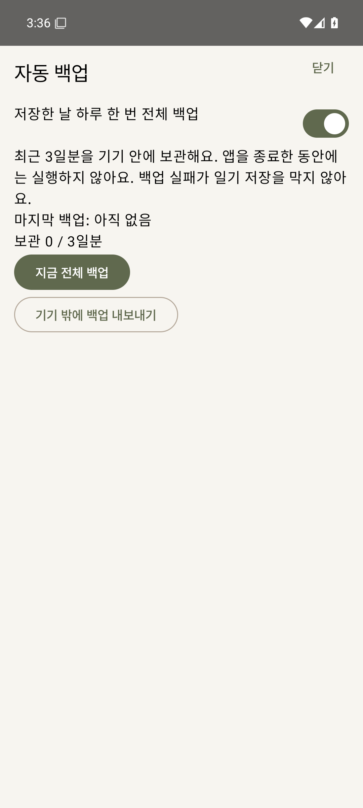
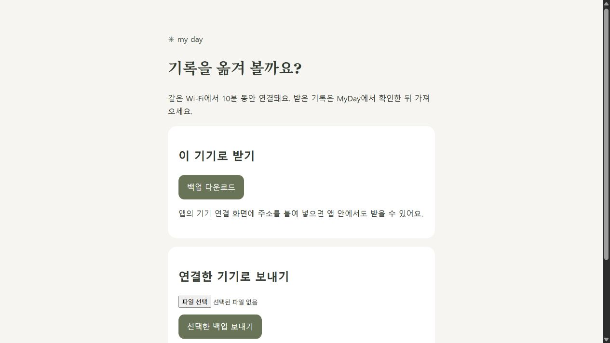

# 0.10.0 · 기기 연결·사진 앨범·자동 백업

[사용법·기능별 수정 파일](../../docs/DEVICE-ALBUM-BACKUP.md) · [실행 파일의 커밋·SHA-256](../../docs/builds/myday-0.10.0.json) · [PR #7](https://github.com/parkhookjung-debug/myday-diary/pull/7)

## 실행 파일 받기

아래 완료된 검사 화면의 **Artifacts**에서 다운로드합니다. GitHub 로그인이 필요할 수 있으며 보관 기간이 지나면 같은 브랜치에서 해당 workflow를 다시 실행합니다. 새 Releases를 게시하지 않았으므로 이전 Releases의 파일에는 이번 기능이 없습니다.

| 플랫폼 | 완료된 검사 → Artifacts | 빌드한 소스 |
|---|---|---|
| Windows 10/11 · .NET Framework 4.8+ | [Windows CI](https://github.com/parkhookjung-debug/myday-diary/actions/runs/40059340138) → `myday-windows-57` → `bin/MyDay.exe` | `839e430` |
| Apple Silicon Mac · macOS 13+ | [Mac·공통 검사](https://github.com/parkhookjung-debug/myday-diary/actions/runs/40059342197) → `myday-chat-macOS-ARM64` → `macos/build/MyDay-macOS-arm64-v0.10.0-preview.zip` | `839e430` |
| Android 8+ · 개발용 debug APK | [Android CI](https://github.com/parkhookjung-debug/myday-diary/actions/runs/40058641013) → `myday-debug-59` → `outputs/apk/debug/app-debug.apk` | `51f1521` |

Mac은 개발용 서명·Apple 공증 없음입니다. Android versionCode 10 / versionName 0.10.0이며, 기존 설치와 서명이 다르면 앱을 삭제하기 전에 기록부터 백업하세요. 이후 `839e430`은 데스크톱 화면·전송 종료 보완만 포함하므로 Android는 먼저 통과한 APK를 사용합니다. 로컬 배포 묶음은 `build/MyDay-0.10.0/`와 `build/MyDay-0.10.0-all-platforms.zip`에 만들었습니다. 빌드 산출물은 Git에 넣지 않습니다.

## 2026-10-24 검사 결과

- Windows: 275개 자체 검사, 실제 WinForms 화면 검사, 기존 채팅 통합 검사 통과.
- Android: 단위 검사 49개·Android 35 에뮬레이터 검사 17개·Lint·APK 빌드, Windows의 실제 코드와 백업 왕복 통과.
- Mac·공통: Swift 빌드, 실제 네이티브 로컬 TCP 다운로드·업로드, QR·백업 보관/실패 검사, 공통 화면·성장·재화 계약 및 Windows 백업 왕복, 기존 로컬 채팅 검사 통과. 5개 CI 작업 모두 성공.
- 합성 자료만 사용한 Windows 로컬 서버를 브라우저에서 열어 실제 백업 다운로드 성공 문구 확인.
- Windows EXE 버전 0.10.0.0, Mac Info.plist 0.10.0 및 arm64, APK versionCode 10 / minSDK 26 / targetSDK 35, ZIP 손상 여부 확인.

실제 서로 다른 물리 기기 간 Wi-Fi·방화벽·로컬 네트워크 권한은 추가 검증 대상입니다. 자동 백업은 앱이 정상 저장한 날 한 번이며 종료 중 예약이나 클라우드 동기화가 아닙니다.

## 실제 화면

개인 기록이 없는 격리 자료로 생성했습니다. 단색 사진은 테스트용 JPEG입니다. QR과 임시 주소는 종료한 로컬 테스트 세션이며 실제 연결에 사용할 수 없습니다. 화면 구현은 OS별로 유지합니다.

### Windows

### Mac

### Android

### 브라우저로 QR을 열었을 때

