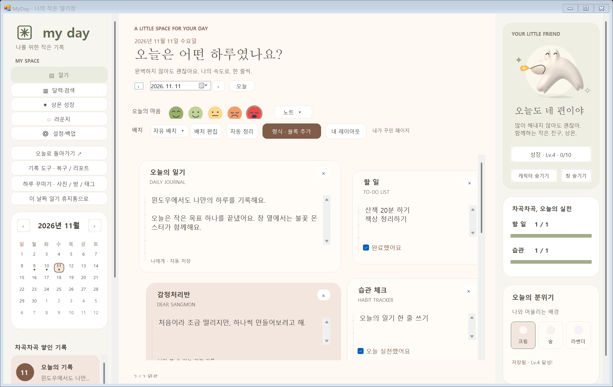
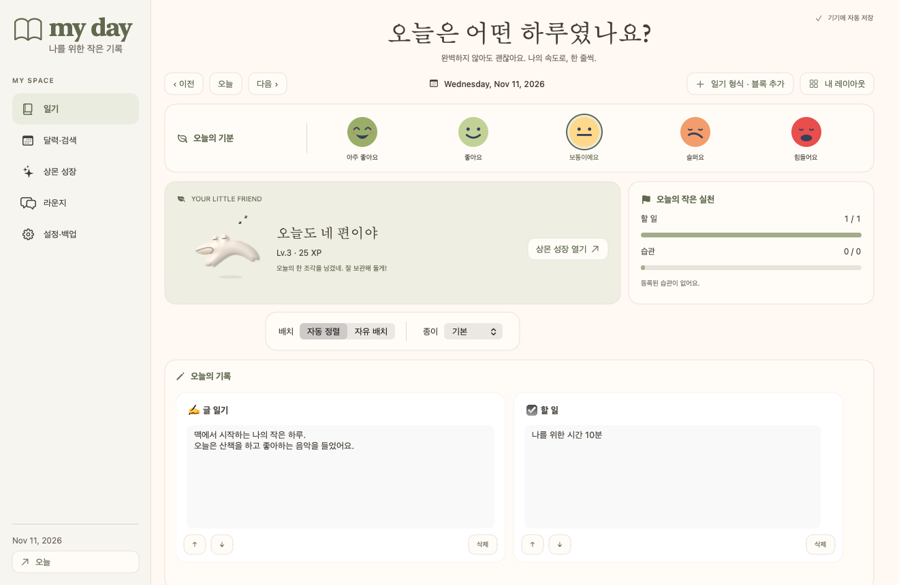
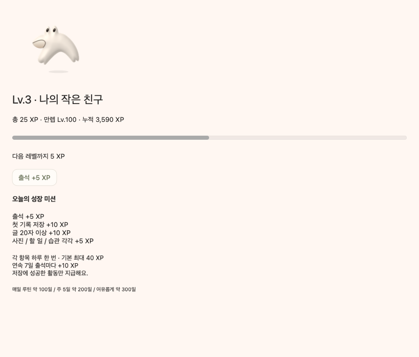
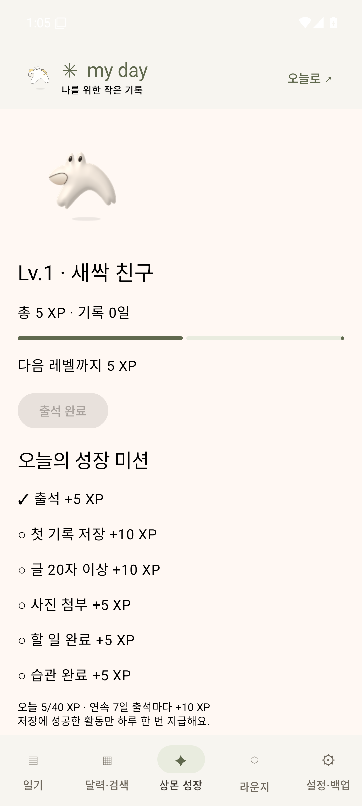
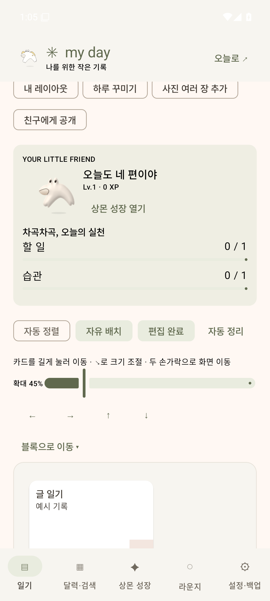
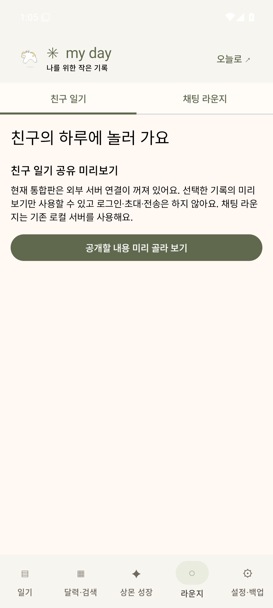

# 0.15 기록과 성장 중심 화면

테스트용 기록을 사용한 실제 네이티브 앱 화면입니다. 개인 일기는 포함하지 않았습니다.

## Windows

## Mac

## Android 35

[기능과 제거 범위](../../docs/FOCUSED-APP.md) · [실행 파일 출처와 검증 결과](../../docs/builds/myday-0.15.0.json).
