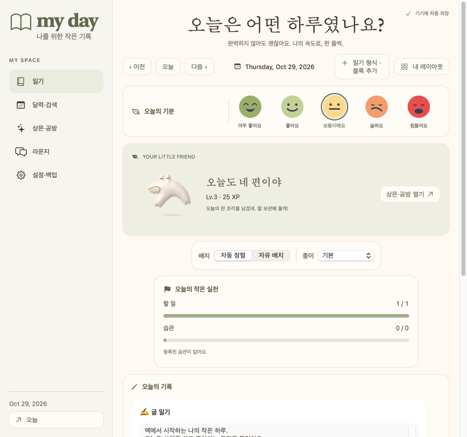
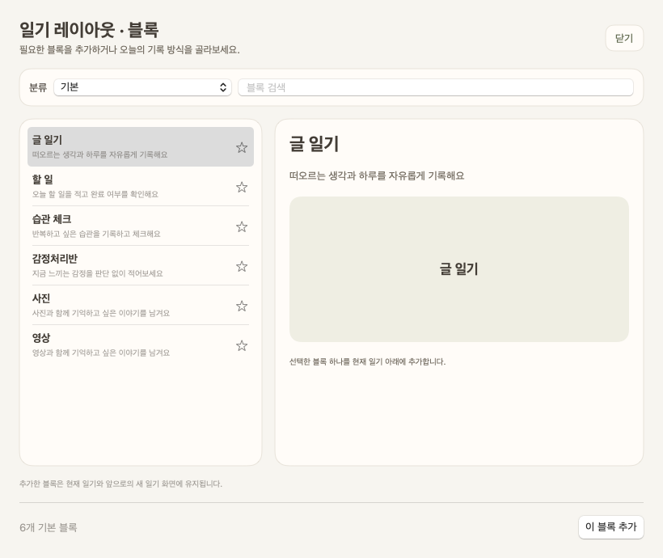
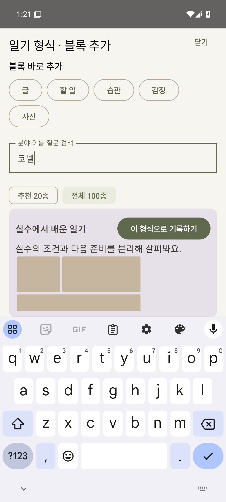
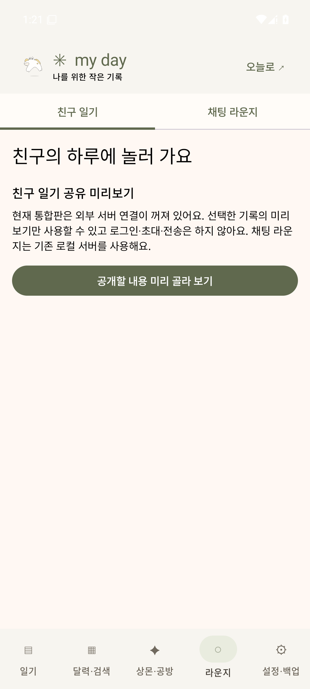

# 0.14 통합판 실제 화면

[사용법과 반영 출처](../../docs/INTEGRATION-2026-10-29.md)

Windows 네이티브 격리 시험 창에서 촬영한 샘플입니다. 개인 일기는 사용하지 않았습니다.

Mac ARM64 네이티브 빌드의 실제 렌더링도 확인했습니다.

Android 35 에뮬레이터의 실제 화면입니다. 형식 적용 버튼은 검색 키보드가 열린 상태에서도 보이며, 라운지에서 친구 미리보기와 기존 로컬 채팅을 구분합니다.

