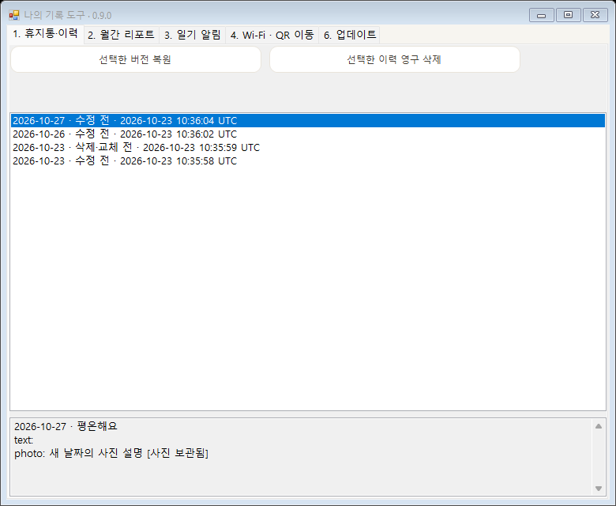
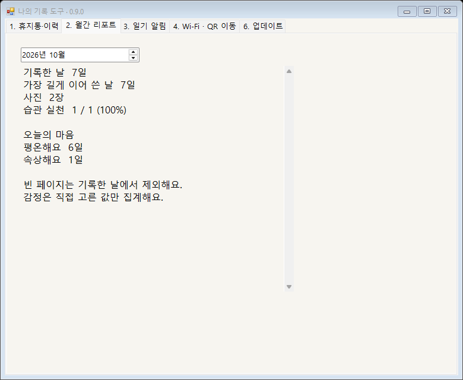
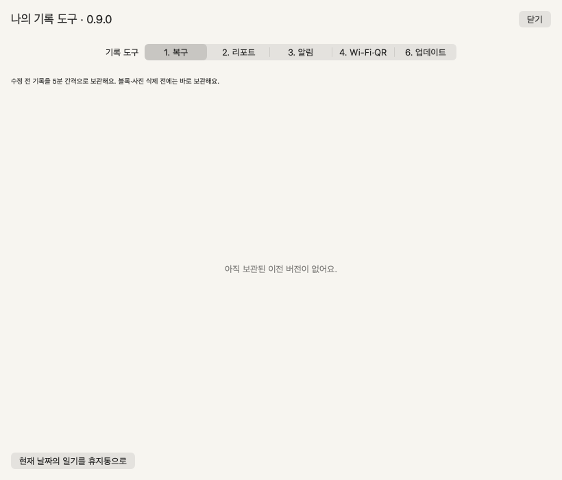
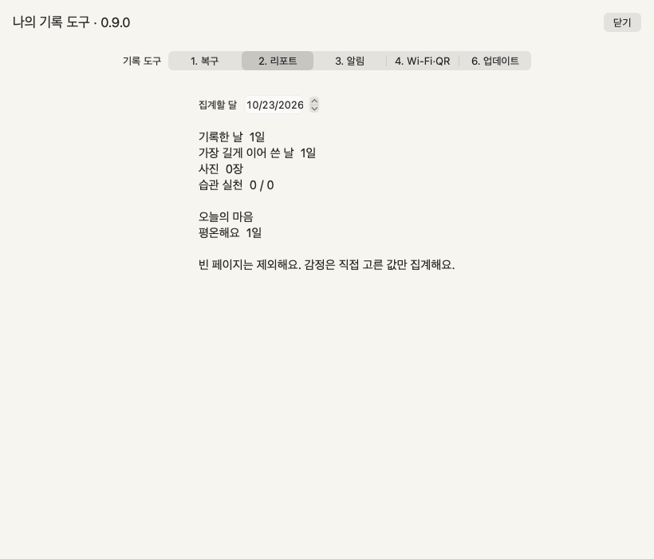
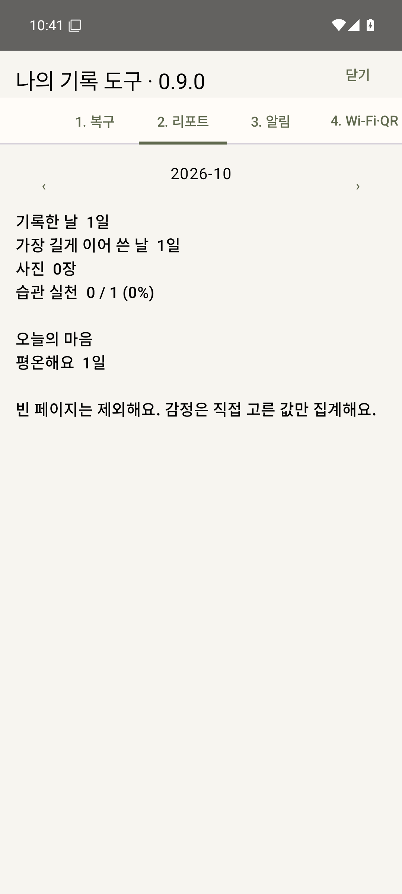
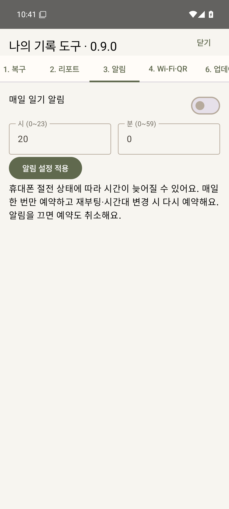
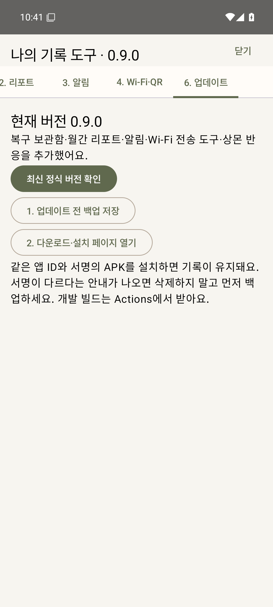
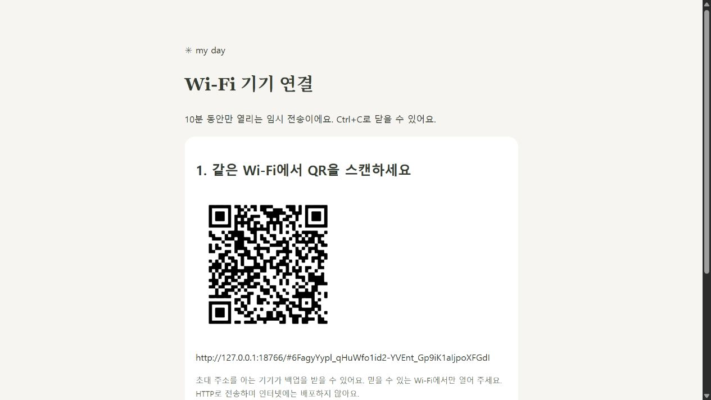

# 0.9.0 기록 도구 · 실제 화면

개인 기록을 사용하지 않은 합성 테스트 데이터입니다. Windows는 네이티브 화면 검사, Mac은 실제 앱 렌더링, Android는 Android 35 에뮬레이터 검사에서 캡처했습니다. QR은 테스트용 루프백 세션이며 이미 종료되었습니다.

## Windows

## Mac

## Android

| 월간 리포트 | 일기 알림 | 업데이트 |
|---|---|---|
|  |  |  |

## 같은 Wi-Fi의 QR 전송 도구

[사용법·기능별 수정 파일·검사 결과](../../docs/JOURNAL-TOOLS.md)
