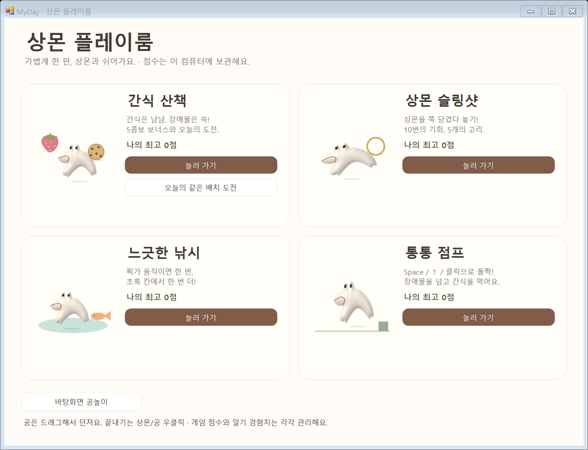
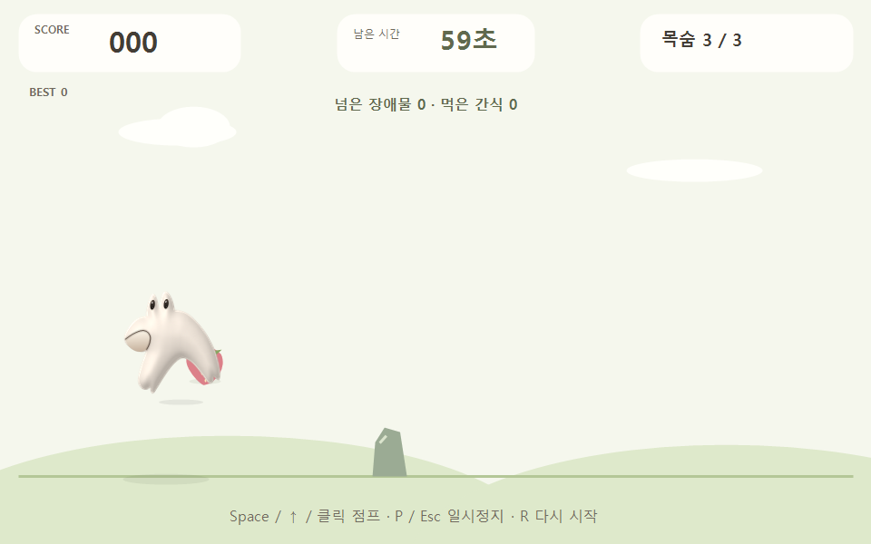
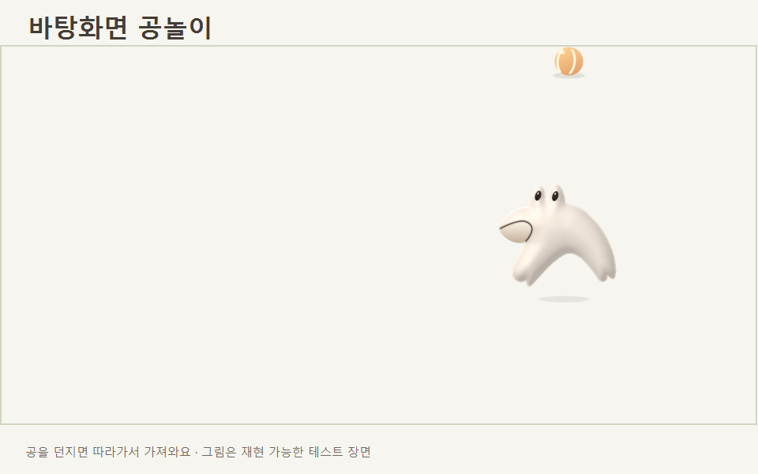

# 통통 점프 · 바탕화면 공놀이

실제 Windows 폼과 앱의 렌더러로 검사 자료를 출력했습니다. 네 게임 선택 화면은 실제 폼의 DrawToBitmap, 점프는 게임 장면, 공놀이는 같은 물리와 상몬·공 렌더러를 사용하는 재현 가능한 테스트 장면입니다. 개인 바탕화면/일기는 캡처하지 않았습니다.

[조작법·기록·수정 파일·검사](../../docs/JUMP-AND-DESKTOP-FETCH.md)
