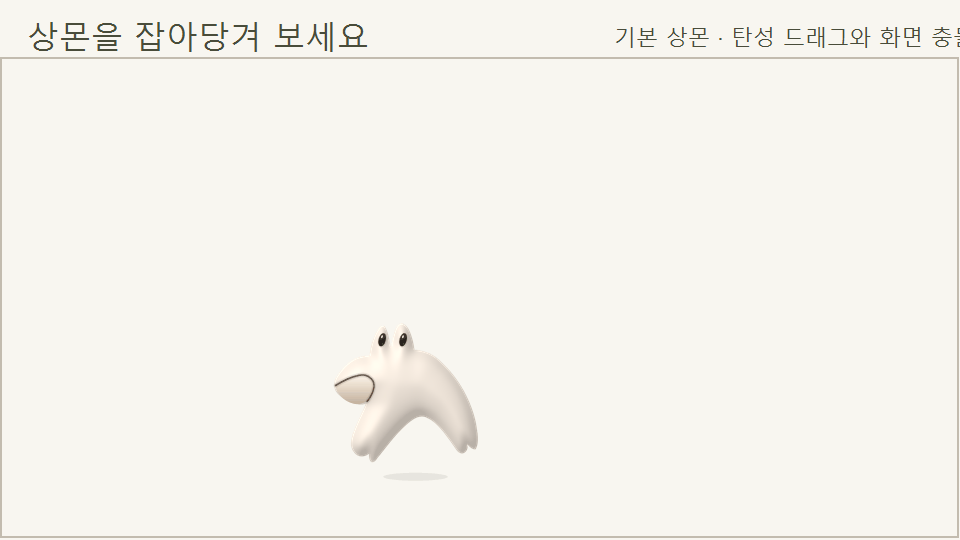

# 상몬 탄성 드래그·던지기

2026-11-11 Windows 앱의 `--pet-physics-preview`에서 생성한 180장, 초당 30프레임의 동작 미리보기입니다. 크림색 바탕은 재현 가능한 테스트 장면이며 실제 바탕화면 녹화는 아닙니다. 물리 계산과 캐릭터 그림은 앱과 같은 코드를 사용합니다.

[사용법·수정할 파일·검증](../../docs/DESKTOP-PET-MOTION.md)
