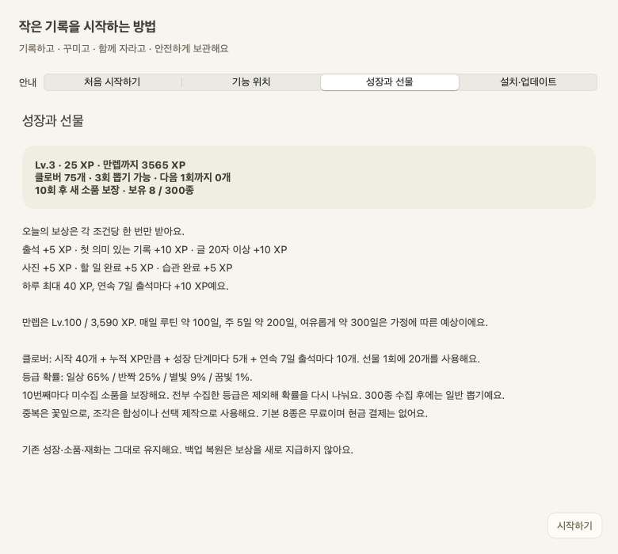
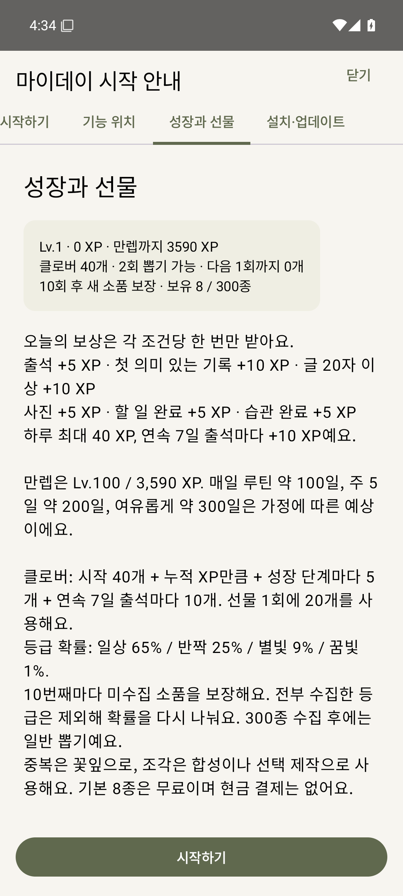

# 0.12.0 — 실제 화면·검사·실행파일

저장 복구 → 기능 위치 → 디자인 정리 → 성장·재화 안내 → 설치·업데이트 순서로 반영했습니다. [사용법·수정 파일·팀 점검](../../docs/QUALITY-UPDATE.md).

## 실행파일 받기

| 운영체제 | 통과한 검사 | Artifacts에서 선택할 항목 | 실제 소스 |
| --- | --- | --- | --- |
| Windows 10/11 | [성공한 실행](https://github.com/parkhookjung-debug/myday-diary/actions/runs/40356914665) | `myday-windows-63` | `16a20a5` |
| Mac Apple Silicon / macOS 13+ | [성공한 실행](https://github.com/parkhookjung-debug/myday-diary/actions/runs/40361697832) | `myday-chat-macOS-ARM64` | `b5438fe` |
| Android 8+ / 갤럭시 | [성공한 실행](https://github.com/parkhookjung-debug/myday-diary/actions/runs/40359386330) | `myday-debug-69` | `3d7aad5` |

성공한 실행을 열고 **Artifacts**를 선택합니다. Windows는 `bin/MyDay.exe`, Mac은 `MyDay-macOS-arm64-v0.12.0-preview.zip`, Android는 `outputs/apk/debug/app-debug.apk`를 사용합니다. 다운로드에 GitHub 로그인이 필요할 수 있으며 Artifacts 보관 기간은 플랫폼별 7~14일입니다. 이전 Releases 파일과 별개인 개발 빌드입니다. 앱 종료·공통 백업 후 교체하고 개인 기록 폴더는 삭제하지 않습니다. Android 서명 불일치 시 백업 확인 없이 앱을 삭제하지 않습니다.

로컬 묶음은 저장소의 무시되는 `build/MyDay-0.12.0/`와 `build/MyDay-0.12.0-all-platforms.zip`에 있습니다. 실행파일은 Git에 중복 커밋하지 않고 Actions에서 받습니다. [각 파일의 소스·CI·SHA256·크기](../../docs/builds/myday-0.12.0.json)를 확인하세요.

## 완료된 검사

- Windows: 325개 검사, 실제 일기·복구 보관·백업 실패·사진·자유 배치·상몬·공방·꾸미기와 안내 4개 탭 네이티브 검사.
- 공통 원본·생성·주요 바탕 글자 대비: 14개 검사. 안내 확률은 공통 뽑기 정책을 읽어 생성합니다.
- Android: JVM 52개, Android 35 에뮬레이터 기기 검사 21개, lint, 실제 Windows 직렬화기로 버전 1~9 호환 검사. 사진 편집·안내 탭·글 바로가기·파일 손상 및 복구 포함.
- Mac: macOS 15 ARM64 빌드·자체 검사·복구·공통 백업·로컬 채팅·안내 4개 탭 화면 렌더링, 실제 Windows 백업 읽기·공통 동작 비교. macos-latest 배정 지연 시 공식 표준 macos-15를 선택하는 수동 입력을 사용했습니다.

스크린샷은 CI의 네이티브 앱과 격리된 샘플 기록으로 만들었습니다. 개인 일기·사진·PIN은 사용하지 않았습니다. 실기기 강제 종료·OS 업데이트·갤럭시 햅틱·Intel Mac은 추가 수동 점검 범위입니다. main 병합·새 Releases·공개 서버·결제는 추가하지 않았습니다.

## Windows: 첫 안내와 현재 보상

## Mac: 현재 성장·재화 현황

## Android: 휴대폰 안내

사진 편집 로딩 보강 후 실제 자르기·프레임·스티커 선택·적용 검사 화면입니다.

