# 0.11.0 · 여섯 가지 하루 꾸미기

[사용법·수정할 파일](../../docs/STUDIO.md) · [파일별 커밋·SHA-256](../../docs/builds/myday-0.11.0.json) · [통합 PR #7](https://github.com/parkhookjung-debug/myday-diary/pull/7)

## 실행 파일 받기

아래 완료된 Actions 화면의 **Artifacts**에서 내려받습니다. GitHub 로그인이 필요할 수 있으며 보관 기간이 지나면 같은 브랜치에서 해당 workflow를 다시 실행합니다. 새 정식 Releases 게시나 main 자동 병합은 하지 않았습니다.

| 플랫폼 | Actions → Artifacts → 파일 | 소스 |
|---|---|---|
| Windows 10/11 · .NET Framework 4.8+ | [Windows 검사](https://github.com/parkhookjung-debug/myday-diary/actions/runs/40167646358) → `myday-windows-61` → `bin/MyDay.exe` | `0264c8f` |
| Apple Silicon Mac · macOS 13+ | [Mac·공통 검사](https://github.com/parkhookjung-debug/myday-diary/actions/runs/40167646214) → `myday-chat-macOS-ARM64` → `macos/build/MyDay-macOS-arm64-v0.11.0-preview.zip` | `0264c8f` |
| Android 8+ · 개발용 APK | [Android 검사](https://github.com/parkhookjung-debug/myday-diary/actions/runs/40168453071) → `myday-debug-66` → `outputs/apk/debug/app-debug.apk` | `56beb8c` |

Mac은 개발용 서명·Apple 공증 없음입니다. Intel Mac은 소스에서 빌드합니다. Android versionCode 11 / versionName 0.11.0이며 이전 설치와 서명이 다르면 삭제 전에 백업하세요. Android의 `56beb8c`는 사진 로딩 표시와 실제 편집 조작 검사를 보완한 커밋입니다. 로컬 묶음은 `build/MyDay-0.11.0/`와 `build/MyDay-0.11.0-all-platforms.zip`에 준비했습니다. 바이너리는 Git에 넣지 않고 Actions로 배포합니다.

## 2026-10-25 검증

- Windows 311개 검사: 기존 저장·성장·소품·이력·QR 검사와 새 버전 9 자료 왕복·태그 병합·유효성·사진 변환·PIN 원문 비저장·재시도 제한·독립 파생값·여러 창 크기의 가구 경계 검사. 실제 WinForms 여섯 화면·사진 편집 버튼 조작과 기존 로컬 채팅 통합 검사 통과.
- Mac·공통 5개 작업: Swift 빌드·실제 사진 변환·자체 스티커·PIN 파생값/저장·오늘의 질문 일치·버전 9 왕복, 실제 Windows 코드로 읽는 Mac 꾸미기 백업·기존 공통 계약·성장·재화·채팅 통과. 여섯 화면과 사진 편집기를 각각 렌더링했습니다.
- Android 단위 검사 52개·Android 35 에뮬레이터 검사 19개·Lint·APK 및 Windows 백업 교환 통과. 방 저장·태그 저장·질문 삽입·스티커 추가와 실제 사진 편집기의 자르기·테두리·스티커 붙이기·적용을 조작했습니다.
- 실행 파일 버전, Mac arm64/Info.plist, APK 메타데이터, ZIP 손상 여부와 SHA-256을 확인했습니다.

실물 기기의 햅틱·OS별 5분 유휴/배경 복귀·두 물리 기기의 방화벽과 Wi-Fi 연결은 추가 확인 대상입니다. PIN은 화면 잠금이며 저장 파일/백업 암호화가 아닙니다. 새 꾸미기 백업을 교환할 때는 세 앱을 0.11.0 이상으로 맞추세요.

## 실제 화면

격리한 예시 기록과 자체 생성 그림만 사용했습니다. 사진 속 풍경·꽃은 테스트용 그림입니다. PIN 설정은 꺼진 상태이며 개인 기록·PIN은 포함하지 않습니다. Windows·Mac은 네이티브 렌더링, Android는 에뮬레이터의 실제 앱 캡처입니다.

### Windows

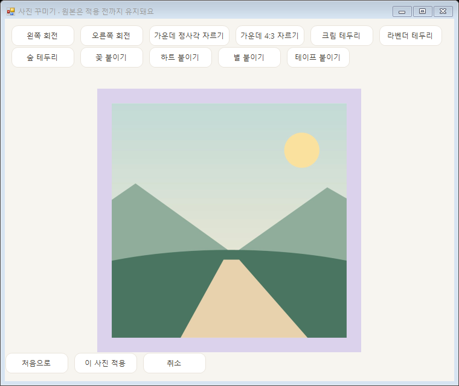

나머지 Windows 화면

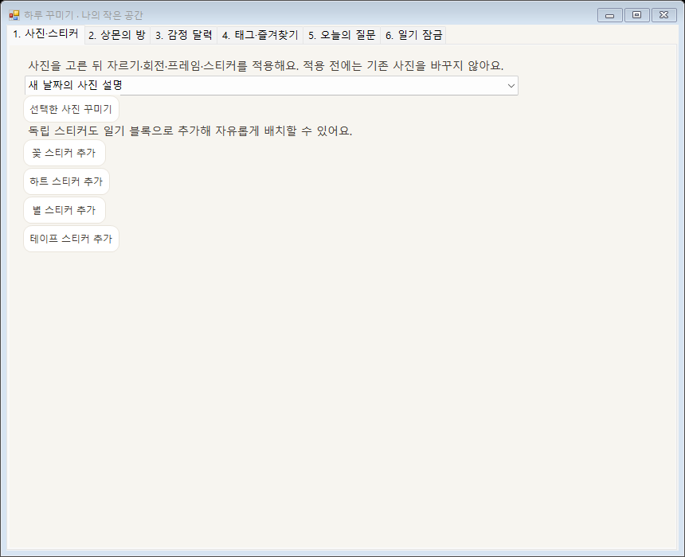

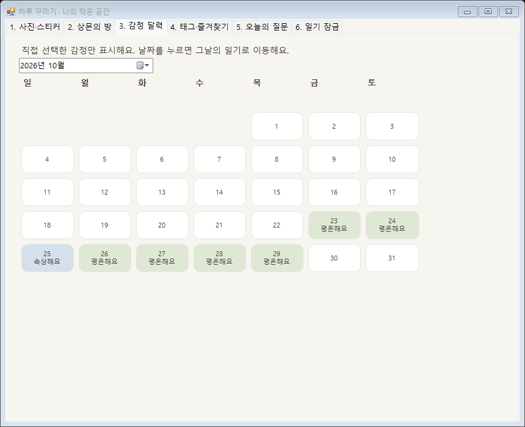

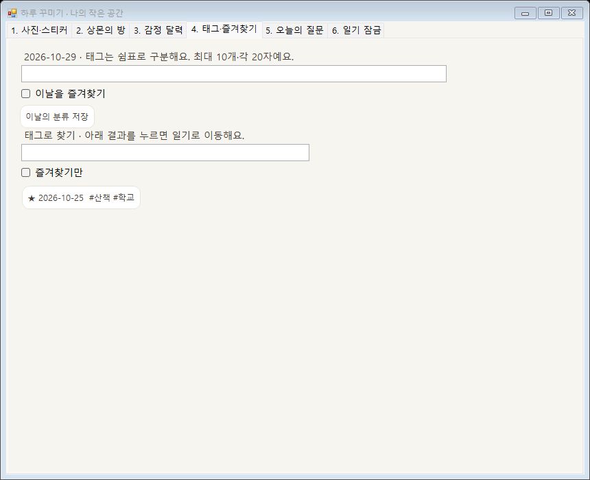

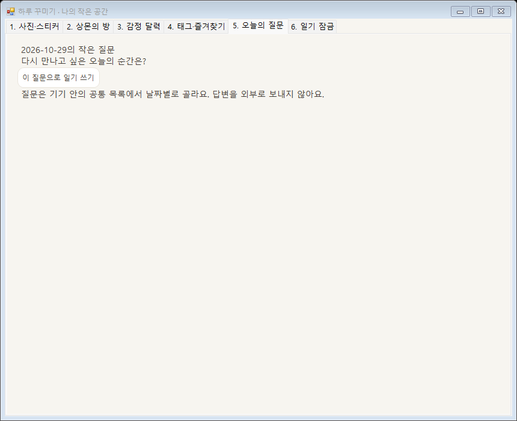

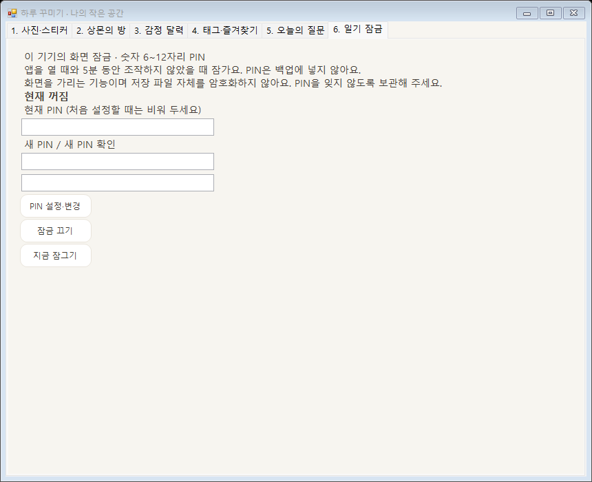

### Mac

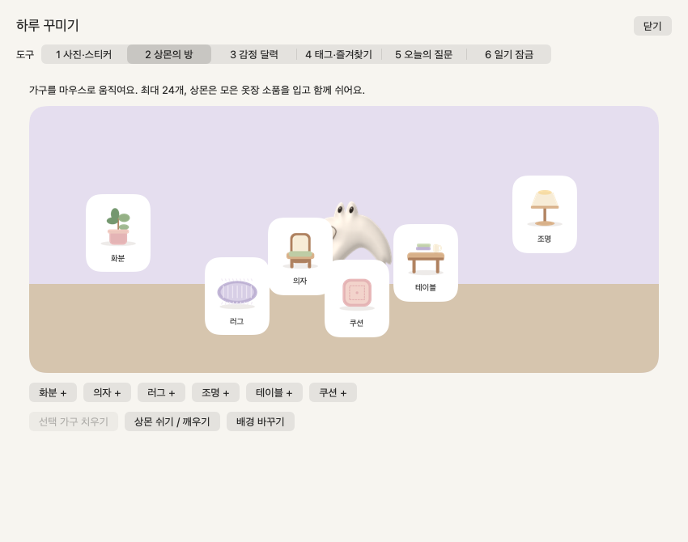

나머지 Mac 화면

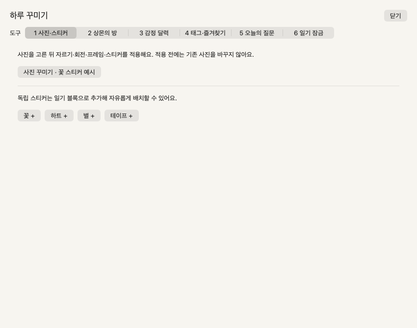

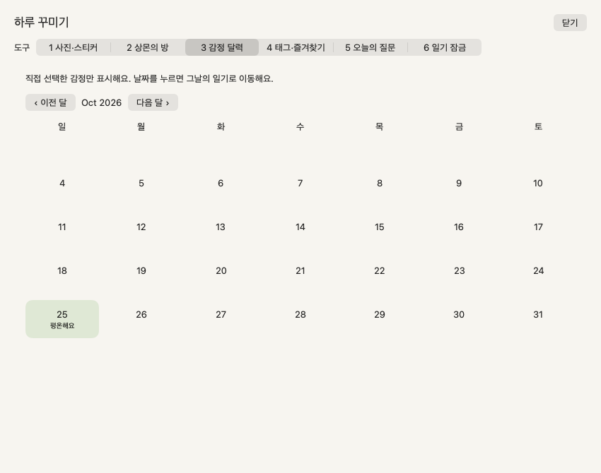

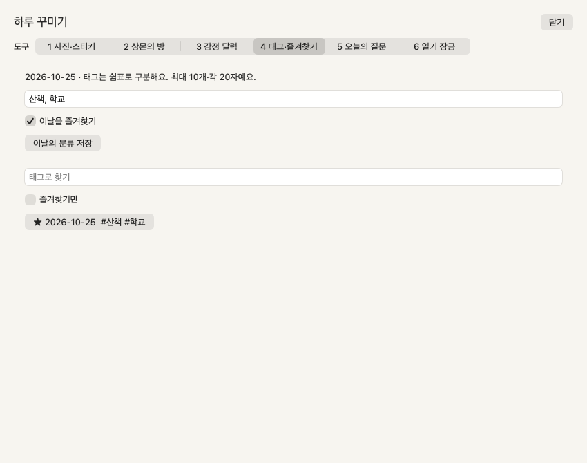

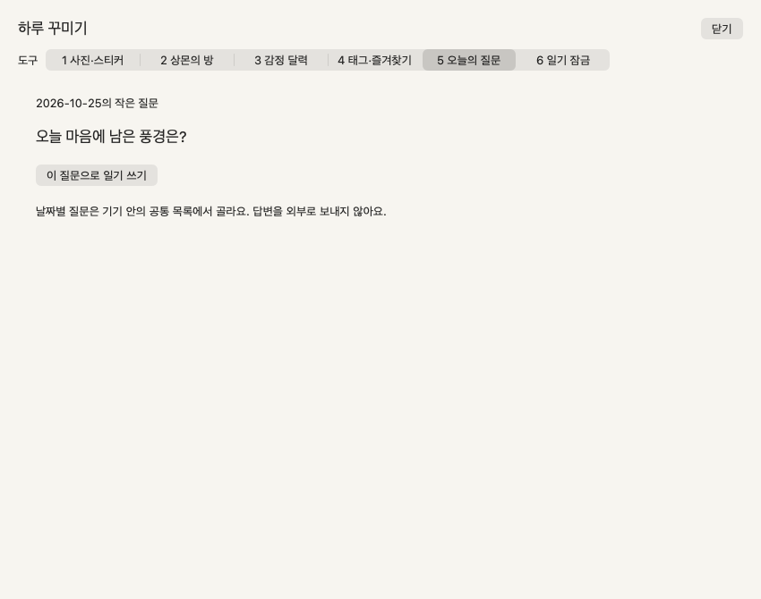

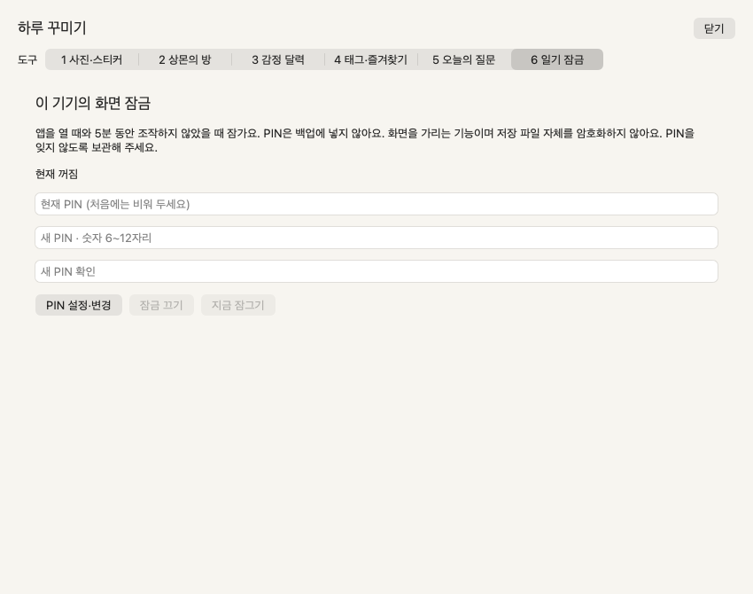

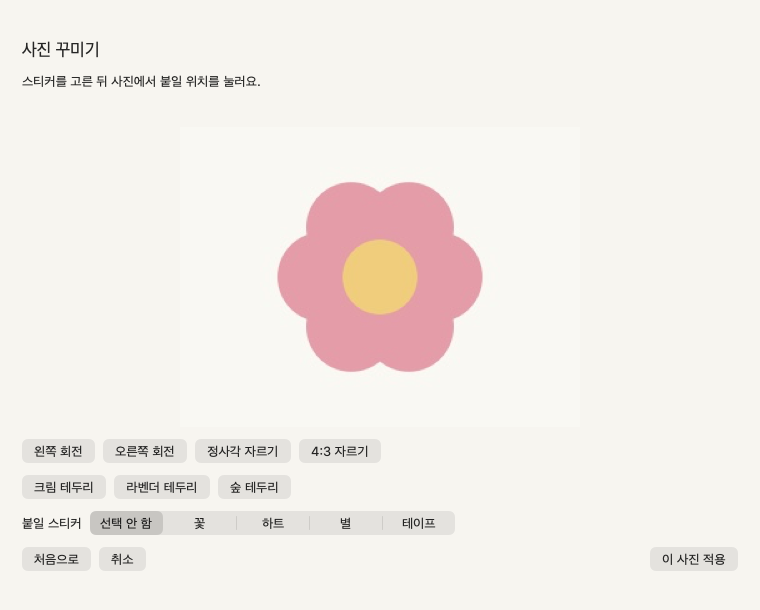

### Android

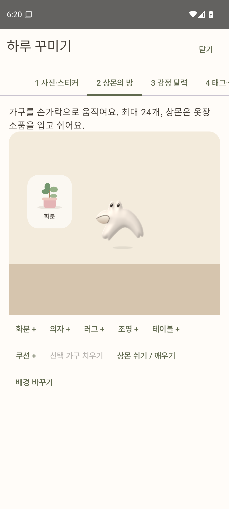
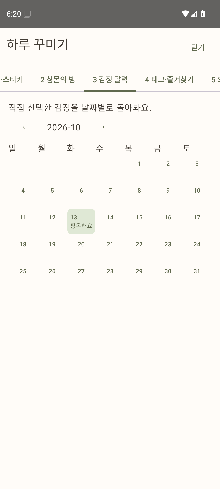

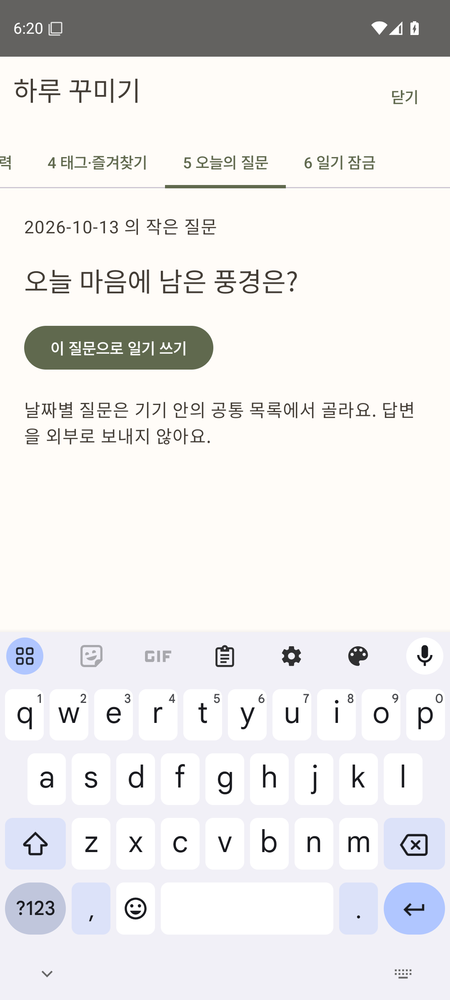
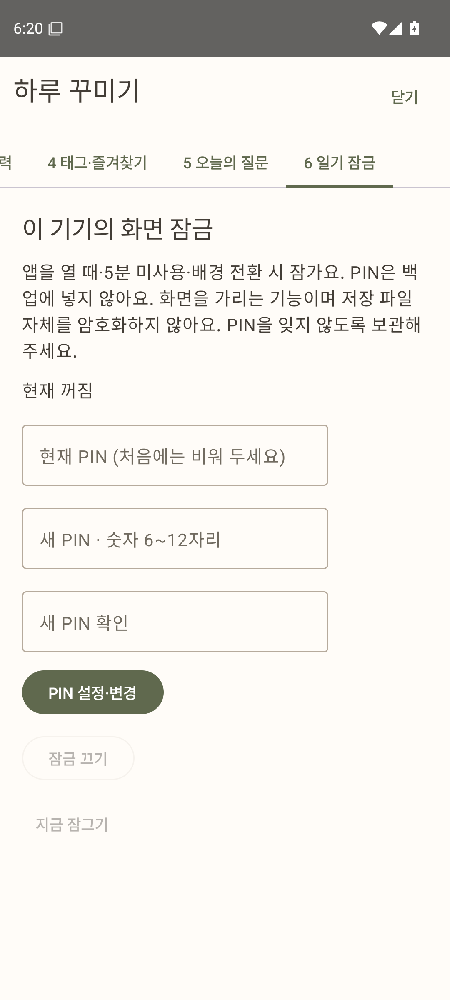
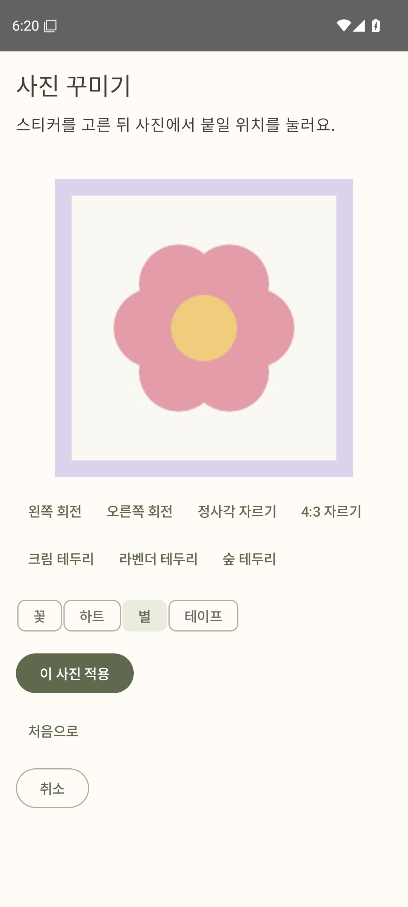
