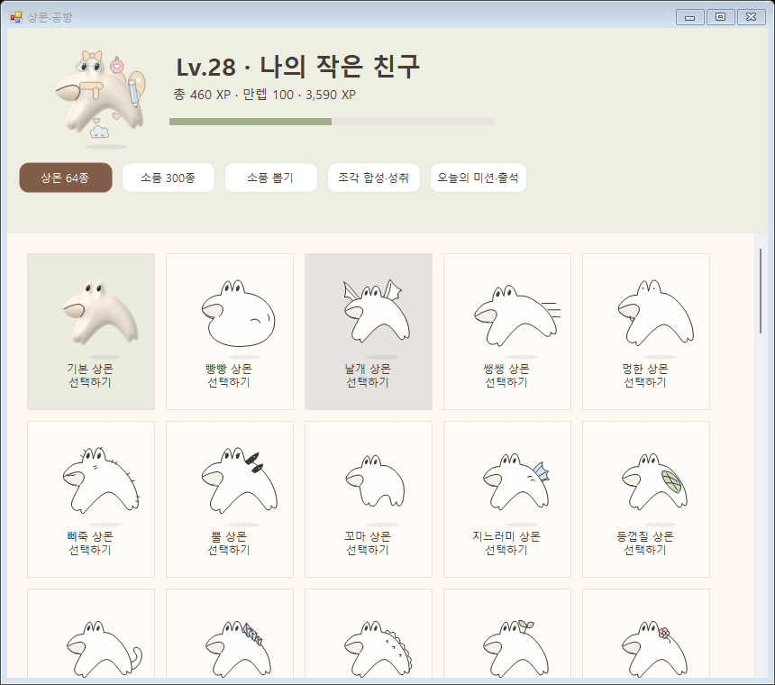
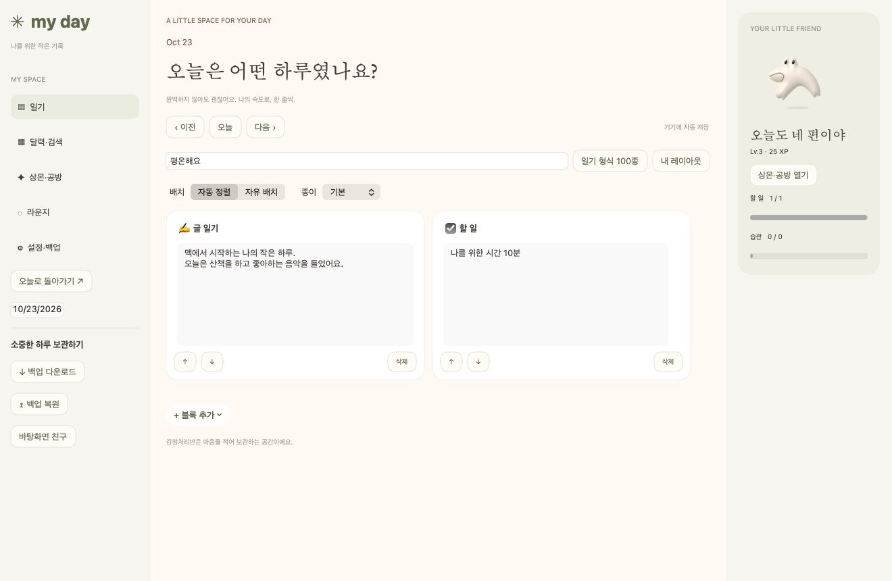
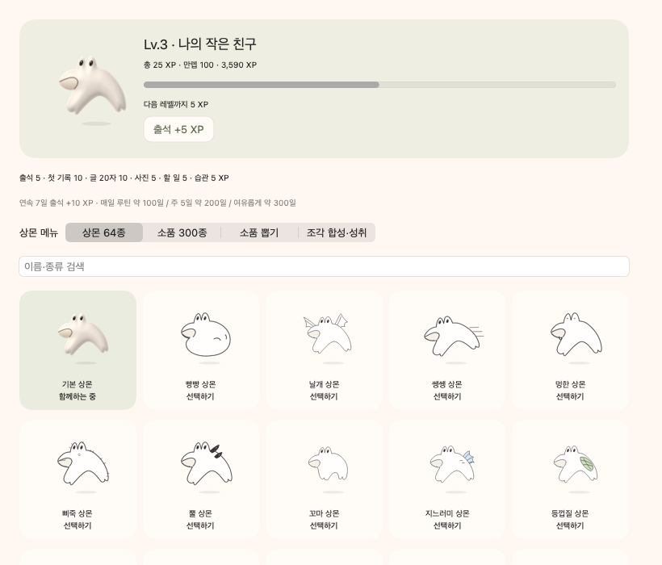
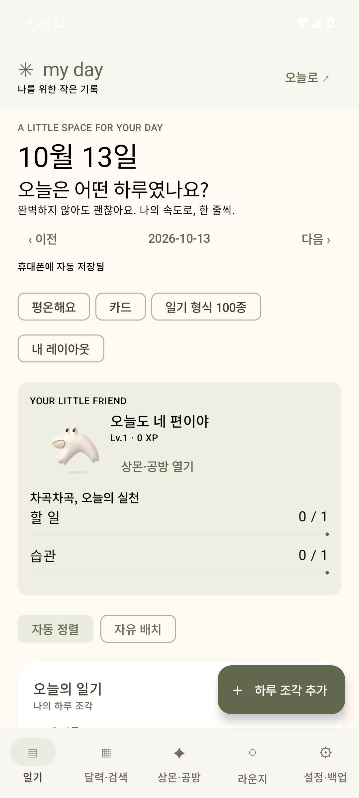
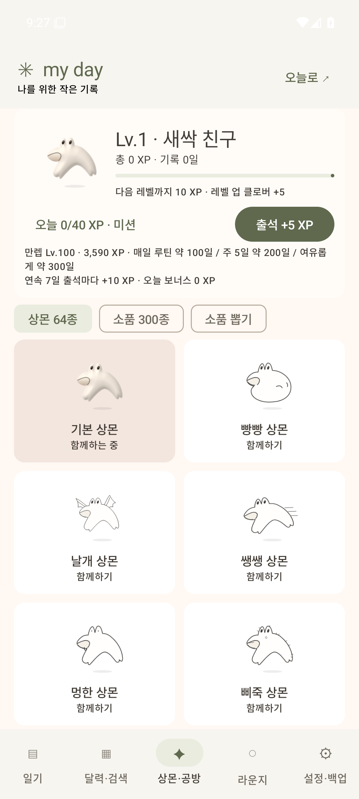
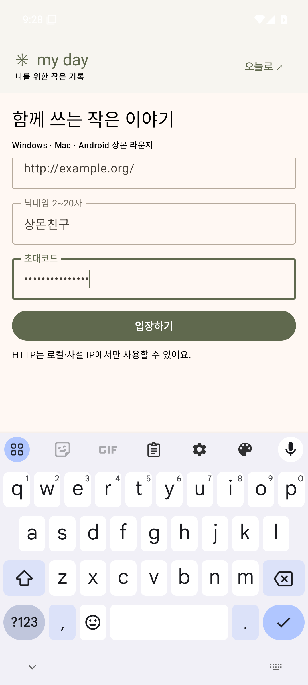

# Windows · Mac · Android 실제 공통 화면

개인 기록을 사용하지 않고 격리된 예시 일기로 캡처했습니다. 디자인 시안이 아니라 실제 네이티브 앱의 렌더링입니다. 같은 메뉴·크림/올리브 색상·카드·상몬 그림을 사용하고, 컴퓨터는 사이드바와 마우스, 휴대폰은 하단 탭·터치·햅틱을 사용합니다.

[기능별 수정 파일·공통 원본·기기별 차이](../../docs/THREE-PLATFORMS.md)

## Windows

## Mac

## Android

검증 커밋과 실행 링크는 [세 플랫폼 안내](../../docs/THREE-PLATFORMS.md)의 검증 기록을 확인하세요. Android는 Android 35 일회용 에뮬레이터, Mac은 Apple Silicon 러너, Windows는 네이티브 창 검사에서 캡처했습니다. 실제 갤럭시의 진동 느낌과 Intel Mac 빌드는 별도 기기 확인 대상입니다.
