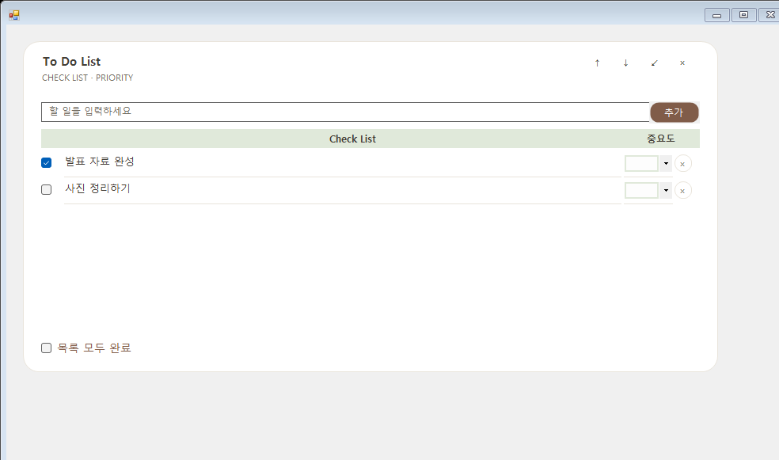

# Windows 할 일 목록 — 0.15.3

최종 CI 빌드 `49acf5b5b149ffc014eb75848432a41259056ebf`에서 격리된 예제 데이터로 확인한 실제 네이티브 화면입니다. 개인 일기 자료는 포함하지 않습니다. ComboBox 텍스트는 오프스크린 DrawToBitmap의 제약으로 비어 보일 수 있으며 실제 선택 상태와 저장은 네이티브 입력 검사로 확인합니다.

mrsandwith-76의 원본 UI를 통합하면서 제거된 변신·옷장 참조, 기존 게임/기념일 연결, 이전 기록과 백업 호환을 보완했습니다. [사용법·수정 파일·검증](../../docs/TODO-INTEGRATION-2026-11-25.md).
